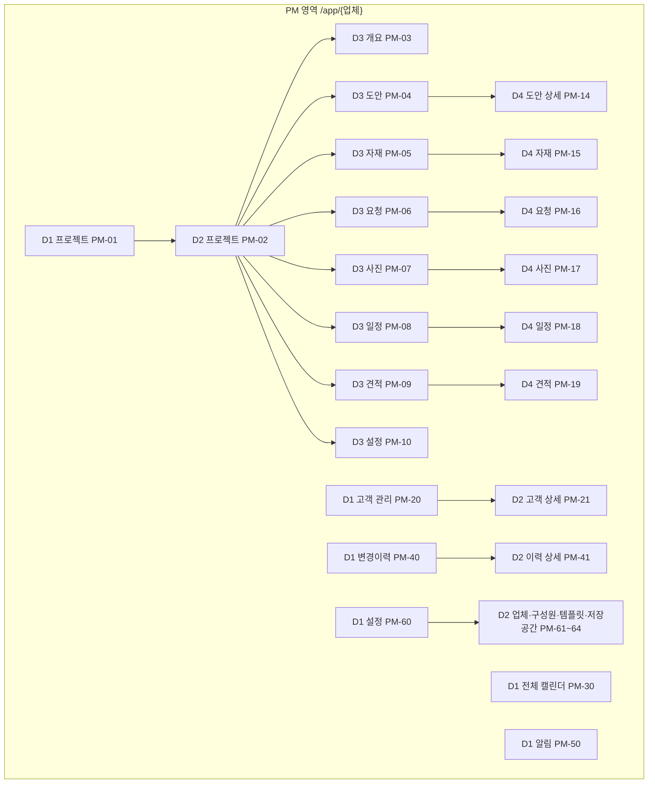
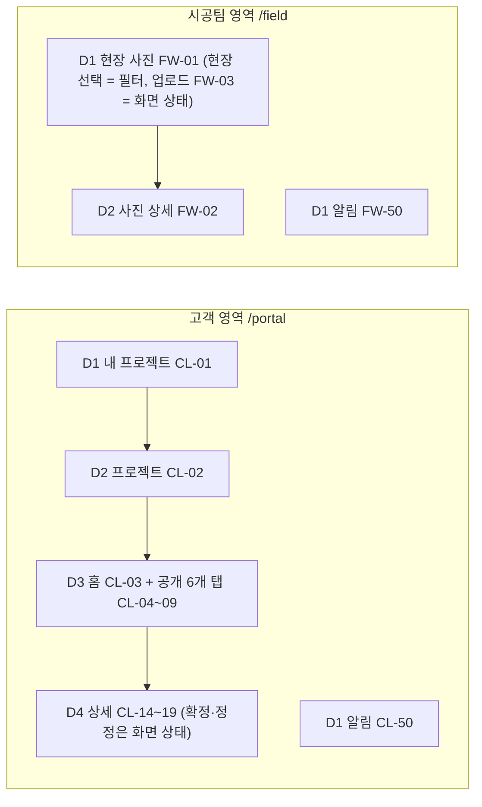
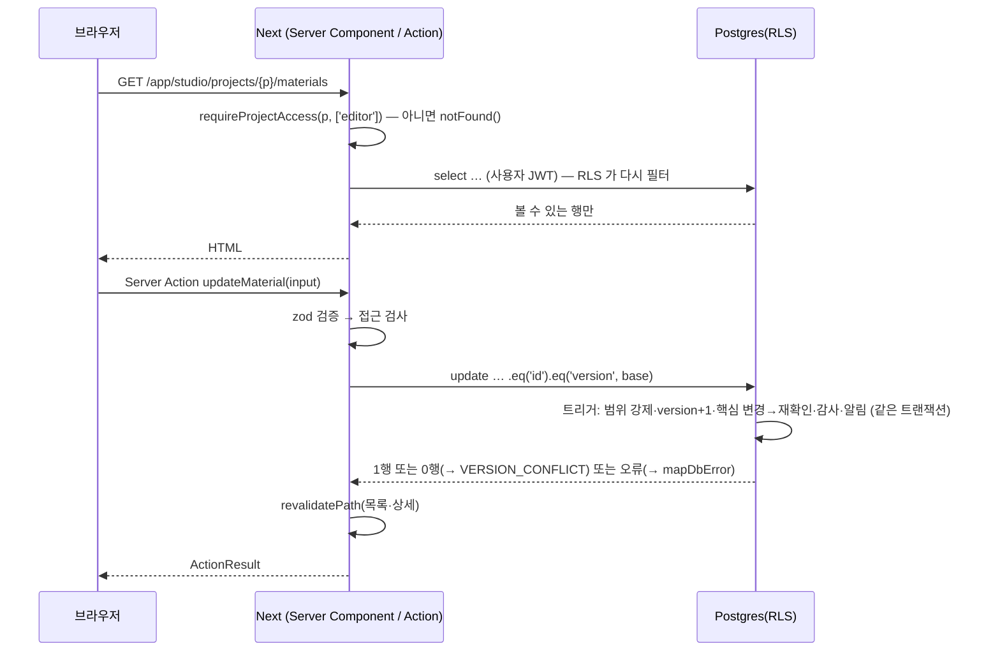

# AI 작업 문서 — C 이재서 (고객 요청 · 현장 사진 · 일정)

> 생성: 2026-10-07 · 생성기 `scripts/build-ai-docs.py` · 원본: `docs/00~04`, `src/shared/contracts/*.ts`, `supabase/migrations/*.sql`, `ownership.json`
> **이 파일 하나에 C 담당 작업에 필요한 모든 기준이 들어 있다** — 헌법 전문(1장), 나머지 두 명이 하는 일과 연결(2장), 내 요구사항·화면·DB·작업표.
> 이 문서와 다른 자료(팀 기준서 2종, 예전 대화, 일반 관행)가 충돌하면 이 문서를 따른다. 이 파일은 직접 고치지 않는다.
> 작업 방식: 내 컴퓨터의 스타터 폴더에서 혼자 작업한다(GitHub·원격 저장소 없음). 끝나면 `npm run submit -- --owner C` 로 제출본을 만들어 통합 책임자(소용우)에게 보낸다.

## 0. 이 문서의 사용 규칙

### 0.1 이 문서를 읽는 작업자(사람 또는 AI)가 지켜야 할 것
1. 작업 단위는 **TASK 하나**다(11장). 요청이 TASK 번호로 오면 그 TASK 의 요구사항(6장)·화면(7장)·데이터(10장)·검증 ID(11장)·연결(2장)을 모두 확인하고 시작한다.
2. 결과물은 **파일 경로와 전체 내용**으로 낸다. 경로는 9.1 의 내 소유 경로 안이어야 한다. 남의 기능은 STUB(헌법 5.7)만 만든다. 스타터 고정 파일(헌법 3.3)은 고치지 않는다.
3. DB 는 10장의 마이그레이션이 완성본이다. 테이블·컬럼·RPC·오류 메시지·열거형 값을 새로 지어내지 않는다.
4. 새 패키지 설치, `package.json`·설정·계약·마이그레이션 변경, `npx shadcn init` 은 하지 않는다. 필요하면 CR(헌법 5.9)로 적는다.
5. 문서에 답이 없으면 추측해서 만들지 않는다. "결정 필요"로 적고 가능한 해석 2가지와 영향을 쓴다.
6. 매 결과 끝에 아래 **보고 형식**을 붙인다.
7. 본문의 "01 문서 3장", "03 문서 5.1", "헌법 5.7" 같은 참조는 원본 문서 위치다. 이 파일에서의 위치는 0.3 을 본다.

### 0.2 보고 형식 (매 TASK 결과 끝)
```
- TASK / REQ / 화면 ID / 검증 ID:
- 만든·바꾼 파일 (경로):
- STUB 으로 만든 파일 (첫 줄 // STUB(C): 병합 시 폐기 — 계약: integration.ts):
- 남과의 연결에 쓴 계약 (이름):
- 실행할 명령: npm run format && npm run check  (DB 를 바꿨다면 npm run db:test) · npm run check:ownership -- --owner C
- 직접 확인할 시나리오(역할별):
- 확인 못 한 것 · 결정 필요 · CR:
```

### 0.3 원본 문서 위치 → 이 파일 위치
| 원본 | 이 파일 |
|---|---|
| 00 헌법 N장 / N.M | 1장의 "헌법 N" / "헌법 N.M" (번호 그대로) |
| 04 문서 0장 · 다른 두 명의 장 · 내 장의 '연결' | 2장 |
| 01 문서 1장 / 2장 / 3장 / 4장 / 5장 / 7장 | 3장 / 4장 / 5장 / 6장 / 6.9 / 5.9 |
| 02 문서 1~8장 | 7장 (7.1~7.8, 핵심 화면 세부는 7.6.x) |
| 03 문서 1장 / 2.1 / 2.2 / 3.x / 4.1 / 4.2~4.4 / 5.1 / 6장 / 7장 / 9.1 | 8.1 / 8.2 / 8.3 / 8.4.x / 10.1 / 8.5~8.7 / 8.8 / 8.9 / 8.10 / 8.11 |
| 04 문서 내 장 | 11장 |

### 0.4 목차
0 사용 규칙 · 1 헌법(전문) · 2 나와 다른 두 명 — 역할·연결 · 3 제품 · 4 용어 · 5 정책·권한·결정 대장 · 6 내 요구사항 · 7 내 화면·디자인 · 8 아키텍처·흐름 · 9 계약 코드·내 소유 경로 · 10 내 데이터베이스 · 11 내 작업·검증표

---

## 1. 헌법 (전문 — 모든 규칙의 원문, 이 파일에서 가장 우선)

### 헌법 1 총칙

#### 헌법 1.1 목적
세 명이 **서로 다른 컴퓨터에서, 서로 코드를 주고받지 않고, 각자(AI 사용 여부 무관) 만든 결과물을** 통합 책임자가 손으로 합쳤을 때 **고칠 것 없이 하나의 서비스로 동작**하게 한다. 이를 위해 기술·이름·경로·데이터·화면·검증·제출 방식을 하나로 고정한다.

#### 헌법 1.2 적용 대상
- A·B·C 담당자, 그리고 담당자가 쓰는 GPT·Claude·Copilot 등 **모든 AI 도구**. AI 가 만든 결과의 책임은 그 담당자에게 있다.
- 통합 책임자(소용우)는 이 문서를 제정·개정하고, CR 을 승인하고, 병합·평가·배포를 한다.

#### 헌법 1.3 진행 방식 한눈에

```
[통합 책임자] 스타터 폴더(ZIP) 배포 ─┬─▶ A 로컬 폴더 ─▶ npm run submit ─▶ A 제출본.zip ─┐
                                    ├─▶ B 로컬 폴더 ─▶ npm run submit ─▶ B 제출본.zip ─┼─▶ [통합 책임자] 새 스타터 복사본
                                    └─▶ C 로컬 폴더 ─▶ npm run submit ─▶ C 제출본.zip ─┘    + npm run merge:submissions
                                                                                          ─▶ 검사·평가(14장) ─▶ 배포(15장)
```

- **GitHub·원격 저장소를 쓰지 않는다.** 개인 레포·공유 레포·PR·브랜치·CI 없음. 각자 자기 컴퓨터의 폴더 하나에서 작업한다.
- 담당자끼리 코드 파일을 직접 주고받지 않는다. 남의 기능은 STUB(5.7)으로 대신하고, 공통 파일 변경은 CR(5.9)로 통합 책임자에게 요청한다.
- 소유권 검사·제출·병합은 Git 대신 `starter-manifest.json`(스타터의 모든 파일 해시)과 비교해 자동으로 한다.

#### 헌법 1.4 문서 체계

| 문서 | 내용 | 누가 언제 |
|---|---|---|
| **`docs/00_헌법_공통규칙.md`** (이 문서) | 원칙·역할·소유권·연결 지도·작업 방식·기술·코드·DB·보안·파일·화면·테스트·제출·병합·평가·배포·위반 처리 | 전원, 작업 전 필독 |
| `docs/01_제품정의_요구사항.md` | 제품·범위·용어(TERM)·정책(POL)·권한표·요구사항(REQ)·NFR·결정 대장 | 전원 (내 REQ 행) |
| `docs/02_화면구조_뎁스_디자인.md` | 뎁스·IA·화면 레지스트리·전환 규칙·화면 공통 규칙·핵심 화면 세부·디자인 시스템·문구 | 화면 작업 |
| `docs/03_아키텍처_데이터_보안.md` | ADR·폴더·Supabase 클라이언트·흐름·테이블·RPC·계약·상태·알림·위협·배포·기준서 대응표 | 서버·데이터·보안 작업 |
| `docs/04_담당별_작업지시서.md` | A·B·C 각자의 TASK·검증표 + 남이 하는 일 | 세션 시작 시 내 장 |
| `ai/AI_작업문서_<담당>_<이름>.md` | 위 문서 중 내 작업에 필요한 부분 + 이 헌법 전문 + 계약 코드 + 내 DB 를 **한 파일로** 묶은 것 (생성물) | AI 에 통째로 넣는다 |
| `AGENTS.md` / `CLAUDE.md` | AI 도구가 폴더를 열면 자동으로 읽는 요약 지침 | 자동 |

팀 기준서 2종(『통합 작업평가서 v1.0』·『데이터아키텍처 통합기준서 v1.1』)은 **원칙·평가 기준의 출처**이며 내용은 이미 이 문서 세트에 반영돼 있다(대응: 03 문서 9장, 결정값: 01 문서 7장, 평가: 이 문서 14장). 구현할 때 기준서를 직접 보고 만들지 않는다.

#### 헌법 1.5 우선순위와 충돌 처리
1. **이 헌법**
2. 원본 파일 — 마이그레이션 SQL · 계약 코드(`src/shared/contracts`) · `ownership.json` · `package.json`
3. 01 → 02 → 03 문서
4. 04 작업지시서
5. 팀 기준서 2종 (원칙 해석에만)

충돌을 발견하면 **어느 쪽도 고치지 않고** 진행 기록 5번에 `충돌: <ID> / 문서: <위치> … / 코드: <파일:줄> … / 제안: …` 로 적고 통합 책임자에게 알린다. 그동안은 우선순위가 높은 쪽을 따른다.

#### 헌법 1.6 용어

| 용어 | 뜻 |
|---|---|
| 스타터 | 통합 책임자가 배포하는 공통 시작 폴더. DB 전체·계약·설정·문서·검사 스크립트가 들어 있다. 현재 버전은 `starter-manifest.json` 의 `starterVersion` |
| 스타터 고정 파일 | `ownership.json` 의 `frozen` 목록. 개발 기간에 **누구도 수정·삭제하지 않는다**(소유자 포함). 바꿀 일은 CR |
| 소유 경로 | `ownership.json` 의 A·B·C 목록. 담당자는 자기 소유 경로에만 파일을 만들고 고친다 |
| STUB | 남의 기능을 계약 시그니처 그대로 흉내 내는 임시 파일. 첫 줄 `// STUB(<담당>): 병합 시 폐기 — 계약: integration.ts`. 제출에서 자동 제외된다 |
| 계약 | `src/shared/contracts/*.ts` 의 타입·함수 시그니처·상수. 담당 간 연결은 계약으로만 한다 |
| CR | 변경 요청(Change Request). 공통 파일·새 패키지·새 마이그레이션·새 화면 ID 등 내 권한 밖 변경을 요청하는 기록 |
| 진행 기록 | `progress/<A|B|C>.md`. 작업 상태·STUB·CR·평가 기록. 곧 제출 보고서 |
| 제출본 | `npm run submit` 이 만드는 `_submit/<담당>_<이름>_<시각>/` 폴더(→ ZIP) |
| 통합본 | 통합 책임자가 새 스타터 복사본에 세 제출본을 합친 결과 |
| TASK / 검증 ID | 04 문서의 작업 단위(TASK-xxx) / 합격 판정 단위(A-T·B-T·C-T·TC·INT) |

#### 헌법 1.7 개정
- 개정은 통합 책임자만 한다. 담당자는 CR 로 제안한다.
- 개정하면: 문서 버전·변경 이력 갱신 → `python scripts/build-ai-docs.py`(AI 문서 재생성) → `npm run starter:manifest -- --version <새 버전>` → **변경된 파일 묶음 + 새 `starter-manifest.json`** 을 세 명에게 배포(5.10).
- 이미 만든 담당자 코드에 영향이 있으면 영향받는 TASK 와 해야 할 일을 함께 알린다.

---

### 헌법 2 기본 원칙 (헌법 조항)

아래 12개는 점수와 상관없이 **위반 1건이면 해당 기능은 반려**한다(결함 등급 '치명' 또는 '중대', 16장).

| ID | 원칙 | 구체적으로 지킬 것 | 검증 |
|---|---|---|---|
| P-01 | **업체·프로젝트 격리** | 다른 업체·배정되지 않은 프로젝트의 데이터·개수·제목·파일 주소를 조회·저장·노출하지 않는다. 존재 자체를 숨긴다(404) | TC-901, G1 |
| P-02 | **이중 검증** | 모든 서버 진입점 첫 줄에서 접근 검사(`requireProjectAccess` 등) + DB RLS 가 한 번 더 막는다. 화면에서 버튼을 숨기는 것은 검사가 아니다 | TC-902, A-T05 |
| P-03 | **공개 통제** | 비공개 항목은 고객 화면의 목록·상세·개수·홈·알림·미리보기·검색 어디에도 나오지 않는다 | G2 |
| P-04 | **원본 단일** | 한 데이터는 한 테이블에만 있다. 요약·홈·알림은 원본을 조회해 그린다. 복사본 테이블·캐시 테이블을 만들지 않는다 | 03 문서 4.1 |
| P-05 | **삭제 없음, 보관만** | DELETE 를 쓰지 않는다. `archived_at` 으로 보관하고 복원할 수 있다 | TC-906 |
| P-06 | **원문·확정 기록 보존** | 요청 원문, 확정 당시 리비전, 선택된 견적 버전은 덮어쓰지 않는다. 고칠 때는 정정·새 버전으로 쌓는다 | G4 |
| P-07 | **감사 기록은 DB 가 같은 트랜잭션에서** | 변경이력·알림은 DB 트리거가 기록한다. 앱 코드에서 따로 쓰지 않는다. 업무 저장이 실패하면 기록도 없다 | TC-031, INT-09 |
| P-08 | **비밀값 보호** | service_role 키·DB 비밀번호·토큰·서명 URL 을 코드·문서·로그·AI 대화·제출본에 넣지 않는다 | TC-909, TC-912 |
| P-09 | **계약·DB 고정** | 계약 코드와 베이스라인 마이그레이션은 바꾸지 않는다. 이름·시그니처·컬럼을 새로 지어내지 않는다 | 소유권 검사 |
| P-10 | **소유 경로** | 내 소유 경로 밖의 파일을 만들거나 고치지 않는다(STUB·shadcn 생성 파일 예외, 3.3·3.4) | `npm run check:ownership` |
| P-11 | **범위 준수** | 01 문서 1.4 제외 범위(시스템 관리자·결제·확정 코드·미팅 탭·마이페이지·공정일지·자재 구매·별도 대시보드)는 이름을 바꿔서도 만들지 않는다 | A-T09, G5 |
| P-12 | **추측 금지 · 검증 없는 완료 금지** | 문서에 없는 것은 만들지 않고 '결정 필요'로 적는다. 직접 실행해 확인하지 않은 것은 '구현 완료(미검증)'으로 보고한다 | 진행 기록 |

---

### 헌법 3 조직 · 역할 · 소유권

#### 헌법 3.1 역할

| 역할 | 사람 | 책임 | 하지 않는 것 |
|---|---|---|---|
| 통합 책임자 | 소용우 | 헌법 제정·개정, 스타터 배포·개정, CR 승인, 질문 답변, 병합, 통합 평가·승인, 운영 Supabase·Render 배포 | 담당 기능을 대신 구현(반려가 원칙) |
| A | 박예원 | 공통 기반: 인증·접근 검사·레이아웃(셸)·프로젝트·고객 카드·변경이력·알림·업체 설정·화면 레지스트리. 병합 때 통합 책임자를 기술 지원 | B·C 화면의 내용 |
| B | 류영걸 | 도안·자재·견적·확정 + **공통 파일 어댑터**(업로드·검증·다운로드, 기준서 D02) | 접근 검사·레이아웃 구현(STUB 만) |
| C | 이재서 | 고객 요청·현장 사진·일정·전체 캘린더·시공팀 화면 | 파일 어댑터·접근 검사 구현(STUB 만) |

교차 검토(평가서 '책임 운영'): **A 의 결과는 C 가, B 의 결과는 A 가, C 의 결과는 B 가** 14.5 양식으로 검토한다. 검토는 통합본에서 한다.

#### 헌법 3.2 소유 경로 (원본 `ownership.json` — 이 표는 요약)

| 담당 | 내가 만들고 고치는 경로 |
|---|---|
| A | `src/features/core/**` · `src/shared/**`(고정 파일 제외) · `src/i18n/**`(고정) · `src/app/` 바로 아래 파일(`layout.tsx`·`page.tsx` 등) · `src/app/(public)/**` · `src/app/(auth)/**` · `src/app/auth/**` · 영역 루트와 프로젝트 layout(`src/app/app/[company]/projects/[project]/*`, `src/app/portal/projects/[project]/*`, `src/app/field/*`) · overview·settings·clients·history·notifications·home 화면 · `src/app/api/health/**` · `messages/*/{common,auth,errors,projects,clients,history,notifications,settings}.json` · `supabase/migrations/*_a_*.sql`(새 파일) · `supabase/tests/a_*`(새 파일) · `supabase/seed.sql` · `tests/e2e/a/**` · `progress/A.md` |
| B | `src/features/{files,designs,materials,estimates}/**` · `src/app/api/files/**` · `src/app/app/[company]/projects/[project]/{designs,materials,estimates}/**` · `src/app/portal/projects/[project]/{designs,materials,estimates}/**` · `messages/*/{files,designs,materials,estimates}.json` · `supabase/migrations/*_b_*.sql`(새 파일) · `supabase/tests/b_*`(새 파일) · `tests/e2e/b/**` · `progress/B.md` |
| C | `src/features/{requests,photos,schedule}/**` · `src/app/app/[company]/projects/[project]/{requests,photos,schedule}/**` · `src/app/app/[company]/calendar/**` · `src/app/portal/projects/[project]/{requests,photos,schedule}/**` · `src/app/field/photos/**` · `messages/*/{requests,photos,schedule}.json` · `supabase/migrations/*_c_*.sql`(새 파일) · `supabase/tests/c_*`(새 파일) · `tests/e2e/c/**` · `progress/C.md` |

#### 헌법 3.3 스타터 고정 파일 (`frozen`)
`package.json` · `ownership.json` · `starter-manifest.json` · `components.json` · `tsconfig.json` · `next.config.ts` · `eslint.config.mjs` · `postcss.config.mjs` · `vitest.config.ts` · `playwright.config.ts` · `.prettierrc.json` · `.prettierignore` · `.editorconfig` · `.gitattributes` · `.gitignore` · `.env.example` · `render.yaml` · `AGENTS.md` · `CLAUDE.md` · `README.md` · `docs/**` · `ai/**` · `scripts/**` · `src/shared/contracts/**` · `src/shared/lib/**` · `src/i18n/**` · `src/proxy.ts` · `src/app/globals.css` · `tests/setup.ts` · `tests/server-only.ts` · 베이스라인 마이그레이션 4개(`supabase/migrations/20261006000*`) · 베이스라인 pgTAP 3개.
- 스타터에 **이미 있는** 이 파일들은 누구도 수정·삭제하지 않는다. 소유자가 같은 폴더에 **새 파일을 추가**하는 것은 된다(예: A 가 `src/shared/lib/rate-limit.ts` 추가).
- `npm install` 이 만드는 `package-lock.json`, `npm run db:types` 가 만드는 `database.types.ts` 는 검사·제출 대상이 아니다.

#### 헌법 3.4 shadcn/ui 생성 파일 예외
- 기본 UI 는 `npx shadcn@4.21.3 add <이름>` 으로만 추가한다(`src/shared/ui/`). **`npx shadcn init` 은 실행하지 않는다**(설정은 스타터 `components.json`).
- B·C 도 필요한 기본 컴포넌트를 이 명령으로 추가해도 된다. 생성된 파일은 **고치지 않는다.** 모양을 바꾸려면 내 feature 폴더에 감싸는 컴포넌트를 만든다.
- 명령이 `package.json`·`globals.css` 를 바꾸면(새 의존성·CSS 변수) 되돌리고 CR 로 적는다.
- 제출본에는 `shadcn/` 폴더로 따로 담기고, 병합 때 A 의 것이 우선한다(같은 명령의 결과이므로 동일).

#### 헌법 3.5 결정 권한

| 결정 | 누가 |
|---|---|
| 정책·권한 해석, 범위, 새 화면·새 기능 | 통합 책임자 |
| 기술·패키지·계약·DB 구조·공통 파일 | 통합 책임자 (CR) |
| 내 소유 경로 안의 구현 방식(컴포넌트 분리, 내부 함수) | 담당자 — 이 헌법·계약 범위 안에서 |
| 문구(메시지 값) | 담당자 — 10.4 문구 규칙 안에서 |

---

### 헌법 4 3인 연결 지도 — 누가 무엇을 만들고 어떻게 이어지는가

#### 헌법 4.1 한 장 요약

| 연결 | 제공자 → 사용자 | 계약 (정확한 이름) | 제공자가 만드는 파일 | 사용자가 개발 중 쓰는 것 (STUB) | 병합 후 확인 |
|---|---|---|---|---|---|
| ① 접근 검사 | **A** → B, C | `integration.ts` 1장 `AccessApi`: `getAccessContext()`, `requireProjectAccess(projectId, as[])` → `ProjectAccess{ as, canConfirm, companySlug, … }`, `requireCompanyStaff(slug)` | `src/features/core/server/access.ts` + `src/features/core/index.ts` 에서 export | B·C: `src/features/core/index.ts` STUB | B·C 모든 page·action 이 진짜 함수로 동작, 권한 없는 계정 404 (A-T03) |
| ② 로그인 | **A** → B, C | Supabase Auth 세션 쿠키 | `src/app/(auth)/login/page.tsx` 등 | B·C: 로그인 page STUB | 로그인 후 B·C 화면 진입 |
| ③ 프로젝트 셸(헤더·탭) | **A** → B, C | `integration.ts` 2장 `ProjectHeaderData`, `screens.ts` 의 `PROJECT_TABS`·`PORTAL_TABS` | 프로젝트 `layout.tsx` 2종 | B·C: layout STUB(이름+탭 링크) | B·C 탭 page 가 A layout 안에서 렌더 (INT-10) |
| ④ 파일 업로드·다운로드 | **B** → A, C | `integration.ts` 5장 `FilesApi`: `createUploadIntent`, `finalizeUpload`, 다운로드 `/api/files/[fileId]` | `src/features/files/**`, `src/app/api/files/**`, 컴포넌트 `FileDropzone`·`UploadQueue`·`FileDownloadLink` | A·C: `src/features/files/index.ts` + `/api/files/[fileId]/route.ts` STUB | C 사진 업로드·A 로고 업로드가 B 어댑터로 동작, 남의 파일 재사용 거부 (TC-101, INT-06) |
| ⑤ 요약(개요·고객 홈) | **B, C** → A | `integration.ts` 3장 `SummaryProvider.recent`, `NextScheduleProvider.next`(C), `DocumentsProvider.documents`(B) | `src/features/<기능>/server/summary.ts` | A: 6개 기능의 `summary.ts` STUB(빈 배열) | PM-03 개요·CL-03 고객 홈에 B·C 최근 항목·다음 일정·문서 표시, 비공개 미노출 (A-T08) |
| ⑥ 알림 이동 | **B, C** → A | `integration.ts` 4장 `NotificationTargetResolver`, `NOTIFICATION_TARGET_OWNERS` | `src/features/<기능>/server/notification-target.ts` | A: 해석기 STUB(`null`) | 알림 클릭 → B·C 정규 상세 화면, 권한 회수 시 안내 (A-T07) |
| ⑦ 변경이력·알림 행 | **DB 트리거** → A 화면 | 베이스라인 마이그레이션의 `audit_row`, `notify_*` | (이미 있음 — 아무도 앱에서 쓰지 않는다) | — | B·C 저장 → `audit_events`·`notifications` 행 (A-T06) |
| ⑧ 확정 | **B** (RPC 이미 있음) | `confirm_target`, `request_reconfirm` RPC | B 화면·액션 | — | INT-04 |
| ⑨ 일정 → 캘린더·홈 | **C** → A | `NextScheduleProvider` + `schedule_events` 테이블 | C `summary.ts` | A: STUB | INT-07 |
| ⑩ 화면 레지스트리·경로·문구·오류 | **스타터(고정)** → 전원 | `screens.ts`, `routes.ts`, `errors.ts`, `domain.ts`, `messages/*` | — (변경은 CR) | — | TC-907 |

#### 헌법 4.2 담당별: 내가 남에게 주는 것 / 남에게 받는 것

**A 박예원**
- 준다: ① 접근 검사, ② 로그인·로그아웃·가입·초대 수락, ③ PM·고객·시공팀 셸과 프로젝트 layout, 공통 UI(StatusBadge·EmptyState·ErrorState·ForbiddenState·LoadMore·DateText·ConfirmDialog), 알림 목록·해석기 등록부(`features/core/notifications/targets.ts` 가 B·C 해석기를 import), 개요·고객 홈 화면(B·C 요약을 호출).
- 받는다: B 의 파일 어댑터(업체 로고), B·C 의 `summary.ts`·`notification-target.ts`.
- 개발 중: B·C 탭 page 는 만들지 않는다(B·C 소유). B·C 요약·해석기·파일은 STUB.

**B 류영걸**
- 준다: ④ 파일 어댑터 전체(업로드 의도 → 서명 업로드 → finalize(서명 확인·sharp 재인코딩·EXIF 제거) → `attach_file` → 60초 서명 다운로드), ⑤ 도안·자재·견적 요약과 고객 홈 문서 목록, ⑥ designs·materials·estimate_versions 알림 해석기, ⑧ 확정 화면.
- 받는다: A 의 ①②③.
- 개발 중: A 의 ①②③ 은 STUB. 파일 어댑터는 B 가 진짜로 만들고 자기 화면에서 먼저 쓴다.

**C 이재서**
- 준다: ⑤ 요청·사진 요약, ⑨ 다음 일정, ⑥ requests·photos·schedule_events 알림 해석기, 전체 캘린더(PM-30)·시공팀 화면(FW-01~03).
- 받는다: A 의 ①②③, B 의 ④(사진 업로드는 B 어댑터의 `createUploadIntent({ kind: 'photo_original' … })` → `finalizeUpload` 로 받은 파일 id 를 `photos` 행에 연결).
- 개발 중: A·B 것은 STUB. 사진 업로드 큐(부분 실패·재시도)는 C 가 만들되 파일 저장은 반드시 `FilesApi` 시그니처로만 호출한다.

#### 헌법 4.3 연결 규칙
1. 연결은 **계약 이름 그대로**만 한다. 남의 내부 파일(`server/queries.ts` 등)을 import 하지 않는다. 남의 기능은 `@/features/<기능>`(index.ts)만 import 한다.
2. 내 코드는 STUB 의 내부 동작이 아니라 **계약 시그니처**에만 기대어 짠다. 병합 때 STUB 이 진짜로 바뀌어도 내 코드는 그대로여야 한다.
3. 제공자는 계약이 약속한 것을 **전부** 지킨다(반환 형태·권한 필터·오류 처리). 호출자의 권한(RLS)으로 조회하므로 요약에도 비공개가 섞이지 않는다.
4. 계약이 부족하면 마음대로 늘리지 말고 CR. 승인되면 통합 책임자가 계약을 개정해 세 명에게 동시에 배포한다.
5. 중간 병합(S3, 5.12)에서 ①~⑨ 를 한 번 실제로 이어 보고, 끊기는 곳은 담당에게 반려한다.

---

### 헌법 5 작업 방식 (로컬)

#### 헌법 5.1 작업 환경 원칙
- 작업 장소: **내 컴퓨터의 폴더 하나**(예: `C:\work\interior-supporter-B`). 폴더 이름은 자유, 내용은 스타터 그대로 시작.
- GitHub·GitLab 등 원격 저장소, 공유 드라이브 동기화 폴더(OneDrive·Google Drive 실시간 동기화)에서 작업하지 않는다(파일 잠금·덮어쓰기 위험).
- Git 은 쓰지 않아도 된다. 쓴다면 **내 컴퓨터 안의 기록용**으로만 쓰고 원격(remote)을 연결하지 않는다. 소유권 검사·제출은 Git 과 무관하게 동작한다.
- 각자 자기 Supabase 무료 프로젝트(Seoul)를 쓴다. 남의 프로젝트 키를 받지 않는다.

#### 헌법 5.2 준비물
Node.js **24 LTS** · npm 11(Node 에 포함) · 편집기(VS Code 권장, 저장 시 Prettier) · Supabase 계정 · 크롬. (Supabase CLI 는 `npm install` 로 함께 설치된다.)

#### 헌법 5.3 시작 절차 (세 명 동일 · Windows PowerShell 기준)

```powershell
# 1) 스타터 ZIP 을 내 작업 폴더에 압축 해제 → 그 폴더에서 PowerShell 열기
node -v                      # v24.x 확인
npm install                  # package.json 을 고치지 않는다. 경고(EBADENGINE 등)는 무시해도 된다
npm run env:init             # .env.example → .env.local 생성 후 값 채우기 (5.4)

# 2) Supabase: 새 프로젝트(Region: Northeast Asia (Seoul)) → 대시보드 설정
#    Authentication → Sign In / Providers → Email ON, "Allow new users to sign up" OFF, 최소 비밀번호 10
#    Authentication → URL Configuration → Site URL http://localhost:3000, Redirect URLs http://localhost:3000/auth/confirm
npx supabase login
npx supabase link --project-ref <내 ref>
npm run db:push              # 베이스라인 마이그레이션 4개 적용
npm run db:test              # pgTAP 110개 통과해야 시작
npm run db:types             # src/shared/contracts/database.types.ts 생성

# 3) 검사
npm run check:ownership -- --owner B    # 내 담당. 처음엔 변경 0개
npm run check                           # lint·typecheck·형식·메시지·테스트·빌드
npm run dev                             # http://localhost:3000
```

이미 팀 기준서로 작업을 시작했다면 5.11 전환 절차를 먼저 한다.

#### 헌법 5.4 환경변수 (`.env.local`, 원본 `.env.example`)
`NEXT_PUBLIC_SUPABASE_URL` · `NEXT_PUBLIC_SUPABASE_ANON_KEY` · `SUPABASE_SERVICE_ROLE_KEY`(비밀) · `APP_ORIGIN=http://localhost:3000` · `NEXT_PUBLIC_APP_NAME` · `LOG_LEVEL` · `SUPABASE_PROJECT_REF` · `SUPABASE_DB_PASSWORD`(비밀).
- `.env.local` 은 제출하지 않고, AI 대화·메신저에 붙여 넣지 않는다.
- `NEXT_PUBLIC_` 접두어는 브라우저에 공개되는 값에만 붙인다.
- 새 환경변수가 필요하면 CR.

#### 헌법 5.5 작업 단위와 순서
1. 04 문서 **내 장**의 TASK 를 **Must → Should → Could** 순서로, **한 번에 하나씩** 한다.
2. TASK 시작 전: 해당 REQ(01 문서)·화면(02 문서)·테이블/RPC(03 문서)·검증 ID 를 확인하고, 바꿀 파일·추가할 테스트·결정 필요 사항을 진행 기록에 짧게 적는다.
3. 구현 → 테스트(11장) → `npm run format && npm run check` → 검증 ID 를 역할별 계정으로 직접 확인 → 진행 기록 1·6번 갱신.
4. 하루 작업이 끝나면 `npm run check:ownership -- --owner <나>` 로 위반 0건을 확인한다.

#### 헌법 5.6 AI 도구 사용 규칙
1. AI 에는 **내 `ai/AI_작업문서_<담당>_<이름>.md` 하나를 통째로** 넣는다(첨부 또는 프로젝트 지식). 다른 사람의 AI 문서, 팀 기준서, 예전 버전 문서를 섞어 넣지 않는다.
2. 지시는 TASK 번호로 한다: "TASK-105 진행. 결과는 파일 경로와 전체 내용으로." 프롬프트를 따로 꾸미지 않는다.
3. AI 가 만든 파일의 **경로를 먼저 확인**한다. 내 소유 경로 밖이면(STUB 제외) 버린다.
4. AI 가 새 패키지 설치, `package.json`·설정 파일·계약·마이그레이션 수정, `shadcn init` 을 제안하면 따르지 않고 CR 로 적는다.
5. AI 가 "완료"라고 해도 직접 실행해 확인하기 전에는 '구현 완료(미검증)'이다.
6. `.env.local`·키·토큰·실제 개인정보를 AI 대화에 넣지 않는다.
7. 스타터가 개정되면 새 AI 문서로 대화를 새로 시작한다.

#### 헌법 5.7 STUB 규칙

| 필요한 것 | 누가 STUB 을 만드나 | STUB 위치 (병합 때 버려짐) | 최소 동작 |
|---|---|---|---|
| 접근 검사 | B, C | `src/features/core/index.ts` | `getAccessContext`·`requireProjectAccess`·`requireCompanyStaff` — `supabase.auth.getUser()` 후 프로젝트 행을 사용자 권한으로 조회해 `ProjectAccess` 반환, 없으면 `notFound()` |
| 로그인 | B, C | `src/app/(auth)/login/page.tsx` | 이메일·비밀번호 `signInWithPassword` 만 |
| 프로젝트 셸 | B, C | `src/app/app/[company]/projects/[project]/layout.tsx`, `src/app/portal/projects/[project]/layout.tsx` | 프로젝트 이름 + `PROJECT_TABS`/`PORTAL_TABS` 링크만 |
| 파일 업로드·다운로드 | A, C | `src/features/files/index.ts`, `src/app/api/files/[fileId]/route.ts` | `createUploadIntent`(files 행 insert + `createSignedUploadUrl`) · `finalizeUpload`(`status='ready'` 만) · 다운로드는 사용자 권한 select 후 `createSignedUrl(60)` — **개발 전용, 검증 없음** |
| 요약·알림 해석기 | A | `src/features/{designs,materials,estimates,requests,photos,schedule}/server/{summary,notification-target}.ts` | 빈 배열 / `null` |

- 모든 STUB 파일 **첫 줄**: `// STUB(<내 담당>): 병합 시 폐기 — 계약: integration.ts` — 소유권 검사가 이 줄로 STUB 을 알아보고 제출에서 뺀다.
- STUB 에 기능을 더 넣지 않는다. STUB 목록은 진행 기록 3번에 적는다.
- 테스트 데이터는 각자 dev Supabase 에 부록 C 의 공통 테스트 데이터로 만든다.

#### 헌법 5.8 진행 기록 (`progress/<담당>.md`, 양식 부록 B)
작업할 때마다 갱신한다. 이 파일이 곧 제출 보고서다. '구현 완료'와 '검증 완료'를 구분하고, 검증하지 못한 것과 이유를 적는다.

#### 헌법 5.9 변경 요청 (CR)
- **CR 이 필요한 것**: 새 패키지 · 스타터 고정 파일 변경 · 계약 변경 · 새 마이그레이션 · 새 화면 ID·경로 · 남의 메시지 네임스페이스 키 · 새 오류 코드 · 새 환경변수 · 정책 해석이 문서와 다른 구현.
- **방법**: 진행 기록 4번 표에 `CR-<담당>-<번호>` 로 적고, 통합 책임자에게 CR 번호와 한 줄 요약을 메신저로 알린다.
- **승인 전**: 기다리지 않는다. 현재 규격대로 진행하거나(가능하면) STUB·임시 구현으로 내 경로 안에서 진행하고, 영향 범위를 CR 에 적는다.
- **승인 후**: 통합 책임자가 스타터를 개정해 세 명에게 배포한다(5.10). 담당자가 직접 공통 파일을 고치지 않는다.

#### 헌법 5.10 스타터 개정 받기
통합 책임자가 `변경 파일 묶음 + 새 starter-manifest.json` 을 보내면: 내 폴더에 그대로 덮어쓰기 → 마이그레이션이 바뀌었으면 `npm run db:push && npm run db:test` → `npm run db:types` → `npm run check:ownership -- --owner <나>` 로 내 파일 외 변경이 없는지 확인 → AI 대화는 새 AI 문서로 새로 시작.

#### 헌법 5.11 이미 기준서로 작업을 시작한 경우 — 전환 절차
1. **코드는 버리지 말고 옮긴다**: 화면·로직을 스타터 폴더의 내 소유 경로로 옮긴다.
2. **DB 는 베이스라인으로**: 직접 만든 테이블(content_items, request_entries, outbox 등)은 쓰지 않고 03 문서 9.1 대응표의 실제 테이블·컬럼으로 바꾼다.
3. **API 는 Server Action 으로**: `/api/v1/...` REST 는 `server/actions.ts`(쓰기)·`server/queries.ts`(조회)로 옮긴다. 반환 `ActionResult`, 오류는 03 문서 9.3 의 ErrorCode.
4. **권한 로직은 이중으로**: 직접 짠 권한 검사는 `requireProjectAccess` 로 바꾸고, 실제 차단은 RLS 가 한다는 전제로 테스트한다.
5. **정책은 01 문서 7장 확정값**: 기준서에서 '비활성'이던 기능(확정·참여자 관리·도안 버전)은 확정값대로 활성화. 요청 열람은 작성자 본인만(POL-018).
6. **화면 ID·경로·문구 키**는 `screens.ts`·`routes.ts`·`messages` 로 맞춘다.
7. 바꾸지 못한 것은 진행 기록 5번에 적는다.

#### 헌법 5.12 진행 단계 (평가서 S0~S5)

| 단계 | 내용 | 산출 |
|---|---|---|
| S0 | 이 헌법·내 AI 문서 숙지, 결정 대장(01 7장) 확인 | — |
| S1 | 스타터로 시작(5.3), STUB 작성, A 는 셸·접근 검사 / B·C 는 계약 기반 화면 | 진행 기록 |
| S2 | 각자 서버 동작·원본 데이터·파일 연결 (Must 먼저) | 진행 기록 |
| S3 | **중간 병합 1회**: Must 완료 시점에 각자 `npm run submit` → 통합 책임자가 합쳐 4.1 ①~⑨ 연결 확인 | 중간 병합 보고 |
| S4 | 최종 제출 → 병합 → INT-01~10 → 역할별 사용자가 설명 없이 핵심 기능 찾기 | 병합 보고·평가 기록 |
| S5 | 점수·G 판정·결함 해소·승인 기록 → 배포 → 이후 변경은 CR | 승인 기록 |

---

### 헌법 6 기술 규격 (고정 — 다른 기술로 대체 금지)

#### 헌법 6.1 런타임·도구

| 항목 | 규격 |
|---|---|
| Node | **24 LTS** (`engines >=24 <25`) |
| 패키지 관리 | **npm** 만 (pnpm·yarn·bun 금지). `package-lock.json` 은 각자 생성, 제출하지 않음(병합 후 재생성) |
| 언어 | TypeScript **5.9** strict + `noUncheckedIndexedAccess`. `any` 금지(eslint) |
| 프레임워크 | **Next.js 16.4 App Router** (`src/app`). `pages/` 금지 |
| UI | **React 19.3**, Tailwind CSS **4.3**(설정은 `globals.css` 의 `@theme`, `tailwind.config.js` 없음), **shadcn/ui 4**(base-ui 기반, 스타일 `base-nova`, `src/shared/ui/`), 아이콘 **lucide-react** |
| 폼·검증 | **react-hook-form 7** + **@hookform/resolvers 5** + **zod 4** |
| 다국어 | **next-intl 4** — URL 접두어 없이 쿠키 `NEXT_LOCALE`(설정 `src/i18n/request.ts`) |
| 데이터·인증·파일 | **@supabase/ssr 0.12** + **@supabase/supabase-js 2** |
| 날짜·금액 | **date-fns 4** + **@date-fns/tz** — `src/shared/lib/dates.ts`, `money.ts` 로만 |
| 파일 처리 | 서버 **sharp 0.35**, 브라우저 **pdfjs-dist 6**, **exifr 7** |
| 토스트 | **sonner 2** (루트 layout 에 `Toaster` 있음) |
| 테스트 | **Vitest 5** + Testing Library + jsdom, **Playwright 1.63**, **pgTAP**(`supabase test db`) |
| 품질 | ESLint 9(`eslint.config.mjs`), **Prettier 3**(100자·작은따옴표·세미콜론·trailing comma all·LF) |
| 배포 | Render Web Service(Node, Singapore, 무료) + Supabase(Seoul) — `render.yaml` |

스타터에 이미 있는 설정: `tsconfig.json` · `next.config.ts` · `eslint.config.mjs` · `postcss.config.mjs` · `vitest.config.ts` · `playwright.config.ts` · `components.json` · `src/i18n/request.ts` · `src/app/layout.tsx` · `src/proxy.ts` · `src/shared/lib/{supabase/*, logger, dates, money, utils}.ts`. (스타터 상태에서 lint·typecheck·test·build 통과 확인됨)

#### 헌법 6.2 금지 기술 (eslint 가 import 를 막는다)
`@supabase/auth-helpers-nextjs` · Prisma·Drizzle 등 ORM · axios · Redux·Zustand·Jotai · React Query·SWR · styled-components·emotion·CSS Modules · MUI·Chakra·Ant Design · moment·dayjs · NextAuth/Auth.js · Firebase · tRPC · Express·별도 API 서버 · `middleware.ts`(Next 16 은 `proxy.ts`) · `pages/` · `next/router` · `localStorage` 에 권한·세션 정보 저장 · 외부 CDN 스크립트.

#### 헌법 6.3 Next.js 16 규칙 (AI 가 자주 틀림)

| 항목 | 올바른 형태 |
|---|---|
| 동적 파라미터 | `async function Page({ params }: { params: Promise<{ project: string }> }) { const { project } = await params; }` |
| searchParams | `Promise` → `await searchParams` |
| 쿠키·헤더 | `await cookies()`, `await headers()` |
| 미들웨어 | `src/proxy.ts` 의 `proxy` (고정 파일) |
| 서버 액션 | 파일 맨 위 `'use server'`, 반환은 직렬화 가능한 `ActionResult<T>` |
| 캐시 | 인증 데이터 페이지는 동적 렌더. 저장 후 `revalidatePath(routes...)` |
| 권한 없음 | `notFound()` (존재 숨김) |

#### 헌법 6.4 명령

| 명령 | 용도 |
|---|---|
| `npm run dev` | 개발 서버 |
| `npm run check` | lint + typecheck + 형식 검사 + ko·en 키 검사 + 단위 테스트 + 빌드 (**제출 전 필수**) |
| `npm run format` | Prettier 정리 |
| `npm run test` / `npm run test:e2e` | Vitest / Playwright |
| `npm run db:push` / `db:test` / `db:types` | 내 dev Supabase 에 마이그레이션 적용 / pgTAP / 타입 생성 |
| `npm run check:ownership -- --owner <A|B|C>` | 스타터 대비 변경 파일의 소유권 검사 |
| `npm run submit -- --owner <A|B|C>` | 제출본 폴더 생성 (12장) |
| `npm run merge:submissions -- <폴더…>` | 통합 책임자 전용 (13장) |
| `npm run starter:manifest -- --version <v>` | 통합 책임자 전용 (스타터 개정) |

---

### 헌법 7 코드 규격

#### 헌법 7.1 폴더와 이름

```
src/features/<기능>/
  components/        # PascalCase.tsx — 'use client' 는 상호작용이 필요한 잎 컴포넌트만
  server/
    queries.ts       # 조회 (Server Component 에서 호출) — snake_case → camelCase 변환은 여기서만
    actions.ts       # 'use server' Server Actions
    summary.ts       # (B·C) SummaryProvider 등 — integration.ts 3장 시그니처 그대로
    notification-target.ts   # (B·C) 알림 해석기 — integration.ts 4장 시그니처 그대로
  schema.ts          # zod 스키마 (DB CHECK 길이와 동일)
  types.ts           # 화면용 타입 (camelCase)
  index.ts           # 공개 API — 다른 기능은 이 파일만 import
src/app/.../page.tsx # 얇게: 접근 검사 → queries → components. <main data-screen-id="PM-05">
```

| 대상 | 규칙 | 예 |
|---|---|---|
| 파일·폴더 | kebab-case (컴포넌트 파일만 PascalCase) | `material-filters.ts`, `MaterialCard.tsx` |
| 함수·변수 | camelCase, 동사로 시작 | `listMaterials`, `confirmTarget` |
| 타입 | PascalCase, 접미어 없음 | `Material`, `MaterialListItem` |
| zod 스키마 | `<대상><동작>Schema` | `materialUpdateSchema` |
| 서버 액션 | `<동작><대상>` | `createMaterial`, `addRequestCorrection` |
| DB | snake_case (마이그레이션 그대로) | `unit_price` ↔ `unitPrice` |
| 메시지 키 | `<ns>.<영역>.<의미>` camelCase | `materials.form.unitPrice` |
| 화면 ID | `screens.ts` 그대로 | `PM-15` |
| `data-ui-key` | kebab, 영역-요소-동작 | `material-form-submit` |
| 테스트 이름 | `TC-<번호> <설명>` | `TC-120 확정권 없는 고객은 확정할 수 없다` |

경로 별칭 `@/` = `src/`. `../../` 상대 경로 금지(eslint).

#### 헌법 7.2 반드시 지키는 형태

| 항목 | 규칙 |
|---|---|
| 데이터 접근 | 서버에서만 `createServerSupabase()`(사용자 세션 → RLS). 브라우저 Supabase 는 `uploadToSignedUrl` 전용 |
| 관리자 클라이언트 | `createAdminSupabase()` 는 허용 파일만 — A `src/features/core/server/auth-actions.ts`(가입·초대 수락·재설정), B `src/features/files/server/*`. 그 밖은 eslint 오류(TC-909) |
| 진입 검사 | 모든 page·action·route 첫 줄 `requireProjectAccess` / `requireCompanyStaff` / `getAccessContext` (`@/features/core`) |
| 입력 검증 | 서버에서 zod `safeParse`. 실패 → `fail('VALIDATION_FAILED', { fieldErrors })` |
| 반환 | `ActionResult<T>`(`@/shared/contracts/errors`). DB 오류 → `mapDbError(error)`, 로그 `logger.warn(..., { ref: newRef() })` |
| 생성 | 폼을 열 때 `crypto.randomUUID()` 로 id 생성 → 재시도 중복은 DB 가 23505 로 거절, 기존 행을 성공으로 반환 (POL-038) |
| 수정 | `.update(...).eq('id', id).eq('version', baseVersion).select('version').maybeSingle()` — `null` 이면 `VERSION_CONFLICT` |
| 삭제 | DELETE 금지 → `archived_at` 갱신 |
| 시스템 컬럼 | `company_id`·`project_id`(자식)·`created_by`·`version`·`confirm_state`·`current_version`·`revision` 은 보내지 않는다(DB 가 강제) |
| 확정·도안 생성 | RPC 만: `create_design`, `add_design_version`, `confirm_target`, `request_reconfirm` |
| URL | `routes.ts` 빌더만. `href="/app/..."` 문자열 금지. 로그인 후 복귀는 `safeNext` |
| 문구 | `getTranslations` / `useTranslations` 키만, ko·en 동시에 추가 |
| 날짜·금액 | `@/shared/lib/dates` · `@/shared/lib/money` 만. `toLocaleString`·`new Date('YYYY-MM-DD')` 시간대 변환 금지 |
| 스타일 | 토큰 클래스만(`bg-primary`, `text-muted-foreground`). hex·`bg-teal-700` 등 기본 팔레트 금지 |
| 주석 | 정책 근거는 ID 로: `// POL-012: 핵심 필드 변경 시 재확인` |

Server Action 표준 형태는 03 문서 5.1 의 `updateMaterial` 예시를 그대로 복사해 시작한다.

#### 헌법 7.3 컴포넌트·화면
- 기본은 Server Component. `'use client'` 는 입력·클릭이 필요한 가장 작은 컴포넌트에만.
- PM·고객 화면은 같은 컴포넌트 + `viewer.as` 로 동작 버튼만 다르게. 고객 화면에는 비공개 항목·편집 버튼·내부 행위자를 아예 그리지 않는다.
- 공통 컴포넌트가 부족하면 **내 feature 폴더 안에** 만든다. 공통화는 병합 때 통합 책임자가 판단한다.

#### 헌법 7.4 오류·로그
- 빈 catch 금지(유일한 예외는 `server.ts` 의 문서화된 쿠키 쓰기).
- 사용자에게는 `errors.<ErrorCode>` 문구 + 서버 오류면 `ref`. 스택·SQL 메시지를 보여 주지 않는다.
- 로그는 `logger` 의 허용 필드만(`ref`·`route`·`action`·`userId`·`companyId`·`projectId`·`objectId`·`code`·`dbCode`·`status`·`durationMs`). 이메일·전화·토큰·서명 URL·파일 내용 금지.

---

### 헌법 8 데이터베이스 규칙
1. 베이스라인 4개(`20261006000100_a_foundation`·`…200_b_…`·`…300_c_…`·`…900_a_grants_hardening`)에 **세 영역의 테이블·RLS·RPC·트리거가 전부** 있고 pgTAP 110개로 검증돼 있다. **수정 금지.**
2. 기준서 논리 모델로 자기 테이블을 따로 만들지 않는다(대응: 03 문서 9.1).
3. 정말 필요하면 CR 과 함께 새 파일 `YYYYMMDDHHMMSS_<a|b|c>_<설명>.sql`(자기 테이블만, 컬럼 추가는 NULL 허용) + pgTAP. 새 테이블 체크리스트: RLS 활성 · select/insert/update 정책 · `row_visible_<table>`(파일 소유 시) · 범위·touch·immutable·audit 트리거 · GRANT 블록(900 파일 형식).
4. 내 dev Supabase 에만 적용한다. 운영 DB 는 병합 후 통합 책임자만.
5. `company_id`·`project_id` 는 트리거가 부모에서 복사한다(클라이언트 값 무시). `version` 은 UPDATE 마다 +1. 변경이력·알림은 트리거가 같은 트랜잭션에서 쓴다.
6. SQL 문자열을 조립하지 않는다. supabase-js 쿼리 빌더·RPC 만 쓴다.
7. `database.types.ts` 는 각자 생성해 쓰고 제출하지 않는다.

### 헌법 9 보안 규칙
1. RLS 를 끄거나 `using (true)` 정책을 만들지 않는다. `security definer` 함수는 `search_path=''` + 함수 안 권한 검사.
2. service_role 키는 서버 환경변수로만, `admin.ts` 한 곳에서만 읽는다. `NEXT_PUBLIC_` 금지. 빌드 결과에 키 문자열이 있으면 치명(TC-912).
3. admin 을 쓰는 함수는 호출 전에 사용자 권한을 스스로 확인한다(`getAccessContext`, `can_issue_password_reset`, 사용자 권한으로 files 행 조회).
4. 인증·권한 검사·입력 검증·보안 헤더를 끄거나 우회하지 않는다(임시 포함). `eval`·`new Function`·사용자 입력 `dangerouslySetInnerHTML` 금지.
5. 로그인 후 이동은 `safeNext` 로만(오픈 리다이렉트 방지). Route Handler 는 GET 만(초대·재설정 확인은 1회용 토큰).
6. 위협·통제 전체 목록은 03 문서 7장(THR-001~020).

### 헌법 10 화면 · 디자인 · 문구 규칙

#### 헌법 10.1 화면 식별·경로
- 화면은 `screens.ts` 에 있는 것만 만든다. 최상위 `<main data-screen-id="PM-05">`.
- 동작 요소 `data-ui-key`(kebab, 영역-요소-동작, 문구·값 금지), 반복 항목 `data-key={id}`.
- 상세(D4)는 독립 경로. 전환 규칙 TR-01~10(02 문서 4장).

#### 헌법 10.2 상태 6종 (모든 목록·상세 필수)
로딩(Skeleton) · 빈 상태(+다음 행동 버튼) · 오류(재시도 + ref) · 권한 없음/없음(404) · 필터 결과 없음(초기화 버튼) · 충돌(`VERSION_CONFLICT`·`STALE_REVISION` → 새로고침 안내). 색만으로 구분하지 않는다.

#### 헌법 10.3 반응형·접근성
360·768·1280px 에서 가로 스크롤 없음 · 모든 기능 키보드 가능 · 포커스 링 항상 표시 · 아이콘 버튼 `aria-label` · 폼 오류 `aria-describedby` · 터치 대상 24px 이상 · 모바일 입력 16px · 폼은 데스크톱 우측 Sheet / 모바일 전체 화면 Sheet · 위험 동작은 AlertDialog · 제출 중 버튼 비활성.

#### 헌법 10.4 다국어·문구
- 모든 문구는 `messages/{ko,en}/<ns>.json` 키. 코드에 문장 하드코딩 금지.
- 네임스페이스 소유: A = common·auth·errors·projects·clients·history·notifications·settings / B = files·designs·materials·estimates / C = requests·photos·schedule. 남의 ns 에 키가 필요하면 CR.
- **ko·en 키 집합은 항상 같다** — `npm run check` 안의 `check:messages` 가 검사.
- 말투 "~하세요/~했습니다", 버튼은 동사, 오류는 원인+해결, '보관'을 '삭제'라 부르지 않는다. 용어는 01 문서 2장 표시명만.

#### 헌법 10.5 디자인 토큰
02 문서 7장 "차분한 스튜디오" 토큰(`globals.css`, 고정)만. 상태 배지 톤 7개. 글꼴 Pretendard(A 가 루트 layout 에 추가), 기본 14px, 간격 4px 단위.

#### 헌법 10.6 날짜·금액
ko `2026. 10. 7.(수) 14:20` / en `Oct 7, 2026, 2:20 PM`, 모두 KST — `formatDateTime`. 달력 값(`date`·`time`)은 `formatCalendarDate`·`formatCalendarTime`(시간대 변환 없음). 오늘 = `todayKst()`. 금액 `formatWon` → `45,000원` / `₩45,000`.

---

### 헌법 11 테스트 · 검증 규칙

#### 헌법 11.1 필수 테스트
새 동작마다 **정상 1개 + 예외 1개 + 권한 거부 1개 이상**. 테스트를 통과시키려고 테스트를 고치거나 건너뛰지 않는다.

| 종류 | 위치 | 명령 |
|---|---|---|
| 단위·컴포넌트 | 내 경로 안 `*.test.ts(x)` | `npm run test` |
| E2E | `tests/e2e/<a|b|c>/` | `npm run test:e2e` |
| DB·RLS | `supabase/tests/<a|b|c>_<설명>.test.sql` (새 파일) | `npm run db:test` |

#### 헌법 11.2 완료 정의
- **구현 완료(미검증)**: 코드는 있으나 `npm run check`·검증 ID 확인을 아직 못 함.
- **검증 완료**: `npm run check` 통과 + 해당 검증 ID 를 역할별 계정(부록 C)으로 직접 확인 + 증거(화면 캡처·응답·DB 행) 위치 기록.
- 로딩·빈·오류·권한 없음 처리가 빠졌으면 검증 완료가 아니다.

#### 헌법 11.3 개인 형식 체크리스트 (제출 전 본인 → 병합 때 통합 책임자)
- [ ] 6장 기술 외 라이브러리 없음, `package.json` 변경 없음
- [ ] 결과물이 모두 내 소유 경로에 있음(STUB·shadcn 제외) — `check:ownership` 위반 0
- [ ] 폴더·파일·함수·스키마 이름이 7.1 규격, 기준서 논리 이름이 남아 있지 않음
- [ ] 모든 page 에 진입 검사 + `<main data-screen-id>`
- [ ] 모든 Server Action 이 zod + `ActionResult` + `mapDbError`, 수정은 `version` 잠금, 생성은 클라이언트 id, DELETE 없음
- [ ] admin 클라이언트는 허용 파일만, 브라우저에서 테이블 조회·RPC 없음
- [ ] URL 은 `routes`, 문구는 키(ko·en), 날짜·금액은 `dates`·`money`, 색은 토큰
- [ ] 상태 6종, 360/768/1280px, 키보드 조작
- [ ] 베이스라인 마이그레이션 수정 없음, `db:test` 통과
- [ ] 진행 기록 최신(평가 기록 포함)

---

### 헌법 12 제출 규칙

#### 헌법 12.1 제출물
`npm run submit -- --owner <나>` 가 만든 **`_submit/<담당>_<이름>_<시각>/` 폴더를 ZIP 으로 압축한 파일 하나**. 메신저·메일·USB 등 전달 수단은 자유.

| 폴더 안 | 내용 |
|---|---|
| `files/` | 내 소유 경로의 추가·수정 파일(원래 경로 그대로). `progress/<나>.md` 포함 |
| `shadcn/` | 내가 추가한 shadcn 생성 파일(참고용) |
| `SUBMISSION.json` | 기계용 목록 — 스타터 버전·추가/수정/삭제·STUB·shadcn |
| `SUBMISSION.md` | 사람용 목록과 제출 전 확인란 |

STUB·남의 경로·`node_modules`·`.next`·`.env*`·`package-lock.json`·`database.types.ts` 는 **자동으로 빠진다.** 프로젝트 폴더 전체를 압축해 보내지 않는다.

#### 헌법 12.2 절차
1. `npm run format` → `npm run check` 통과
2. `npm run db:test` 통과
3. `npm run check:ownership -- --owner <나>` 위반 0건
4. 진행 기록 갱신(평가 기록·검사 결과 8번)
5. `npm run submit -- --owner <나>` → 생성된 폴더를 탐색기에서 우클릭 → 압축(ZIP) → 통합 책임자에게 전달

#### 헌법 12.3 통과 조건
위 1~3 통과 · 진행 기록의 평가 기록(14.5)에 내 검증 ID 전부 기입 · 스타터 버전이 통합 책임자의 현재 버전과 같음. 하나라도 아니면 통합 책임자는 받지 않고 반려한다.

#### 헌법 12.4 제출 시점
S3 중간 제출 1회(Must 완료), S4 최종 제출. 재제출은 새 제출본 전체로 한다(부분 파일 전달 금지).

---

### 헌법 13 병합 규칙 (통합 책임자)

#### 헌법 13.1 원칙
- 병합은 **새로 압축 해제한 스타터 위에서** 한다(누구의 작업 폴더도 기준으로 쓰지 않는다).
- 순서 A → B → C. 각 제출본의 `files/` 만 가져온다. STUB 은 제출본에 없으므로 진짜 구현이 자연히 그 자리를 채운다.
- 같은 경로를 두 사람이 내면 병합을 멈춘다(소유권상 나올 수 없음 — 나오면 규칙 위반).

#### 헌법 13.2 절차

```powershell
# 1) 새 스타터 폴더 준비 (현재 버전)
# 2) 각자의 ZIP 을 풀어 둔다 (예: D:\submits\A_..., B_..., C_...)
npm install
npm run merge:submissions -- --dry-run D:\submits\A_박예원_... D:\submits\B_류영걸_... D:\submits\C_이재서_...
npm run merge:submissions -- D:\submits\A_박예원_... D:\submits\B_류영걸_... D:\submits\C_이재서_...
# → _submit/MERGE_REPORT.md
```

스크립트가 확인하는 것: 스타터 버전 일치 · 각 파일이 그 담당의 소유 경로 · 고정 파일 미변경 · 담당 간 경로 충돌 없음. shadcn 파일은 없는 것만 추가하고 다르면 보고한다.

#### 헌법 13.3 병합 후 확인
1. 통합용 Supabase 에 `db push`(새 마이그레이션 포함) → `npm run db:types` → `npm run check` → `npm run db:test`
2. 각 진행 기록의 CR 검토 → 승인분 반영(계약·공통 파일 개정)
3. 4.1 연결 ①~⑨ 를 실제 화면으로 확인
4. 14장 평가(점수·G1~G6·INT-01~10·TC-990)와 교차 검토
5. 남은 공통 컴포넌트 중복은 정리하되 기능 동작을 바꾸지 않는다

#### 헌법 13.4 반려 기준
`check` 실패 · 소유권 위반 · 2장 원칙 위반 · 계약 시그니처 불일치 · 검증 ID 미기입. 반려는 진행 기록 6번 형식(결함 등급·내용·기한)으로 알리고, 담당자가 고쳐 **새 제출본 전체**를 다시 낸다.

---

### 헌법 14 평가 · 승인 (통합 작업평가서 v1.0 기준)

#### 헌법 14.1 점수표 (100점 — 담당별로 같은 틀, 제품 통합도 같은 틀)

| 영역 | 배점 | 세부 항목 (각 배점) | 보는 증거 |
|---|---|---|---|
| IA·범위 준수 | 15 | 화면/부모/뎁스 5 · 정규 링크 5 · 제외·보류 준수 5 | `screens.ts`·`data-screen-id`·`routes`, 제외 범위 화면 없음 |
| 데이터 일관성 | 20 | 원본 단일화 5 · 소속/FK 5 · 동시성/중복 5 · 이관/보존 5 | 베이스라인 테이블만, 범위 강제, `version`·클라이언트 id, 보관 |
| 권한·공개 통제 | 25 | 업체/프로젝트 격리 10 · 역할/기간 5 · 필드/요약 5 · 파일 접근 5 | pgTAP(TC-901·902·905·906), 직접 URL·ID 바꿔치기, `/api/files` 재검사 |
| 담당 기능 충족 | 20 | 목록/상세 5 · 핵심 동작 5 · 예외/실패 5 · 역할별 흐름 5 | 04 문서 내 장의 검증 ID |
| 통합·감사 기록 | 10 | 저장/이력 일치 5 · 홈/알림/캘린더 연동 5 | 변경이력·알림 행, 4.1 연결 |
| 사용성·인수인계 | 10 | 모바일/키보드 5 · 계약/증거/사용성 기록 5 | 11.3 체크, 진행 기록 |

- 세부 점수 = 충족률(0 · 0.5 · 1) × 배점. **1** = 필수 시나리오 전부 통과 + 증거, **0.5** = 차단 결함 없이 일부 미흡, **0** = 실패 또는 미검증.
- 01 문서 7장 '보류' 기능만 적용 제외. 조정 점수 = 획득 ÷ 적용 가능 만점 × 100.
- 판정: **통합 승인 = 85점 이상 + G1~G6 전부 통과 + 치명·중대 결함 0 + 필수 검증 미검증 0** · 70~84 = 보완 후 재평가 · 70 미만 또는 G 실패 = 통합 보류.

#### 헌법 14.2 필수 통과 조건 G (점수로 상쇄 불가)

| G | 조건 | 확인 |
|---|---|---|
| G1 | 다른 업체/미허용 프로젝트의 조회·저장·파일 접근 차단 | TC-901, TC-017, TC-903, INT-02 |
| G2 | 비공개 내용이 상세·목록·개수·홈·알림·미리보기에 노출 안 됨 | TC-016, TC-100, TC-103, TC-132, TC-212, TC-040, INT-03, INT-08 |
| G3 | 권한 회수·기간 만료가 서버에서 차단, 확정은 지정 고객만 | TC-018, TC-120, TC-902, INT-03 |
| G4 | 요청 원문·선택 견적 버전·확정 당시 자료가 덮어써지지 않음 | TC-202, TC-132, TC-121, INT-04, INT-05, INT-08 |
| G5 | 금지 메뉴·기능이 복원되지 않고 업무 저장과 감사기록이 일치 | TC-907, TC-031, INT-09 |
| G6 | 핵심 통합 흐름이 실제 서버·저장소에서 검증됨 | TC-990, INT-01 |

#### 헌법 14.3 통합 인수 테스트 INT (통합본에서)

| ID | 담당 | 입력·행동 | 합격 결과 | 대응 |
|---|---|---|---|---|
| INT-01 | A+B+C | P1 진입 → 자료 공개 → 고객 요청 → 답변 → 사진·일정 등록 | 같은 P1 원본이 홈·알림·이력에 반영, 링크는 원래 상세 | TC-990 |
| INT-02 | A+B+C | P1 계정으로 P2·Q1 항목·파일 ID 전송 | 서버 거부, 제목·개수·파일 주소 노출 없음 | TC-901 |
| INT-03 | A+B+C | 조회 후 고객 권한 회수/공개 해제 → 재조회·다운로드 | 새 접근 차단, 홈·알림도 현재 권한 적용 | TC-018, TC-903 |
| INT-04 | A+B | 리비전 3 화면을 연 채 PM 수정(리비전 4) → 고객 확정 | `STALE_REVISION`, 중복 확정 1건만 | TC-120, TC-121 |
| INT-05 | A+C | 요청 생성 → 답변 → 정정 → 저장 재시도 | 원문 불변, 정정·답변 작성자·시각 보존, 중복 없음 | TC-202, TC-203 |
| INT-06 | A+B+C | 사진 3장 중 1장 실패 → 실패분 재시도 | 성공 2장 보존, 최종 3장, 다른 현장 저장 없음 | TC-211 |
| INT-07 | A+C | 일정 수정 → 프로젝트 캘린더·전체 캘린더·홈 | 같은 일정 ID·시간, 일요일 시작, PM-18 연결 | TC-231, TC-233 |
| INT-08 | A+B | 견적 v1 공개 후 v2 비공개 업로드 | v1 링크는 v1 파일, 고객에게 v2 노출 없음 | TC-132 |
| INT-09 | 전체 | 업무 저장 실패(제약 위반) 주입 | 업무·이력·알림 함께 롤백 | TC-031 |
| INT-10 | 전체 | 360px·직접 URL·새로고침·뒤로가기 | 같은 프로젝트·항목·계층 유지, 비인가 상세 순간 노출 없음 | TC-012 |

INT-03 은 이미 내려받은 파일 회수가 아니라 이후 요청 차단이다(POL-037). 증거에는 역할만 적고 비밀번호·토큰·실제 개인정보를 넣지 않는다.

#### 헌법 14.4 보안·통합 테스트 (TC-900대)

| ID | 확인 | 방법 |
|---|---|---|
| TC-901 | 업체 격리 (조회·파일 행) | pgTAP ✅ |
| TC-902 | 역할 범위 (시공팀·고객) | pgTAP ✅ |
| TC-903 | 파일 다운로드 재검사·60초 서명 URL·no-store | Playwright (B) |
| TC-904 | 오픈 리다이렉트 차단 `safeNext` | Vitest (A) |
| TC-905 | 모든 public 테이블 RLS | pgTAP ✅ |
| TC-906 | anon 무권한·DELETE 무권한 | pgTAP ✅ |
| TC-907 | 모든 page `data-screen-id` 가 screens.ts 와 일치 | 스크립트 (A) |
| TC-908 | TS 열거형(`domain.ts`) = DB 열거형 | Vitest + 생성 타입 (A) |
| TC-909 | admin import 가 허용 파일에만 | eslint (`npm run check`) |
| TC-910 | 보안 헤더·CSP | Playwright (A) |
| TC-911 | 로그인·가입 요청 제한 | Vitest (A) |
| TC-912 | 빌드 결과에 service_role 키 없음 | 통합 책임자: 빌드 후 `.next` 문자열 검색 |
| TC-990 | INT-01~10 을 한 시나리오로: 소유자 가입 → PM 초대 → 프로젝트 → 고객(U1·U2)·시공팀(F1) 초대 → 도안·자재·견적 공개 → U1 요청 → PM 답변 → F1 사진 → PM 공개 → 일정 공개 → U1 자재 확정 → PM 단가 수정 → 재확인 알림 → 재확정 → 변경이력 → U2 가 U1 요청·비공개 항목 직접 URL → 404 | 수동 + Playwright |

#### 헌법 14.5 평가 기록 양식 (검증 ID 1개 = 1행, 묶어서 '통과' 금지)

| 평가 ID | 평가일 | 담당 / 교차 검토자 | 작업·REQ·화면 ID | 스타터 버전 | 대상 역할·업체·프로젝트 | 입력·행동·예상 결과 | 실제 결과(화면·저장) | 증거 위치 | 결과(미검증/통과/실패) | 결함 등급·내용·수정 담당·기한 | 재검증 결과·일시 |
|---|---|---|---|---|---|---|---|---|---|---|---|

제품 통합 승인 기록: 승인 대상 기능·보류 정책 / 영역별 점수·조정 점수 / G1~G6 / 치명·중대·미검증 건수 / 최종 판정 / 승인자·일시·배포 버전.

---

### 헌법 15 배포 (통합 책임자)
1. 운영 Supabase(Seoul) 생성 → 5.3 과 같은 설정(URL 은 `https://<서비스>.onrender.com`) → `db push` → `db:test`.
2. Render 는 Git 저장소 또는 Docker 이미지에서만 배포할 수 있다. 그래서 **배포할 때만** 통합 책임자가 통합본을 비공개 저장소 1개에 올려 Render Blueprint(`render.yaml`)에 연결한다. 이 저장소는 배포 전용이며 담당자 개발에 쓰지 않는다.
3. 환경변수 입력(`sync:false` 항목) → Manual Deploy → `/api/health` 200 → TC-990 스모크 → 버전 `REL-1.0.0` 기록.
4. 이후 변경은 CR → 스타터 개정 → 제출 → 병합 → 배포 순서를 그대로 따른다. 운영 절차는 03 문서 8장.

---

### 헌법 16 위반과 처리

| 결함 등급 | 기준 | 처리 |
|---|---|---|
| **치명** | 데이터 유출·소실·권한 우회, 비밀값 노출 | 즉시 반려, 해결·재검증 전 병합·승인 불가 |
| **중대** | 핵심 흐름 중단, 원본 불일치, 감사 누락, 소유권 위반, 계약 불일치 | 반려, 기한 내 재제출 |
| **일반** | 우회 가능한 사용성·표시 문제 | 기록 후 보완(승인 가능) |

| 위반 유형 | 처리 |
|---|---|
| 남의 경로·고정 파일 수정 | 제출 불가(스크립트가 막음). 되돌리고 CR |
| 새 패키지 설치 | 되돌리고 CR. 승인 전 그 기능은 패키지 없이 |
| 테이블·컬럼 새로 지어냄 | 반려. 03 문서 9.1 대응표의 실제 테이블로 |
| 검증 없이 '완료' 보고 | 해당 항목 0점, 미검증으로 기록 |
| 제외 범위 기능 구현 | 제거 후 재제출 (G5) |
| 비밀값을 파일·대화에 노출 | 치명. 키 즉시 재발급(Supabase 대시보드) 후 통합 책임자에게 보고 |

---

### 헌법 부록 A. 제출 전 한 장 체크리스트
- [ ] 스타터 버전이 최신이다 (`starter-manifest.json` 의 `starterVersion`)
- [ ] `npm run check` 통과 · `npm run db:test` 통과
- [ ] `npm run check:ownership -- --owner <나>` 위반 0
- [ ] STUB 파일 첫 줄 표시, 진행 기록 3번에 목록
- [ ] CR 은 진행 기록 4번에 전부, 통합 책임자에게 알림
- [ ] 검증 ID 전부 평가 기록에 1행씩
- [ ] `npm run submit -- --owner <나>` → ZIP → 전달

### 헌법 부록 B. 진행 기록 양식 (`progress/<담당>.md`)

```markdown
# PROGRESS — <담당> <이름>
- 스타터 버전: <starterVersion> (digest <digest>) / 최종 갱신: YYYY-MM-DD HH:MM

## 1. 요구사항·화면 상태 (01 문서 4장의 내 REQ 전부)
| REQ | 화면 ID | 상태(완료/부분/미구현) | 검증 ID(A-T/B-T/C-T·TC) | 증거 위치 | 비고 |

## 2. 추가·변경한 파일 (내 경로)

## 3. STUB 목록 (병합 시 폐기)

## 4. 변경 요청 (CR) — 없으면 '없음'
| CR ID | 요청자 | 사유 | 근거(문서·절) | 변경 전 → 후 | 영향 화면 ID | API·DB 변경 | 기존 데이터 이관 | 권한·공개 영향 | 추가 검증 | 승인자·일시 | 적용 스타터 버전 | 되돌리기 방법 |

## 5. 결정 필요·충돌·규격과 다르게 한 것 (없으면 '없음')

## 6. 평가 기록 (00 헌법 14.5 양식, 내 검증 ID 마다 1행)

## 7. 알려진 문제 · 다음 작업

## 8. 검사 결과 — npm run check / db:test / check:ownership 출력 요약
```

### 헌법 부록 C. 공통 테스트 데이터 (평가서 05장 · 기준서 14장)

| 기호 | 데이터 |
|---|---|
| 업체 X, Y | X = 검증 대상 업체, Y = 다른 업체 |
| P1, P2, Q1 | P1·P2 = X 의 서로 다른 고객 카드 프로젝트(P1 공개, P2 비공개), Q1 = Y 의 프로젝트 |
| 소유자 OX · PM1 · PM2 | OX = X 소유자, PM1 = P1 배정 PM, PM2 = P2 전용 PM(P1 미배정) |
| 고객 U1 · U2 · U3 | U1 = P1 고객(확정권), U2 = P1 고객(확정권 없음), U3 = 미초대 고객 |
| 시공팀 F1 · F2 | F1 = P1 유효 배정, F2 = P1 기간 만료 배정 |
| P1 자료 | 공개/비공개 도안(버전 2개·비교 이미지 2장)·자재·사진·일정, 견적 v1 공개·v2 비공개, 요청 U1 작성 1건 |

pgTAP 시드의 owner1·pm1·pm2·cust1·cust2·field1·out1 = OX·PM1·PM2·U1·U2·F1·Y 소유자. 병합 후 A 의 `supabase/seed.sql` 로 통일.

### 헌법 부록 D. 변경 이력

| 날짜 | 버전 | 내용 |
|---|---|---|
| 2026-10-07 | 1.x | 04 공통규칙 문서(레포 기반 분리 개발) |
| 2026-10-07 | 2.0 | **헌법으로 재제정**: GitHub·레포·CI 제거 → 로컬 폴더 + `starter-manifest.json` 기반 소유권 검사·제출·병합, 통합 책임자(소용우) 역할 신설, 3인 연결 지도(4장), 스타터 완결(설정 파일·dates·money·i18n·layout), 기존 04 문서 흡수(04 = 담당별 작업지시서로 번호 변경) |

## 2. 나와 다른 두 명 — 역할 · 연결

### 2.1 세 명 한눈에 보기

| | A 박예원 — 공통 기반·통합 | B 류영걸 — 도안·자재·견적·확정·**파일 어댑터** | C 이재서 — 요청·사진·일정 |
|---|---|---|---|
| 화면 | PUB-01, AUTH-01~05, PM-01~03, PM-10, PM-20/21, PM-40/41, PM-50, PM-60~64, CL-01~03, CL-50, FW-50, SYS-403/404 | PM-04/14, PM-05/15, PM-09/19, CL-04/14, CL-05/15, CL-09/19 | PM-06/16, PM-07/17, PM-08/18, PM-30, CL-06/16, CL-07/17, CL-08/18, FW-01~03 |
| REQ | REQ-001~053 | REQ-060·061(파일, D02) + REQ-100~140 | REQ-200~234 |
| 쓰는 테이블 | profiles, companies, company_settings, company_members, projects, project_participants, invitations, clients, client_projects, audit_events, notifications | files, designs, design_versions, design_previews, materials, estimates, estimate_versions, confirmations | requests, request_corrections, request_replies, photos, schedule_events |
| 만드는 경로 | `src/features/core`, `src/shared/**`, `src/proxy.ts`, `src/i18n`, 공통·인증·영역 layout, A 화면 page, `/api/health` | `src/features/{files,designs,materials,estimates}`, `/api/files`, 해당 page | `src/features/{requests,photos,schedule}`, 해당 page, `/field/photos` |
| 메시지 ns | common, auth, errors, projects, clients, history, notifications, settings | files, designs, materials, estimates | requests, photos, schedule |
| 남에게 제공 | 접근 검사(CT01), 프로젝트 레이아웃, 화면 레지스트리·토큰(CT08), 이력·알림(CT04), 알림 해석기 등록부 | **파일 업로드·다운로드(CT03)**, 요약·문서(CT05), 확정 실행(CT06), 알림 해석기(designs·materials·estimate_versions) | 일정 조회(CT07), 요약·다음 일정(CT05), 알림 해석기(requests·photos·schedule_events) |
| STUB 으로 쓰는 것 | files(B), B·C 의 `summary.ts`·`notification-target.ts` | core(접근 검사)·로그인·프로젝트 레이아웃(A) | core·로그인·레이아웃(A), files(B) |
| 교차 검토자 | C | A | B |
| 진행 기록 | `progress/A.md` | `progress/B.md` | `progress/C.md` |

---

### 2.2 내가 주고받는 것 (C 기준)

| 상대 | 그 사람이 하는 일 | 나 → 상대 (내가 주는 것) | 상대 → 나 (내가 받는 것) | 개발 중 내가 쓰는 대체물 |
|---|---|---|---|---|
| A 박예원 | 인증·접근 검사·셸·프로젝트·고객·변경이력·알림·설정 | ⑤ `summary.ts`(요청·사진 최근 항목) · ⑨ `NextScheduleProvider.next`(다음 일정) · ⑥ requests·photos·schedule_events 해석기 | ① 접근 검사 · ② 로그인 · ③ 프로젝트 layout·시공팀 셸 · 공통 UI | `features/core/index.ts`·로그인 page·프로젝트 layout STUB |
| B 류영걸 | 도안·자재·견적·확정·**공통 파일 어댑터** | 없음 | ④ `FilesApi` — 사진 원본은 `createUploadIntent({kind:'photo_original', …})` → `uploadToSignedUrl` → `finalizeUpload`(EXIF 촬영일 반환) → 받은 file id 로 `photos` insert. 다운로드는 `/api/files/[fileId]` | `features/files/index.ts`·`/api/files/[fileId]/route.ts` STUB |

- 업로드 큐(부분 실패·재시도·진행률)는 **내가** 만들지만 파일 저장은 반드시 `FilesApi` 시그니처로만 호출한다(스토리지 직접 호출 금지). B 코드를 import 하지 않고 일정 관련 링크는 `routes` 로만 만든다.
- 병합 후 확인: B 어댑터로 사진 업로드·썸네일·원본 다운로드(INT-06), 일정 → 프로젝트·전체 캘린더·홈 일치(INT-07), 요청 원문 보존(INT-05), 개요·홈에 내 요약·다음 일정(A-T08), 알림 → 내 상세(A-T07).

### 2.3 A. 박예원 — 공통 기반 · 프로젝트 관리 · 통합 — 하는 일 (나는 만들지 않는다)

- 담당자 A 박예원 — 범위: 인증·접근 검사·레이아웃·프로젝트·고객 카드·변경이력·알림·업체 설정·화면 레지스트리·통합.
- 화면: PUB-01, AUTH-01~05, PM-01~03, PM-10, PM-20/21, PM-40/41, PM-50, PM-60~64, CL-01~03, CL-50, FW-50, SYS-403/404.
- 요구사항: docs/01 4.1 (REQ-001~053). admin(service_role) 클라이언트는 docs/03 2.2 허용 파일(가입·초대 수락·재설정)에서만.
- 파일 업로드는 B 소유다 — @/features/files 는 00 헌법 5.7 STUB 으로 대신한다.
- B·C 화면 탭 page 는 "<main data-screen-id> + 준비 중" 자리만 두고, 개요·고객 홈의 B·C 요약은 integration.ts SummaryProvider 시그니처의 STUB(빈 배열)을 붙인다.

#### 작업표

| ID | 작업 | REQ | 우선 | 검증 ID |
|---|---|---|---|---|
| TASK-001 | 공통 lib 추가: `rate-limit.ts`(메모리)·`action.ts`(새 파일, `src/shared/lib/`), 루트 layout 에 Pretendard(`next/font/local`) 추가, 언어 전환 액션(쿠키 `NEXT_LOCALE` + `profiles.locale` 저장). ※ `dates.ts`·`money.ts`·`utils.ts`·`src/i18n/request.ts`·루트 layout 뼈대는 스타터에 이미 있음(고정) | REQ-008 | Must | TC-008, TC-904, TC-911 |
| TASK-002 | `features/core/server/access.ts`: `getAccessContext`·`requireProjectAccess`·`requireCompanyStaff` (CT01) | REQ-012 | Must | A-T03, A-T04 |
| TASK-003 | 셸: PM·고객·시공팀 layout(상단바·모바일 하단 탭), ProjectShell 2종(헤더·탭·전환), SYS-403/404, shadcn 기본 + 공통 컴포넌트(StatusBadge·EmptyState·ErrorState·LoadMore·DateText·ConfirmDialog), B·C 탭 자리 page | REQ-012 | Must | A-T01, A-T04, A-T09 |
| TASK-004 | 로그인·로그아웃, 업체 가입, `/auth/confirm` | REQ-001, REQ-002 | Must | TC-001, TC-002 |
| TASK-005 | PM-01 목록·검색·필터·요약·생성 Sheet | REQ-010, REQ-011 | Must | A-T01 |
| TASK-006 | PM-03 개요 (B·C SummaryProvider 호출 자리) | REQ-013 | Must | A-T06, A-T08 |
| TASK-007 | PM-10 설정(기본 정보·공개) + 참여자 구역(pm 배정·초대 링크 1회 표시·폐기·기간·회수·확정권) | REQ-003, REQ-017, REQ-018 | Must | A-T05 |
| TASK-008 | AUTH-03 초대 수락, AUTH-05 영역 선택·헤더 전환 | REQ-004, REQ-007 | Must | TC-004, TC-007 |
| TASK-009 | CL-01 내 프로젝트, CL-03 고객 홈 | REQ-015, REQ-016 | Must | A-T08 |
| TASK-010 | 알림 PM-50/CL-50/FW-50 + 해석기 등록부(`features/core/notifications/targets.ts`) | REQ-040, REQ-041 | Must | A-T07 |
| TASK-011 | `/api/health`, 9.6 공통 테스트 데이터로 `supabase/seed.sql`(dev 전용) | REQ-031 | Must | A-T06 |
| TASK-012 | 고객 홈 편집·미리보기, 보관·복원 | REQ-014, REQ-019 | Should | A-T08 |
| TASK-013 | 고객 관리 PM-20/21 (프로젝트 1개 = 고객 카드 1개) | REQ-020, REQ-021 | Should | A-T02 |
| TASK-014 | 변경이력 PM-40/41 (필터·전후 값) | REQ-030 | Should | A-T06 |
| TASK-015 | 업체 설정 PM-61·62(구성원·초대·역할·재설정 링크), 비밀번호 변경·재설정, 랜딩·약관 페이지 | REQ-005, REQ-006, REQ-009, REQ-050, REQ-051 | Should | A-T05 |
| TASK-016 | PM-63 템플릿, PM-64 저장공간 | REQ-052, REQ-053 | Could | TC-052, TC-053 |
| TASK-900 | 병합 기술 지원: 통합 책임자의 병합(00 헌법 13장)·타입 재생성·INT-01~10·보안 TC-907·910 실행 지원, `supabase/seed.sql` 로 공통 테스트 데이터 통일 | — | Must | INT-01~10 |

### 2.4 B. 류영걸 — 도안 · 자재 · 견적 · 확정 · 공통 파일 어댑터 — 하는 일 (나는 만들지 않는다)

- 담당자 B 류영걸 — 범위: 공통 파일 어댑터(업로드 의도·finalize·다운로드, 기준서 D02)·도안(버전·비교 이미지·A/B 슬라이더)· 자재·견적(버전)·고객 확정 실행.
- 화면: PM-04/14, PM-05/15, PM-09/19, CL-04/14, CL-05/15, CL-09/19. 요구사항: docs/01 REQ-060·061, 4.2 (REQ-100~140).
- DB: files, designs, design_versions, design_previews, materials, estimates, estimate_versions, confirmations.
- 파일: docs/03 3.3 순서 그대로(사용자 권한 files insert → createSignedUploadUrl → uploadToSignedUrl → finalize 에서 실제 바이트 검사 ·sharp 재인코딩·썸네일 → attach). admin 클라이언트는 src/features/files/server/* 에서만.
- 도안 생성·새 버전·확정·재확인은 RPC(create_design, add_design_version, confirm_target, request_reconfirm)만 쓴다.
- confirm_state·current_version·revision 은 직접 update 하지 않는다. 슬라이더 명세는 docs/02 6.1, 확정 버튼은 6.5.
- A 의 접근 검사·로그인·프로젝트 레이아웃은 00 헌법 5.7 STUB 으로 대신한다.

#### 작업표

| ID | 작업 | REQ | 우선 | 검증 ID |
|---|---|---|---|---|
| TASK-100 | **파일 어댑터**: `createUploadIntent`·`finalizeUpload`(형식 헤더 PDF/DWG/SKP/PNG/JPEG/WebP·크기·sharp 재인코딩·EXIF 제거·`photo_original` 썸네일 WebP 640px)·`GET /api/files/[fileId]`(재검사 + 60초 서명 URL)·FileDropzone·UploadQueue·FileDownloadLink | REQ-060, REQ-061 | Must | B-T01, B-T02, TC-903 |
| TASK-101 | 자재 목록 PM-05/CL-05 + 카테고리·공간·검색 결합 필터 | REQ-110 | Must | B-T06 |
| TASK-102 | 자재 등록·수정 Sheet(이미지 업로드), 확정 상태일 때 핵심 필드 변경 경고 | REQ-111 | Must | B-T06 |
| TASK-103 | 자재 상세 PM-15/CL-15 + 공개 토글 (공개 시 단가 포함 고객 노출, POL-036) | REQ-112, REQ-113 | Must | B-T06, B-T10 |
| TASK-104 | 확정 버튼(CL-14·CL-15) + 확정 기록 + PM 재확인 요청 | REQ-120, REQ-121 | Must | B-T07, B-T08 |
| TASK-105 | 도안 목록 PM-04/CL-04 + 업로드 Sheet(.skp/.pdf/.dwg 50MB) | REQ-100, REQ-101 | Must | B-T01 |
| TASK-106 | 도안 상세 PM-14/CL-14: 버전 목록·새 버전·원본 다운로드·정보 수정·공개 | REQ-102, REQ-103, REQ-106 | Must | B-T02, B-T10 |
| TASK-107 | 비교 이미지 등록: 이미지 업로드 + PDF 페이지 → PNG(pdfjs-dist, 긴 변 2400px) | REQ-104 | Must | B-T02 |
| TASK-108 | A/B 비교 슬라이더 + 컴포넌트 테스트(0·50·100%, 키보드, 비활성 4종) | REQ-105 | Must | B-T03, B-T04, B-T05 |
| TASK-109 | 견적 목록 PM-09/CL-09 + 생성·새 버전 Sheet | REQ-130, REQ-131 | Must | B-T09 |
| TASK-110 | 견적 상세 PM-19/CL-19: `?v=N` 버전 선택, 같은 버전 PDF 미리보기·다운로드, 버전별 공개 | REQ-132, REQ-133 | Must | B-T09, B-T10 |
| TASK-111 | 연동: `summary.ts`(recent·documents), `notification-target.ts`(3종) | REQ-140 | Must | A-T07 연동 |

## 3. 제품


| 항목 | 내용 |
|---|---|
| 이름(작업명) | **인테리어 서포터** — 표시명은 `NEXT_PUBLIC_APP_NAME` 으로 변경 가능 |
| 한 줄 | 인테리어 업체가 한 번 올리면, 고객과 시공팀이 **같은 원본을 각자 허용된 범위에서** 보고, 모든 변경이 기록으로 남는 프로젝트 공간 |
| 해결할 문제 | 도안(메일 첨부)·자재(엑셀)·요청(메신저)·현장 사진(단톡방)·일정(개인 캘린더)·견적(PDF)이 흩어져 최신본·공개 여부·답변 여부·결정 사항을 확인할 수 없음 |
| 형태 | 반응형 웹. PM 영역 `/app/{업체}`, 고객 영역 `/portal`, 시공팀 영역 `/field` — 같은 도메인, 경로로 구분 |
| 배포 | Render Web Service(무료, Singapore, `*.onrender.com`) + Supabase(Seoul) |
| 언어 | 한국어 기본, 영어 전환 (사용자 입력은 번역하지 않음) |
| 개발 | 3인이 같은 스타터 폴더에서 **각자 로컬로** 개발(GPT 등 AI 사용, GitHub 미사용) → 제출본(ZIP) → 통합 책임자 소용우가 소유 경로 기준으로 병합 (00 헌법) |
| 근거 자료 | 뎁스구조 설계안 0917 · 3인 분담 세부문서 v1.0 · 제품 구현 브리핑. 구버전 SITE_DESIGN/SITE_STRUCTURE 와 기존 interior-platform 코드는 **폐기**(참고 금지) |

#### 사용자

| 사용자 | 하는 일 | 핵심 질문 |
|---|---|---|
| 업체 소유자·관리자 | 업체 설정, 구성원 관리, 전체 프로젝트 감독 | 우리 업체 프로젝트 전체가 어떻게 진행되나 |
| PM(디자이너) | 프로젝트 생성, 자료 등록·공개, 요청 답변, 사진·일정 관리 | 고객에게 무엇이 공개돼 있고 무엇이 확정됐나 |
| 고객(건축주) | 공개 자료 확인, 요청 작성·정정, 지정 시 확정 | 지금 공정은? 내 요청에 답이 왔나? 무엇을 확정해야 하나 |
| 시공팀 | 배정 현장 사진 업로드·확인 | 어느 현장에 사진을 올리나 |

#### 목표

| ID | 목표 | 측정 | 목표값 |
|---|---|---|---|
| GOAL-001 | 프로젝트 정보를 한 공간에 모은다 | 프로젝트당 등록 자료 종류 수 | 파일럿 평균 4종 이상 |
| GOAL-002 | 고객이 진행 상황을 스스로 확인한다 | 초대 고객 주간 재방문율 | 50% 이상 |
| GOAL-003 | 요청·답변이 누락 없이 기록된다 | 7일 내 답변 달린 요청 비율 | 90% 이상 |
| GOAL-004 | 결정이 기록되고 변경 시 다시 확인된다 | 재확인 필요 → 재확정 완료율 | 80% 이상 |
| GOAL-005 | 권한 밖 정보가 노출되지 않는다 | 보안 테스트 통과 / 운영 노출 사고 | 100% / 0건 |

#### 출시 범위 (v1.0)

| 영역 | 포함 | 담당 |
|---|---|---|
| 계정 | 업체 셀프 가입, 로그인·로그아웃, 초대 링크(메일 없음·복사 전달), 재설정 링크(관리자 생성), 비밀번호 변경, 영역 선택, 한/영 전환 | A |
| 프로젝트 | 목록·검색·상태 필터·요약, 생성, 공통 헤더·탭·전환, 개요, 고객 홈 편집·미리보기, 설정(기본 정보·공개·참여자·확정권·보관) | A |
| 고객 관리 · 기록 · 업체 설정 | 고객 카드, 변경이력, 앱 내 알림, 업체 정보·로고·구성원·기본 템플릿·저장공간 | A |
| 파일 | 서명 URL 업로드, 서버 검증(형식 헤더·크기·디코딩·메타데이터 제거), 권한 재검사 다운로드 | A |
| 도안 · 자재 · 견적 · 확정 | SKP/PDF/DWG 버전 보존, 비교 이미지(PDF 페이지 추출), A/B 비교 슬라이더, 자재 사양·필터, 견적 PDF 버전·공개, 지정 고객 확정·재확인 | B |
| 요청 · 사진 · 일정 | 요청 원문·정정·답변·처리 상태, PM 다중 업로드·공개, 시공팀 사진 영역, 월간 캘린더·타임라인, 전체 캘린더 | C |

#### 제외 범위 — 이름을 바꿔서도 만들지 않는다

시스템 관리자(운영자) 화면·OP 영역 · 요금제·결제 · 업체 총관리자 콘솔 · 고객 확정 코드 페이지 · 미팅 탭 · 고객 마이페이지(언어·비밀번호는 헤더 메뉴의 화면 상태) · 시공팀 '오늘 작업'·'내 현장 목록'·공정일지·작업일지 · 사진 업로드 기반 공사 완료 처리 · 자재 구매·발주·배송 · 견적 계산기·전자서명·견적 승인 · 별도 대시보드 메뉴 · 자동 이메일/SMS/푸시 · 사용자 입력 자동 번역 · 브라우저 CAD 뷰어·서버 CAD 변환 · 실시간 채팅.

#### 제약

| 제약 | 대응 |
|---|---|
| 개발 기간이 짧음 | Must 먼저, Should/Could 는 남는 시간 (05 우선순위) |
| Render 무료: 15분 미사용 시 잠듦(첫 요청 30~60초), 512MB, 단일 인스턴스 | 이미지 4,000만 픽셀 한도, 메모리 기반 요청 제한 허용, 콜드스타트 안내 |
| Supabase 무료: DB 500MB, Storage 1GB, 자동 백업 없음, 7일 미사용 시 일시정지 | 파일 용량 제한, 저장공간 표시(PM-64), 주간 수동 백업 |
| 메일 발송 없음 | 초대·재설정은 링크 복사 전달 |
| 3인 로컬 분리 개발 | 같은 스타터·기술 규격 고정·경로 소유권·스타터 고정 파일·계약 고정·STUB·진행 기록·제출본 (00 헌법) |

---

## 4. 용어


| ID | 용어 | 코드명 | 정의 |
|---|---|---|---|
| TERM-001 | 업체 | `companies` | 인테리어 시공사. 데이터 격리 단위. 화면 표기는 "업체" |
| TERM-002 | 업체 주소명 | `slug` | URL 식별자 `/app/{slug}`. 영소문자·숫자·하이픈 3~40자, 변경 불가 |
| TERM-003 | 구성원 | `company_members` | 업체 스태프. 역할 `owner`(1명)·`manager`·`pm` |
| TERM-004 | 참여자 | `project_participants` | 프로젝트에 배정된 계정과 역할 `pm`·`customer`·`field`, 유효기간 |
| TERM-005 | 편집자 | `can_edit_project` | 업체 owner/manager, 또는 구성원이면서 유효한 pm 참여자 |
| TERM-006 | 고객 / 고객 카드 | `customer` / `clients` | 로그인하는 건축주 계정 / 업체가 관리하는 연락처(계정과 별개, 선택 연결) |
| TERM-007 | 시공팀 | `field` | 배정 현장 사진을 올리는 계정 |
| TERM-008 | 영역 | `area` = app·portal·field | 같은 서비스의 사용 환경. 선택으로 권한이 생기지 않음 |
| TERM-009 | 공개 | `is_public` | 고객에게 보이는지. 프로젝트 자체도 공개여야 고객 진입 |
| TERM-010 | 확정 / 확정권 | `confirmations` / `can_confirm` | 지정 고객이 도안 현재 버전·자재 현재 리비전에 동의한 기록 / PM 이 부여하는 권한 (코드 없음) |
| TERM-011 | 재확인 필요 | `needs_reconfirm` | 확정 후 핵심 내용이 바뀌어 다시 확정이 필요한 상태 |
| TERM-012 | 리비전 / 행 버전 | `revision`·`current_version` / `version` | 확정 대상의 핵심 내용 판 / 낙관적 잠금용 정수(모든 수정마다 +1) |
| TERM-013 | 도안 · 도안 버전 · 비교 이미지 | `designs` · `design_versions` · `design_previews` | 도면 묶음 · 원본 파일(SKP/PDF/DWG) 한 판(모두 보존) · A/B 비교용 이미지 |
| TERM-014 | 자재 · 공간 | `materials` · `material_space` | 사양·수량·단가·이미지 (구매 항목 아님) · 적용 공간 분류 |
| TERM-015 | 견적 · 견적 버전 | `estimates` · `estimate_versions` | 견적 묶음 · PDF 한 판(표시명·변경 설명·공개) |
| TERM-016 | 요청 · 정정 · 답변 | `requests` · `request_corrections` · `request_replies` | 고객 작성(제목·원문 불변) · 작성자가 덧붙이는 내용 · 편집자 답변(추가 전용) |
| TERM-017 | 처리 상태 | `open`·`in_progress`·`resolved` | 접수 · 처리 중 · 완료 |
| TERM-018 | 현장 사진 · 공정 | `photos` · `photo_phase` | 기본 비공개 사진 · 사진 분류(공사 완료 신호 아님) |
| TERM-019 | 현재 공정 | `projects.current_phase` | PM 이 직접 입력하는 문구 (자동 계산 금지) |
| TERM-020 | 일정 · 전체 캘린더 | `schedule_events` · PM-30 | 시작·종료 일시·공개 · 편집 가능한 프로젝트 일정을 합쳐 보는 조회 창 |
| TERM-021 | 고객 홈 | `home_message`, `home_sections` | 안내문 + 4개 영역(overview·recent·schedule·documents) 순서·표시 |
| TERM-022 | 변경이력 · 알림 | `audit_events` · `notifications` | DB 트리거 기록(스태프 전용) · 앱 내 알림(대상 참조만 저장) |
| TERM-023 | 초대 링크 · 재설정 링크 | `invitations` · recovery `hashed_token` | 72시간 1회용 · 관리자가 만드는 1회용 비밀번호 재설정 링크 |
| TERM-024 | 보관 | `archived_at` | 삭제 대신 숨김. 복원 가능 |
| TERM-025 | 화면 상태 · 뎁스 | — · `depth` | 폼·필터·확정·업로드처럼 뎁스를 늘리지 않는 상태 · 정보 계층 D1~D4 |
| TERM-026 | 스타터 · STUB | `starter-manifest.json` · `// STUB(<담당>)` | 세 명이 똑같이 시작하는 기준 폴더(파일 해시 목록으로 식별) · 남의 기능을 계약대로 흉내 내는 임시 파일(제출 제외, 병합 때 폐기) |

---

## 5. 정책 · 권한 · 결정 대장


원 설계안 9절 미결정 항목은 2026-10-06 사용자 결정으로 권고안을 확정했다. 단 "업체 개설은 운영 절차" 권고는 **셀프 가입**(POL-009)으로 대체했다.

| ID | 정책 | 핵심 규칙 |
|---|---|---|
| POL-001 | 업체 격리 | 모든 업무 행은 `company_id` 보유, 하위 행은 트리거가 부모에서 강제 복사. 타 업체는 존재 자체를 숨김(404) |
| POL-002 | 역할 모델 | 구성원 역할 owner/manager/pm + 참여 역할 pm/customer/field. 한 계정 다중 업체·다중 역할 허용 |
| POL-003 | 편집 권한 | owner/manager = 업체 전체, pm = 배정 프로젝트. 구성원 누구나 프로젝트 생성, 생성자 자동 pm 배정. 다른 구성원은 편집자가 pm 으로 직접 배정 |
| POL-004 | 고객 열람 | 유효 customer 참여 + 프로젝트 공개 + 미보관. 항목은 공개·미보관만. 비공개 항목의 제목·개수·미리보기·알림 문구도 노출 금지 |
| POL-005 | 시공팀 범위 | 유효 field 참여 프로젝트의 **사진만**(공개 여부 무관 전체 열람). 업로드 가능, 본인 사진의 공정·촬영일·설명만 수정, 공개·보관 불가 |
| POL-006 | 배정 유효기간 | `valid_from`~`valid_until`(KST 날짜, 양 끝 포함), `revoked_at` 즉시 무효. 매 요청 DB 판정 |
| POL-007 | 참여자 관리 위치 | PM-10 '참여자' 구역(별도 /access 화면 없음). 고객·시공팀 초대 = 편집자, PM 초대 = owner/manager, manager 지정 = owner |
| POL-008 | 초대 링크 | 1회용·72시간·토큰 32바이트(DB 에는 SHA-256 만). **메일 없음 — 생성 직후 한 번 표시 + 복사 버튼**. 재발급 시 이전 링크 자동 폐기. 수락 계정 이메일 = 초대 이메일. 초대자가 권한을 잃으면 무효 |
| POL-009 | 업체 셀프 가입 | 누구나 업체+소유자 계정 생성. 고객·시공팀은 초대로만. slug 예약어 금지. IP 당 시간당 5회. Supabase 공개 가입은 OFF, 서버 관리자 API 로만 계정 생성. 이메일 확인 없음 |
| POL-010 | 비밀번호 재설정 | 자가 재설정 메일 없음. owner/manager 가 자기 업체 사용자(소유자 제외)의 1회용 링크(1시간)를 만들어 전달. 소유자 분실은 운영 절차. 완료 시 다른 세션 종료 |
| POL-011 | 확정권 | 편집자가 고객 참여자에게 부여·회수. 대상 = 도안(현재 버전)·자재(현재 리비전), 공개·미보관만. 서버가 매번 재검사 |
| POL-012 | 확정 후 변경 | 기록은 보존하고 무효화 사유를 남긴 뒤 `needs_reconfirm`. 자재 핵심 필드 = 이름·카테고리·공간·사양·수량·단위·단가·이미지. 도안 = 새 버전 업로드. 비핵심 변경은 확정 유지. 확정권 고객에게 알림 |
| POL-013 | 확정 취소·중복 | 고객은 취소 불가. 편집자는 사유(1~500자)와 함께 '재확인 요청'. 같은 리비전 1회만 확정. 리비전 불일치 시 거절·새로고침 안내 |
| POL-014 | 도안 버전 | 모든 원본 보존, 현재 = 최대 번호. PM 은 전 버전, 고객은 현재 버전과 그 비교 이미지만 |
| POL-015 | 견적 버전 | 새 PDF 로만 새 버전(교체 불가). 번호는 서버 부여, 표시명·변경 설명(필수)은 입력. 버전별 공개, 화면 선택 버전 = 다운로드 파일. 최초 공개 시각 기록 |
| POL-016 | 공개 기본값 | 프로젝트·도안·자재·견적 버전·사진·일정 모두 기본 비공개 |
| POL-017 | 사진 공개 | 시공팀 업로드는 서버가 비공개 강제. 공개 전환은 편집자만 |
| POL-018 | 요청 | 작성 = 해당 프로젝트 고객만. 열람 = **작성한 고객 본인** + 편집자 (같은 프로젝트의 다른 고객 계정과 공유하지 않음 — 기준서 D03 기본 차단). 정정 = 원 작성자만. 답변·상태 = 편집자. 상태 전환: open→in_progress/resolved, in_progress→resolved/open, resolved→in_progress. 정정은 상태를 자동으로 바꾸지 않고 PM 에게 알림 |
| POL-019 | 원문 불변 | 요청 제목·원문은 누구도 수정 불가(DB 트리거). 원문→정정→답변을 서버 시각순 표시 |
| POL-020 | 보관 | 물리 삭제 없음(DELETE 권한 자체가 없음). 보관 항목은 고객·시공팀에게 숨김, PM 은 '보관함' 필터. Storage 객체도 지우지 않음 |
| POL-021 | 파일 규격 | 도안 .skp/.pdf/.dwg 50MB(형식 헤더 검사) · 이미지 .png/.jpg/.jpeg/.webp 20MB·4,000만 픽셀(디코딩·재인코딩) · 견적 .pdf 20MB · 로고 1MB · 사진 한 번에 20장 · HEIC 미지원(안내) |
| POL-022 | 이미지 메타데이터 | 서버 재인코딩으로 EXIF(위치 포함) 제거. EXIF 촬영일은 기본값으로 제안, 사용자 입력 우선 |
| POL-023 | 시간대 | Asia/Seoul. `timestamptz` 는 UTC 저장, 일정·기간은 `date`/`time` 달력 값. 영어 화면도 날짜 이동 금지 |
| POL-024 | 분류 목록 | 사진 공정 13종(철거·설비·전기·목공·타일·도장·필름·도배·바닥·가구·조명·마감·기타), 자재 공간 9종(거실·주방·욕실·침실·현관·발코니·다용도실·공용·기타), 자재 카테고리는 자유 입력+자동완성 |
| POL-025 | 현재 공정 | 편집자가 직접 입력. 사진·일정으로 자동 계산·완료 처리 금지 |
| POL-026 | 고객 홈 | 안내문 2,000자 + 4영역 순서·표시, 저장 즉시 반영. 원본 참조만(복제 금지). 미리보기 = 고객과 같은 공개 필터. 신규 프로젝트 안내문 기본값 = 업체 템플릿 |
| POL-027 | 알림 | 앱 내만. 행에 제목 저장 안 함 — 열 때 현재 권한으로 재조회, 못 보면 "더 이상 볼 수 없는 항목"(다른 프로젝트로 이동 금지). 90일 보관 |
| POL-028 | 변경이력 | DB 트리거가 생성·변경 전후 값 기록, 수정·삭제 불가, 스태프만 열람, 토큰 해시 미기록 |
| POL-029 | 다중 역할 | 가능한 영역이 둘 이상이면 영역 선택(AUTH-05), 헤더에서 전환 |
| POL-030 | 업체 설정 | 정보·로고·템플릿·저장공간·PM 초대·재설정 링크 = owner/manager. 역할 변경·구성원 제거 = owner. 소유자 역할 불변(이전은 범위 밖) |
| POL-031 | 언어 | ko 기본·en 전환, `profiles.locale` + 쿠키 `NEXT_LOCALE` |
| POL-032 | 고객 카드 | 연락처 데이터, 계정과 선택 연결. 고객 카드 1 : 프로젝트 N (프로젝트는 고객 카드 하나에만 귀속, D03). 고객 아래 업무 복제 금지 — 관련 프로젝트 클릭 시 PM-03 |
| POL-033 | 세션 | Supabase Auth 쿠키 세션. 서버는 항상 `auth.getUser()` 로 확인. 비밀번호 변경 시 다른 세션 종료 |
| POL-034 | 비밀번호 | 10~72자, 흔한 비밀번호·한 글자 반복 거절 |
| POL-035 | 탈퇴·개인정보 요청 | 운영자가 표시명 익명화 + Auth 차단(ban), 업무 기록은 보존, 10일 내 처리 |
| POL-036 | 자재 단가 공개 | 자재가 공개되면 고객은 수량·단위·단가(원, 부가세 포함 여부는 설명에 표기)까지 본다 — 확정 판단에 필요. 비공개 자재는 단가 포함 전부 비노출 (D12) |
| POL-037 | 파일 다운로드 방식 | 매 요청 서버가 권한을 재검사한 뒤 **60초 서명 URL**로 302. 서명 URL 은 저장·공유·로그 금지. 이미 내려받은 파일은 회수 대상 아님 (기준서 6장 TTL 결정) |
| POL-038 | 중복 생성 방지(멱등성) | 생성 폼은 열 때 클라이언트가 UUID 를 만들어 행 `id` 로 보낸다. 재시도로 같은 id 가 다시 오면 DB 가 중복을 거절(23505)하고 서버는 기존 행을 성공으로 돌려준다. 확정은 (대상, 리비전) 유일 (기준서 10장 idempotency 대응) |
| POL-039 | 한 프로젝트의 여러 고객 계정 | 허용(가족 공동 의뢰). 계정마다 개별 초대·개별 확정권. 요청은 작성자 본인만 열람(POL-018) (D03) |

#### 권한표 (✅ 허용 · ❌ 불가 · 📝 조건부)

| 행동 | owner | manager | pm(배정) | pm(미배정) | 고객 | 고객(확정권) | 시공팀 |
|---|---|---|---|---|---|---|---|
| 업체 정보·로고·템플릿, PM 초대, 재설정 링크 | ✅ | ✅ | ❌ | ❌ | ❌ | ❌ | ❌ |
| 관리자 지정·구성원 제거 | ✅ | ❌ | ❌ | ❌ | ❌ | ❌ | ❌ |
| 프로젝트 생성 | ✅ | ✅ | ✅ | ✅ | ❌ | ❌ | ❌ |
| 프로젝트 조회·편집 | ✅ 전체 | ✅ 전체 | ✅ | ❌ | 📝 공개 시 조회 | 📝 | 📝 이름·현장만 |
| 참여자 초대·기간·확정권 | ✅ | ✅ | ✅ | ❌ | ❌ | ❌ | ❌ |
| 고객 카드 | ✅ | ✅ | ✅ | ✅ | ❌ | ❌ | ❌ |
| 도안·자재·견적 등록·수정·공개 | ✅ | ✅ | ✅ | ❌ | ❌ | ❌ | ❌ |
| 도안·자재·견적 조회 | ✅ | ✅ | ✅ | ❌ | 📝 공개만 | 📝 공개만 | ❌ |
| 확정 / 재확인 요청 | ❌ / ✅ | ❌ / ✅ | ❌ / ✅ | ❌ | ❌ | ✅ / ❌ | ❌ |
| 요청 작성·정정 / 답변·상태 (고객은 본인 요청만 열람) | ❌ / ✅ | ❌ / ✅ | ❌ / ✅ | ❌ | ✅ 본인 요청 / ❌ | ✅ 본인 요청 / ❌ | ❌ |
| 사진 업로드 / 공개 | ✅ / ✅ | ✅ / ✅ | ✅ / ✅ | ❌ | ❌ | ❌ | ✅(비공개 강제) / ❌ |
| 사진 조회 | ✅ | ✅ | ✅ | ❌ | 📝 공개만 | 📝 공개만 | ✅ 배정 현장 전체 |
| 일정 등록·수정 / 조회 | ✅ | ✅ | ✅ | ❌ | ❌ / 📝 공개만 | ❌ / 📝 | ❌ |
| 변경이력 | ✅ | ✅ | ✅ 배정분 | ❌ | ❌ | ❌ | ❌ |
| 보관·복원 | ✅ | ✅ | ✅ | ❌ | ❌ | ❌ | ❌ |
| 알림 | 본인 | 본인 | 본인 | 본인 | 본인 | 본인 | 본인 |

---

### 5.9 통합 결정 대장


두 기준서가 '결정대기·비활성'으로 남긴 항목을 2026-10-06 사용자 결정("권고안으로 확정")과 2026-10-07 통합 정리로 확정했다. **아래 확정값이 기준서의 '승인 전 처리(비활성)'를 대체한다** — 상태가 '확정'인 기능은 비활성 대상이 아니라 구현 대상이다. '보류'는 화면·API 자체를 만들지 않는다.

| 결정 근거 | 평가서 DEC | 기준서 D | 주제 | 확정값 | 상태 |
|---|---|---|---|---|---|
| ADR-001 | DEC-12 | D01 | 기술 스택·API 방식 | Next.js 16 + Supabase. 조회는 Server Component, 쓰기는 Server Action(`ActionResult`). 외부 REST `/api/v1` 은 만들지 않음(파일 다운로드·헬스만 Route Handler). HTTP 상태 대응은 03 문서 9.3 | 확정 |
| ADR-002 | DEC-12 | D01 | 식별자·시각 | `uuid`(서버 기본값 또는 POL-038 클라이언트 생성), `timestamptz` UTC 저장·ISO 8601 전송·KST 표시, 달력 값은 `date`/`time` | 확정 |
| ADR-005 | DEC-07 | D02 | 공통 파일 어댑터 | **B 소유**(`src/features/files`, `/api/files`). A 는 권한 판정(RLS 헬퍼·`requireProjectAccess`) 제공, C 는 사진 업무 저장·촬영일 | 확정 |
| POL-018, POL-032, POL-039 | DEC-06 | D03 | 고객·계정·프로젝트 격리 | 고객 카드 1:N 프로젝트(프로젝트당 카드 1), 고객 계정은 프로젝트별 초대(참여자), 여러 계정 허용, 요청은 작성자 본인만 | 확정 |
| POL-006, POL-007, POL-008 | DEC-02 | D04 | 참여자·초대·배정 | PM-10 참여자 구역 활성, 72시간 1회용 링크(메일 없음), 기간 = KST 날짜 양 끝 포함, 회수 즉시 | 확정 |
| POL-011, POL-012, POL-013 | DEC-03 | D05 | 확정권·확정 후 변경 | PM 이 고객 참여자에게 확정권 부여·회수, 핵심 변경·새 버전 → 재확인 필요, 고객 취소 불가, PM 재확인 요청(사유 필수) | 확정 |
| POL-009, POL-030, ADR-007 | DEC-01 | D06 | 업체 설정 권한·초기 등록 | 업체 셀프 가입 → 소유자. 업체 설정 = owner/manager, 역할 변경 = owner | 확정 |
| POL-014 | DEC-04 | D07 | 도안 이전 버전 | 모든 버전 보존, PM 전체·고객 현재 버전만, 새 버전 업로드 UI 활성 | 확정 |
| POL-005 | DEC-05 | D08 | 시공팀 첫 화면·사진 범위 | FW-01 첫 화면, 배정 현장 사진 전체 열람·원본 다운로드, 본인 사진 공정·촬영일·설명 수정, 공개·보관 불가 | 확정 |
| POL-016, POL-017, POL-021, POL-022 | DEC-07 | D08 | 파일 규격·사진 최초 공개 | 도안 50MB · 이미지 20MB/4천만 픽셀 · 견적 20MB · 로고 1MB, 사진 기본 비공개, EXIF 제거 | 확정 |
| POL-018 | DEC-06 | D09 | 요청 상태·첨부·완료 후 정정 | 상태 open·in_progress·resolved(전환표), **첨부 없음(v1)**, 완료 후에도 정정 가능(상태 자동 변경 없음, PM 알림) | 확정 |
| POL-020, POL-027, POL-038, NFR-009 | DEC-10 | D10 | 보존·복구·멱등 | 물리 삭제 없음(보관), 알림 90일, 주 1회 백업(RPO 7일), 중복 방지 = 클라이언트 생성 id | 확정 |
| 02 문서 7장, 2장 용어 | — | D11 | UI 토큰·용어 | "차분한 스튜디오" 토큰, 상태 배지 7톤, 용어표 | 확정 |
| POL-015, POL-036 | DEC-08 | D12 | 견적 과거 버전·자재 가격 공개 | 공개된 견적 버전 전부 고객 열람, 자재 공개 시 단가 공개, 통화 KRW 정수 | 확정 |
| POL-023, POL-025, REQ-231 | DEC-09 | D13 | 일정 기간·종일·공개·공정 | 시각 없으면 종일, 종료일 포함, 고객 노출 = 프로젝트 공개 AND 일정 공개, 현재 공정은 PM 수동 입력 | 확정 |
| POL-026 | DEC-10 | — | 고객 홈 편집 범위 | 안내문 + 4블록 순서·표시, 저장 즉시 반영, 알림 없음, 변경이력 보존 | 확정 |
| 1.4 제외 범위 | DEC-11 | D14 | 시공 완료 기록·일정 자동 연동 | 만들지 않음 | 보류 |
| LAW-003, POL-031 | DEC-11 | D15 | 약관·개인 설정 | 약관·처리방침 정적 페이지 + 가입 동의. 개인 설정은 헤더 계정 메뉴(언어·비밀번호) 대화상자, 마이페이지 없음 | 확정 |
| 02 문서 3장 | — | — | PM-61~64 번호 | PM-61 업체 정보 · PM-62 구성원 · PM-63 기본 템플릿 · PM-64 저장공간 으로 고정 | 확정 |
| TERM-006 | — | — | 역할 이름 | 기준서의 `client` = 이 문서의 `customer` (DB 열거형 `customer`) | 확정 |
| POL-037 | — | 6장 | 다운로드 방식 | 60초 서명 URL + 매 요청 재검사 | 확정 |
| 00 헌법 14장 | 평가서 3장 | 14장 | 평가 기준 통일 | 평가서의 100점(6영역)·G1~G6·INT-01~10 을 기준으로 한다. 기준서가 언급한 xlsx 의 'G01~G07·IT01~14·공통 70+담당 30점'은 **원본 미제공 → 사용하지 않음** | 확정 |
| 1장 | DEC-12 | — | 기존 interior-platform 데이터 이관 | 이관 없음(폐기) | 확정 |

#### 아직 정할 것 (v1 이후)

| 내용 | 결정자 | 현재 처리 |
|---|---|---|
| 소유자 이전 | 사용자 | 운영자 수동 |
| 메일 발송(Resend 등) | 사용자 | 링크 복사 유지 |
| 가입 남용 시 캡차 | A | 남용 발생 시 |
| 국외 이전 고지·처리방침 문안 | 사용자 | 출시 전 |
| 문의 채널 | 사용자 | 미정 |
| 요청 첨부 파일 | 사용자 | v1 없음 |

## 6. 내 요구사항


**읽는 법** — 우선순위: Must(오늘 필수) · Should(오늘 목표) · Could(시간 남으면). 검증 테스트 ID = REQ 번호(`REQ-120` ↔ `TC-120`). 화면 ID 는 02 문서·`screens.ts`. 모든 REQ 공통 인수 조건(**공통 AC**): ① 권한 없는 계정·다른 업체·직접 URL 접근 → 상세를 그리지 않고 404/안내 ② 로딩·빈 상태·오류(재시도)·필터 결과 없음을 구분 표시 ③ 저장 실패 시 입력 보존, 실패한 저장은 이력·알림 없음 ④ 동시 수정 시 `VERSION_CONFLICT` 안내 + 새로고침 ⑤ ko/en 문구 키 사용 ⑥ 모바일 360px 에서 가로 스크롤 없음.


### 6.1 C 이재서 — 요청·사진·일정

| ID | 요구사항 | 우선 | 화면 | 핵심 인수 조건 (공통 AC 외) | 정책 |
|---|---|---|---|---|---|
| REQ-200 | 요청 목록 | Must | PM-06, CL-06 | 제목·작성자·처리 상태·답변 여부·최근 활동 · 상태 필터·검색 · 고객은 **본인이 쓴 요청만** | POL-018 |
| REQ-201 | 요청 작성 | Must | CL-06(Sheet) | 제목(1~120)·원문(1~4000) → 상태 open 강제, PM 알림 · 중복 제출 방지 · PM 은 작성 불가 | POL-018 |
| REQ-202 | 요청 상세 | Must | PM-16, CL-16 | 원문 → 정정 → 답변을 서버 시각순, 작성자·시각 표시 · 원문 수정 UI 없음 | POL-019 |
| REQ-203 | 정정 추가 | Must | CL-16 | 원 작성자만 정정 추가(원문 보존), PM 알림 · 상태 자동 변경 없음 | POL-018 |
| REQ-204 | 답변 작성 | Must | PM-16 | 편집자 답변 추가(수정·삭제 없음), 요청 작성자에게 알림 | POL-018 |
| REQ-205 | 처리 상태 변경 | Must | PM-16 | 허용 전환만(`REQUEST_TRANSITIONS`), 목록·상세 일치, 요청 작성자에게 알림 | POL-018 |
| REQ-210 | 사진 목록·필터 | Must | PM-07, CL-07 | 공정·촬영일 범위·업로더 독립 필터, 촬영일 기준 묶음 · 고객은 공개분만 | POL-004, POL-024 |
| REQ-211 | PM 다중 업로드 | Must | PM-07 | 최대 20장, 파일별 진행·성공·실패 · 성공분 유지, 실패분만 재시도, 중복 행 없음 · 공정·촬영일(EXIF 제안)·설명·공개 | POL-021, POL-022 |
| REQ-212 | 사진 상세 | Must | PM-17, CL-17 | 사진·공정·촬영일·등록 시각·설명·업로더·공개 · 원본 다운로드(권한) | — |
| REQ-213 | 사진 정보 수정·공개 | Must | PM-17 | 공정·촬영일·설명·공개·보관 수정, 공개 시 고객 알림 · 업로드 ≠ 공개 승인 | POL-017 |
| REQ-220 | 시공팀 현장 사진 | Must | FW-01 | 유효 배정 현장 0개 → 안내 / 1개 → 자동 선택 / 여러 개 → 선택 요구 · 현장의 사진 목록·공정·날짜 필터 · 기간 만료·회수 즉시 차단 | POL-005, POL-006 |
| REQ-221 | 시공팀 업로드 | Must | FW-03(화면 상태) | 현장 선택 전 업로드 불가, 폼에 현장명 고정 표시 · 파일·공정·촬영일·설명 → 비공개 저장, PM 알림 → 같은 현장 목록 갱신 · 공사 완료 처리 없음 | POL-005, POL-017 |
| REQ-222 | 시공팀 사진 상세 | Must | FW-02 | 사진·촬영일·설명·업로더·등록 시각 · 본인 사진만 설명 등 수정 | POL-005 |
| REQ-230 | 프로젝트 일정 | Must | PM-08, CL-08 | 일요일 시작 월간 캘린더 + 전체 기간 타임라인, 같은 날은 시각순 · 고객은 공개 일정만 | POL-023 |
| REQ-231 | 일정 등록·수정 | Must | PM-08, PM-18 | 제목·설명·시작일(필수)·시작 시각·종료일·종료 시각·공개·관련 항목 링크 · 종료<시작 거절 · 공개 일정 변경 시 고객 알림 | POL-023 |
| REQ-232 | 일정 상세 | Must | PM-18, CL-18 | 일시·내용·관련 프로젝트·관련 항목 링크(접근 가능한 것만) | — |
| REQ-233 | 전체 캘린더 | Should | PM-30 | 편집 가능한 모든 프로젝트 일정 합침, 프로젝트 필터 · 클릭 시 해당 PM-18 · 별도 원본 없음 | — |
| REQ-234 | C 연동 제공 | Must | (계약) | SummaryProvider(최근 요청·사진)·NextScheduleProvider(다음 일정)·알림 대상 해석기(requests·photos·schedule_events) | POL-027 |

---

### 6.9 비기능 요구사항 (전원 공통)


| ID | 특성 | 기준 | 확인 |
|---|---|---|---|
| NFR-001 | 성능 | LCP ≤ 2.5s · INP ≤ 200ms · CLS ≤ 0.1 (웜 인스턴스, 모바일 4G, **콜드스타트 제외**) | Lighthouse 모바일 3회 중앙값 |
| NFR-002 | 서버 처리 | p95 ≤ 800ms (웜, 파일 전송·이미지 처리 제외) | 구조화 로그 `durationMs` 집계 |
| NFR-003 | 보안 | OWASP ASVS 5.0 L2(권한·인증·파일) / L1(기타) · 모든 public 테이블 RLS · anon 권한 0 · DELETE 권한 0 · service_role 키 번들 포함 0 · 서버 이중 검증 | pgTAP + 보안 TC(00 헌법 8장) |
| NFR-004 | 접근성 | WCAG 2.2 AA 주요 흐름 · 키보드만으로 전 기능(슬라이더 포함) · 포커스 항상 보임 · 대비 4.5:1(UI 3:1) · 터치 24px 이상 | Lighthouse 0 실패 + 수동 점검 |
| NFR-005 | 호환 | Chrome·Edge·Safari·삼성 인터넷 최신 2개, iOS Safari 16+ | Playwright chromium·webkit + 실기기 스모크 |
| NFR-006 | 반응형 | 360~1920px 가로 스크롤 0, 768 미만 탭 가로 스크롤·폼 전체 화면 Sheet | 뷰포트별 Playwright |
| NFR-007 | 국제화 | ko/en 키 누락 0, 하드코딩 문구 0 | `npm run check:messages` |
| NFR-008 | 신뢰성 | 저장 실패 시 입력 유실 0, 부분 업로드 유지, 재시도 중복 0 | 네트워크 실패 주입 E2E |
| NFR-009 | 데이터 보존 | 물리 삭제 0, 주 1회 백업(DB+Storage), 복구 실연 1회 | 운영 기록 |
| NFR-010 | 유지보수 | TS strict, lint·typecheck 0, 소유권 위반 0, 새 동작마다 정상·예외·권한 거부 테스트 | `npm run check` · `check:ownership` |
| NFR-011 | 관찰 | JSON 구조화 로그(ref·route·userId·durationMs·code), 비밀·토큰·서명 URL 기록 0 | 로그 검토 |
| NFR-012 | 용량·비용 | 월 0원, DB ≤ 500MB, Storage ≤ 1GB(80% 경고), 메모리 512MB 안 | 주간 사용량 점검 |

---

## 7. 내 화면 · 디자인 시스템

### 7.1 뎁스 원칙

| 구분 | 뜻 | 예 |
|---|---|---|
| D0 영역 | 사용 환경. 뎁스 계산에서 제외 | PM `/app/{업체}` · 고객 `/portal` · 시공팀 `/field` · 인증·공개 |
| D1 | 그 영역에서 항상 찾을 수 있는 업무 메뉴 | 프로젝트, 고객 관리, 전체 캘린더, 변경이력, 알림, 설정 |
| D2 | 업무 대상 또는 설정 분류 | 특정 프로젝트, 특정 고객, 업체 정보 |
| D3 | 프로젝트 내부 기능 탭 | 개요, 도안, 자재, 요청, 사진, 일정, 견적, 설정 |
| D4 | 독립적으로 조회·공유하는 개별 항목 | 특정 자재 상세, 특정 요청 상세 |
| 화면 상태 | 그 화면에서 하는 일. **뎁스 아님(D5 없음)** | 등록·수정 폼, 필터, 확정, 업로드, A/B 비교, 미리보기 |

- 업체 전체 업무는 D1, 한 프로젝트의 업무는 D3, 항목 자체는 D4 에 둔다. **원본 기능의 위치는 하나** — 요약·알림·캘린더는 원본 D4 로 링크만 한다.
- 클릭 수·URL 슬래시 수로 뎁스를 세지 않는다. 직접 링크로 D4 에 들어와도 D4 다.
- 로그인·초대 수락은 공통 진입 절차이며 메뉴의 부모가 아니다.
- 모든 메뉴를 4단계로 늘리지 않는다 (고객 관리·사진 상세는 2단계로 끝남).

### 7.2 정보 구조





#### 전역 내비게이션

| 영역 | 데스크톱 상단바 | 모바일(<768px) |
|---|---|---|
| PM | 로고·업체명(업체 전환) · D1 메뉴 **프로젝트 / 고객 관리 / 전체 캘린더 / 변경이력** · 알림 버튼(안 읽은 수) · 설정 · 계정 메뉴(언어·비밀번호 변경·영역 전환·로그아웃) | 하단 탭 4개(프로젝트·캘린더·알림·더보기) — 더보기에 고객 관리·변경이력·설정·계정 |
| 고객 | 로고 · 내 프로젝트 · 알림 · 계정 메뉴 | 하단 탭 3개(내 프로젝트·알림·계정) |
| 시공팀 | 로고 · 현장 사진 · 알림 · 계정 메뉴 | 하단 탭 3개(현장 사진·알림·계정) |

프로젝트 안에서는 ProjectHeader(이름·현장·기간·상태·현재 공정·프로젝트 전환) 아래에 탭: PM `개요 | 도안 | 자재 | 요청 | 사진 | 일정 | 견적 | 설정`, 고객 `홈 | 도안 | 자재 | 요청 | 사진 | 일정 | 견적`. 모바일은 탭만 가로 스크롤. 브레드크럼: D1 › D2 › D3 › D4.

### 7.3 내 화면 레지스트리 (요약 — 원본 `screens.ts`)

| 화면 ID | 이름 | 뎁스 | 경로 | 담당 | REQ |
|---|---|---|---|---|---|
| PM-06 / PM-16 | 요청 목록 / 요청 상세(답변·상태) | D3 / D4 | `…/requests` / `…/requests/[requestId]` | C | REQ-200, REQ-202, REQ-204, REQ-205 |
| PM-07 / PM-17 | 사진 목록(+다중 업로드) / 사진 상세 | D3 / D4 | `…/photos` / `…/photos/[photoId]` | C | REQ-210~213 |
| PM-08 / PM-18 | 일정(월간·타임라인) / 일정 상세 | D3 / D4 | `…/schedule` / `…/schedule/[eventId]` | C | REQ-230~232 |
| PM-30 | 전체 캘린더 | D1 | `/app/[company]/calendar` | C | REQ-233 |
| CL-06·16, CL-07·17, CL-08·18 | 요청(작성·정정) · 사진 · 일정 (공개분) | D3 / D4 | `/portal/projects/[project]/{requests,photos,schedule}[/[id]]` | C | REQ-200~232 |
| FW-01 / FW-02 / FW-03 | 현장 사진 / 사진 상세 / 업로드(화면 상태 `?upload=1`) | D1 / D2 / 상태 | `/field/photos?project=` · `/field/photos/[photoId]?project=` | C | REQ-220~222 |

규칙: 각 `page.tsx` 최상위 `<main data-screen-id="PM-05">`. 화면 ID 는 재번호·재사용 금지. 새 화면이 필요하면 만들지 말고 진행 기록(progress/<담당>.md)의 변경 요청(CR)으로 적는다(00 헌법 5.9). `screens.ts` 는 A 소유.

### 7.4 화면 전환 규칙

| ID | 출발 | 행동 | 도착 | 규칙 |
|---|---|---|---|---|
| TR-01 | PM-01 | 프로젝트 선택 | PM-02 의 PM-03 | 중간 빈 화면 없음 (`routes.app.project(c,p)`) |
| TR-02 | PM-03 | 자재 탭 | PM-05 | D3 간 전환 |
| TR-03 | PM-05 | 자재 선택 | PM-15 | D3→D4 (`routes.app.material`) |
| TR-04 | PM-15 | 수정 후 저장 | PM-15 갱신, 목록에도 반영 | D4 유지, Sheet 닫힘, `revalidatePath` |
| TR-05 | PM-30 | 일정 선택 | 해당 프로젝트 PM-18 | 바로가기가 원본 계층을 바꾸지 않음 |
| TR-06 | PM-21 | 관련 프로젝트 선택 | PM-03 | 고객 아래 프로젝트 복제 없음 |
| TR-07 | CL-15 | 확정 | CL-15 갱신(확정 기록) | 코드 페이지 없음, 확인 대화상자 |
| TR-08 | FW-01 | 사진 업로드 성공 | 같은 현장 FW-01 목록 | 입력 상태 종료 |
| TR-09 | 알림 | 요청 알림 선택 | 역할별 PM-16 또는 CL-16 | 정규 상세로 |
| TR-10 | PM-14 | A/B 선택·핸들 이동 | 같은 화면 | D4 유지 |

- 로그인 후 목적지: `next`(같은 사이트 상대 경로만, `safeNext`) > 영역 1개면 그 영역 첫 화면 > 2개 이상이면 AUTH-05. PM 업체가 여럿이면 마지막 사용 업체(쿠키).
- 직접 URL·새로고침·뒤로가기에서 업체·프로젝트·선택 항목을 유지한다. 폼·필터 상태는 query(`?mode=new|edit`, `?status=`)로 표현 — 새 뎁스 아님.
- 없는 항목·권한 없음·비공개·만료 배정 → **상세를 먼저 그리지 않고** `notFound()`(존재 숨김). 다른 프로젝트로 묵시 이동 금지.
- 프로젝트를 전환하면 이전 프로젝트의 목록·필터·선택이 남지 않는다(레이아웃 key 에 projectId).

### 7.5 화면 공통 규칙

| 항목 | 규칙 |
|---|---|
| 상태 6종 | 로딩(Skeleton) · 빈 상태(EmptyState + 다음 행동 버튼) · 오류(ErrorState + 재시도 + ref 코드) · 권한 없음/없음(SYS-404) · 필터 결과 없음(필터 초기화 버튼) · 충돌(`VERSION_CONFLICT`·`STALE_REVISION` → 새로고침 안내) — 모든 목록·상세 필수, 색만으로 구분하지 않음 |
| 폼 | 데스크톱 우측 Sheet, 모바일 전체 화면 Sheet. 위험 동작(보관·회수·재확인 요청)은 AlertDialog. 제출 중 버튼 비활성(중복 제출 방지). 실패 시 입력 보존 + 필드 오류 |
| 상세(D4) | 독립 경로. 헤더(제목·상태 배지·주요 동작) → 메타 → 본문 → 사이드(기록·파일) |
| 목록 | 필터바(검색·패싯) → 목록(30개 단위 '더 보기') → 빈/결과 없음 |
| 식별 속성 | `data-screen-id`(main), `data-ui-key="material-form-submit"`(kebab, 영역-요소-동작, 문구·언어·값 금지), 반복 항목 컨테이너 `data-key={레코드 id}` |
| 접근성 | 모든 기능 키보드 가능, 포커스 링 항상 표시, 아이콘 버튼 aria-label, 폼 오류 `aria-describedby`, 색만으로 의미 전달 금지 |
| 역할별 차이 | PM·고객 화면은 같은 컴포넌트 + `viewer.as` 로 동작 버튼만 다르게. 고객 화면에는 비공개 항목·편집 버튼·내부 행위자를 그리지 않음 |

#### 7.6.1 PM-07 다중 업로드 큐 (C, REQ-211) · FW-03
- 최대 20장 선택 → 파일별 행(썸네일·이름·진행률·상태). 상태: 대기 → 업로드 중 → 확인 중(finalize) → 완료 / 실패(사유) → 재시도.
- 성공분은 즉시 목록에 반영·유지, 실패분만 재시도. 같은 파일 재시도 시 기존 files 행 재사용(중복 행 없음).
- 공통 입력(공정·촬영일·설명·공개)은 한 번에, 촬영일은 파일별 EXIF 로 제안. 시공팀은 공개 입력 없음.

#### 7.6.2 FW-01 현장 선택 (C, REQ-220)
유효 배정 0개 → "배정된 현장이 없습니다" 안내, 업로드 버튼 없음 / 1개 → 자동 선택 / 여러 개 → 상단 현장 Select 필수, 선택 전 업로드 비활성. 업로드 폼 상단에 현장명 고정 표시, 제출 중 현장 변경 불가.

#### 7.6.3 PM-08 일정 (C, REQ-230)
월간 그리드(일요일 시작, 오늘 강조, 날짜 칸에 일정 칩 — 시각순, 많으면 "+N") + 타임라인(프로젝트 기간 전체, 시작일순). 모바일은 월간 대신 주간 목록. 날짜·시각은 KST 달력 값 그대로 표시.

### 7.7 디자인 시스템 — "차분한 스튜디오"

따뜻한 무채색 바탕 + 깊은 청록 강조, 얇은 선, 정보 밀도 높은 업무 화면. 기존 클론 디자인은 쓰지 않는다. 코드 원본: `src/app/globals.css`(Tailwind 4 `@theme` + shadcn 변수, 라이트/다크).

#### 색 토큰 (hex 직접 사용·Tailwind 기본 팔레트 사용 금지, 토큰 클래스만)

| 토큰 | 라이트 | 다크 | 용도 |
|---|---|---|---|
| `--background` | #FAF9F7 | #161412 | 페이지 바탕 |
| `--foreground` | #1C1917 | #EDEAE6 | 본문 |
| `--card` | #FFFFFF | #1E1C19 | 카드·표·Sheet |
| `--muted` / `--muted-foreground` | #F1EFEC / #5E5852 | #292623 / #A9A29B | 보조 면 / 보조 글자 |
| `--border` / `--input` | #E3DFD9 / #8F877E | #37332F / #6E6760 | 구분선 / 입력 테두리(3:1) |
| `--primary` / `--primary-foreground` | #0F766E / #FFFFFF | #2DD4BF / #042F2E | 주요 버튼·링크·활성 탭 |
| `--ring` | #0F766E | #2DD4BF | 포커스 링 |
| `--secondary` | #EDEAE5 | #2A2724 | 보조 버튼 |
| `--accent` / `--accent-foreground` | #E3F1EE / #134E4A | #123430 / #99F6E4 | hover·선택 행 |
| `--destructive` | #B42318 | #F87171 | 위험·오류 |
| `--success` · `--warning` · `--info` | #15803D · #B45309 · #1D4ED8 | #4ADE80 · #FBBF24 · #60A5FA | 상태 아이콘 |

모든 텍스트 조합 WCAG AA(본문 4.5:1, UI 3:1) 계산 확인 완료. 다크 모드는 OS 설정을 따른다.

#### 상태 배지 (톤 7개만, 라벨+아이콘이 의미 전달)

| 상태 | 톤 | 아이콘 | 상태 | 톤 | 아이콘 |
|---|---|---|---|---|---|
| 공개 | brand | Eye | 요청 접수 | info | CircleDot |
| 비공개 | neutral | EyeOff | 요청 처리 중 | caution | Clock |
| 확정 | positive | CircleCheck | 요청 완료 | positive | CircleCheck |
| 재확인 필요 | attention | TriangleAlert | 파일 확인 중 / 사용 가능 / 거절 | info / positive / critical | LoaderCircle / Check / CircleX |
| 미확정(PM만) | neutral | Circle | 프로젝트 예정·진행·보류·완료 | neutral·brand·caution·positive | CalendarClock·Hammer·Pause·Flag |

#### 타이포·간격·형태

| 항목 | 값 |
|---|---|
| 글꼴 | Pretendard Variable(`next/font/local`, OFL) · 굵기 400/500/600/700 · 숫자 `tabular-nums` · `word-break: keep-all` |
| 크기 | 12(배지) · 13(메타) · **14(기본 본문·표·버튼)** · 16(읽기 본문·모바일 입력) · 18(카드·Sheet 제목) · 20(D4 제목) · 24(페이지 제목) · 30(인증 제목) · 36(랜딩 전용) |
| 간격 | 4px 단위 (4·8·12·16·24·32·48) |
| 반경 | sm 4 · md 8(기본) · lg 12 / 그림자 2단계(카드·떠 있는 요소) |
| 레이아웃 | 최대 폭 1280, 12열, 브레이크포인트 360 · 640 · 768 · 1024 · 1280 |
| 모션 | 150/200/300ms, `prefers-reduced-motion` 시 제거 |
| 아이콘 | lucide-react 16/20px |
| 터치 대상 | 최소 24×24px(권장 40px) |

#### 컴포넌트 소유

| 구분 | 컴포넌트 | 소유·위치 |
|---|---|---|
| 기본(shadcn) | Button, Input, Textarea, Select, Combobox, Checkbox, Switch, Dialog, AlertDialog, Sheet, Tabs, Table, Card, Badge, DropdownMenu, Tooltip, Skeleton, Toast(sonner), Avatar, Breadcrumb, Calendar(DatePicker) | A · `src/shared/ui/` |
| 공통 도메인 | AppShell(상단바·하단 탭), ProjectHeader, ProjectTabs, StatusBadge, EmptyState, ErrorState, ForbiddenState, LoadMore, DateText(KST), ConfirmDialog | A · `src/shared/ui/` |
| 파일 공통 | FileDropzone, UploadQueue, FileDownloadLink | B · `src/features/files/components/` (D02) |
| B 도메인 | DesignVersionList, CompareSlider, PdfPreview, PdfPageExtractor, MaterialCard, MaterialFilters, ConfirmButton, ConfirmRecord, EstimateVersionPicker | B · `src/features/{designs,materials,estimates}/components/` |
| C 도메인 | RequestThread(원문·정정·답변), RequestStatusSelect, PhotoGrid, PhotoFilters, SiteSelector, CalendarMonth, Timeline, ScheduleForm | C · `src/features/{requests,photos,schedule}/components/` |

공통 컴포넌트가 부족하면 자기 feature 폴더 안에 만들고, 공통화는 병합 때 통합 책임자가 한다(00 헌법 13장).

### 7.8 문구 규칙

| 항목 | 규칙 |
|---|---|
| 말투 | 존댓말 "~하세요 / ~했습니다". 버튼은 동사("저장", "공개하기"). 기술 용어 금지 |
| 오류 | 원인 + 해결 ("파일이 50MB를 넘습니다. 더 작은 파일을 올려 주세요.") + 서버 오류는 "문의 코드: {ref}" |
| 용어 | 01 문서 2장 용어 표시명만. "회사"·"삭제"(보관을 삭제라 부르지 않음) 금지 |
| 숫자·날짜 | ko `2026. 10. 7.(수) 14:20`, en `Oct 7, 2026, 2:20 PM` — 모두 KST. 금액 `45,000원` / `₩45,000` |
| i18n 키 | `messages/{ko,en}/{ns}.json`, 키는 `영역.요소.의미` 영문 camelCase. 화면 제목 = `screens.ts` 의 `titleKey`. 오류 = `errors.{ErrorCode}`, 필드 오류 = `errors.field.*`. 열거형 라벨 = `projects.status.*`, `materials.space.*`, `photos.phase.*`, `requests.status.*`, `designs.confirmState.*` |
| 네임스페이스 소유 | A: common·auth·errors·projects·clients·history·notifications·settings·files / B: designs·materials·estimates / C: requests·photos·schedule. **ko·en 키 집합은 항상 동일**(`npm run check:messages`) |

## 8. 아키텍처 · 흐름

### 8.1 기술 결정 (ADR 요약)

| ID | 결정 | 이유 | 기각한 대안 |
|---|---|---|---|
| ADR-001 | **Next.js 16 App Router 풀스택 단일 서비스** (ai-website-cloner-template 의 기술 뼈대는 스타터에 흡수 — 템플릿을 따로 받지 않음 + 스타터 `package.json` 버전 고정: Next 16.4, React 19.3, TS 5.9 strict, Tailwind 4.3, shadcn/base-ui, Node 24 — 상세 00 헌법 6장). 디자인은 02 문서로 새로 정의 | 한 레포·한 배포로 3인이 기능 폴더만 나눠 병렬 개발. 오늘 배포 가능 | 프론트+별도 API 서버(계약·CORS·배포 2배), SPA+Supabase 직결(파일 검증·이력 보장 약함) |
| ADR-002 | **Supabase(Postgres·Auth·Storage, Seoul) + RLS + 서버 이중 검증**. 데이터 접근은 서버에서만, 사용자 세션 클라이언트로 RLS 적용. service_role 은 `admin.ts` 한 곳·허용 함수만 | DB 가 마지막 방어선. 서버 버그가 곧 유출로 이어지지 않음 | service_role 만 쓰고 RLS 차단(서버 버그=유출), 자체 세션 |
| ADR-003 | **Render Web Service 무료**, Singapore, `*.onrender.com`, `render.yaml` Blueprint, health `/api/health`, 자동 배포 OFF | 사용자 결정. 비용 0 | 유료(잠들지 않음, 월 $7) — 파일럿 후 전환 |
| ADR-004 | **Supabase Auth 이메일+비밀번호, 공개 가입 OFF, 메일 없음.** 계정은 서버 `auth.admin.createUser({email_confirm:true})` 로만. 재설정 = `auth.admin.generateLink({type:'recovery'})` 의 `hashed_token` 으로 `/auth/confirm?token_hash=…&type=recovery&next=/reset-password` 링크를 관리자가 복사 전달 | 메일 미발송 결정 + 우회 가입 차단 | 매직링크·OAuth(메일·외부 계정 필요) |
| ADR-005 | **파일: 비공개 버킷 `project-files` + 서명 업로드 + 서버 finalize 검증 + 권한 재검사 다운로드(60초 서명 URL)**. 파이프라인은 **B 소유**(기준서 D02 — A 는 권한 판정, C 는 사진 업무 저장) | Render 메모리·본문 제한 회피, 위장 파일 차단, 공개 해제 즉시 차단 | 서버 경유 업로드(512MB 위험), 공개 버킷(유출) |
| ADR-006 | **next-intl 4**(라우팅 없이 쿠키 `NEXT_LOCALE` + `profiles.locale`), 네임스페이스별 파일 분리(소유 담당별) | URL 구조 유지, 병합 충돌 방지 | `/ko`·`/en` 경로(뎁스·URL 복잡) |
| ADR-007 | **업체 셀프 가입** — 원 설계안 9절 "운영 절차 개설" 대체(사용자 결정) | 파일럿 업체가 스스로 시작 | 운영자 수동 개설 |
| ADR-008 | **로컬 분리 개발·수동 병합 전략**: 같은 스타터 폴더(전체 DB·계약·버전·설정·문서·검사 스크립트) → 각자 로컬 폴더·각자 AI 로 개발(GitHub·원격 저장소 미사용) → 남의 기능은 계약 시그니처 STUB → `npm run submit` 제출본(내 소유 경로 파일만, STUB 자동 제외) → 통합 책임자가 새 스타터 위에 A→B→C 순서로 `npm run merge:submissions`. 소유권 판정은 Git 대신 `starter-manifest.json`(파일 해시) 비교 (00 헌법 3·12·13장) | 대안: 공유 Git 레포 — 사용자 결정으로 미사용 |

### 8.2 폴더 구조와 소유 (원본: `ownership.json`)

```
src/
  proxy.ts · i18n/request.ts · app/{layout,globals.css,not-found,error}        A
  app/(public)/page.tsx · app/(auth)/{login,signup,invite/[token],reset-password,select-area}   A
  app/auth/confirm/route.ts · app/api/health/route.ts                            A
  app/api/files/[fileId]/route.ts                                                B
  app/app/[company]/layout.tsx (PM 셸) · projects/page.tsx · projects/[project]/{layout,page}.tsx   A
  app/app/[company]/projects/[project]/{overview,settings}/                      A
  app/app/[company]/projects/[project]/{designs,materials,estimates}/            B
  app/app/[company]/projects/[project]/{requests,photos,schedule}/               C
  app/app/[company]/{clients,history,notifications,settings}/                    A
  app/app/[company]/calendar/                                                    C
  app/portal/{layout, projects/page, projects/[project]/{layout,home}, notifications}   A
  app/portal/projects/[project]/{designs,materials,estimates}/                   B
  app/portal/projects/[project]/{requests,photos,schedule}/                      C
  app/field/{layout, notifications}  A  ·  app/field/photos/                       C
  features/core/                                                                 A
  features/files/  (공통 파일 어댑터, D02)                                        B
  features/{designs,materials,estimates}/                                        B
  features/{requests,photos,schedule}/                                           C
  shared/{ui, lib/supabase/{server,browser,admin}.ts, lib/{dates,logger,rate-limit,action}.ts, contracts/}   A (다른 담당은 읽기만)
messages/{ko,en}/{ns}.json (ns 소유 02 문서 8장) · supabase/{migrations,tests} (파일명 접두 a_/b_/c_) · tests/e2e/{a,b,c}/
```

- feature 내부: `components/` · `server/{queries,actions,summary,notification-target}.ts` · `schema.ts`(zod) · `types.ts` · `index.ts`(공개 API).
- 의존 방향: `app → features → shared`. 다른 feature 는 `index.ts` 만 import. B·C 는 `core`(접근 검사)·`files`(업로드)를 쓸 수 있고, **B↔C 직접 import 금지**(링크는 `routes.ts`).
- 페이지 파일(`page.tsx`)은 얇게: 접근 검사 → feature 쿼리 → feature 컴포넌트.

### 8.3 Supabase 클라이언트 3종 (기준 코드가 이미 스타터에 있음)

| 파일 | 키 | 쓰는 곳 | 금지 |
|---|---|---|---|
| `src/shared/lib/supabase/server.ts` `createServerSupabase()` | anon + 사용자 쿠키 세션 | Server Component, Server Action, Route Handler — **모든 데이터 조회·저장** | 클라이언트 컴포넌트 |
| `src/shared/lib/supabase/browser.ts` `createBrowserSupabase()` | anon | `storage.uploadToSignedUrl` **만** | 테이블 조회·RPC·auth 호출 |
| `src/shared/lib/supabase/admin.ts` `createAdminSupabase()` | service_role | 허용 목록: 가입·초대 수락·재설정 링크(`features/core/server/auth-actions.ts`), 업로드 의도·finalize·서명 다운로드(`features/files/server/*`, **B 소유**) | 그 밖의 모든 파일 (eslint 가 막음, TC-909) |

admin 을 쓰는 함수는 호출 전에 사용자 권한을 스스로 확인한다(`getAccessContext`, `can_issue_password_reset`, 사용자 권한으로 files 행 조회). 서버는 항상 `auth.getUser()` 로 사용자를 확인한다.

#### 8.4.1 화면 조회 · 저장



#### 8.4.2 파일 (B 구현 — 공통 파일 어댑터, A·C 사용) — 계약: `integration.ts` 5장

| 단계 | 처리 |
|---|---|
| ① `createUploadIntent` (Server Action) | zod + `FILE_RULES`(확장자·크기 1차) → 접근 검사 → **사용자 클라이언트**로 `files` insert(status `pending`, RLS 가 종류별 권한 검사) → 경로 `company/{companyId}/project/{projectId 또는 _}/{kind}/{fileId}{ext}` → `admin.storage.createSignedUploadUrl(path)` → `{fileId, path, token}` |
| ② 브라우저 업로드 | `createBrowserSupabase().storage.from('project-files').uploadToSignedUrl(path, token, file)` (진행률은 UploadQueue) |
| ③ `finalizeUpload` (Server Action) | 사용자 권한으로 files 행 확인 → admin 으로 객체 다운로드 → 실제 크기·형식 헤더 검사(PDF `%PDF-`, DWG `AC10`, SKP SketchUp 헤더, PNG/JPEG/WebP 시그니처) → 이미지: `sharp(buf,{limitInputPixels:40e6}).rotate()` 재인코딩(EXIF 제거) 후 같은 경로 덮어쓰기, EXIF 촬영일 추출(`exifr`, 재인코딩 전), 사진은 썸네일 WebP 640px(`photo_thumb`, `derived_from`) → status `ready`(크기·폭·높이·sha256) 또는 `rejected`(사유) |
| ④ 업무 행 연결 | 업무 insert/RPC 에 `fileId` 전달 → DB `attach_file` 이 같은 프로젝트·ready·미연결·업로더 본인·허용 종류 검사 후 소유 연결 (위반 시 `file_*` 오류) |
| 다운로드 `GET /api/files/[fileId]` | 사용자 클라이언트로 files 행 select(RLS 의 `can_view_file` 이 소유 객체 열람 가능 여부 판정) → 없으면 404 → `admin.storage.createSignedUrl(path, 60, {download})` → 302, `Cache-Control: no-store` |

SKP 신버전 헤더는 실제 파일로 확인(B, TASK)하고 다르면 검사 함수를 고친다. 거절된 파일 행·객체는 남기되 연결 불가.

---

### 8.5 공통 규약 (모든 업무 테이블)

| 컬럼·장치 | 규칙 |
|---|---|
| `id uuid` | `gen_random_uuid()` |
| `company_id`, `project_id` | 트리거 `set_scope_from_project`/`_parent` 가 부모에서 **강제 복사** — 클라이언트 값 무시, 이후 불변 |
| `version` | `touch_row` 가 UPDATE 마다 +1. 클라이언트는 `.eq('version', base)` |
| `archived_at` | 보관. DELETE 권한·정책 없음 |
| `created_by`·`author_id`·`uploaded_by` | 트리거가 `auth.uid()` 로 강제 |
| 감사 | `audit_row` AFTER INSERT/UPDATE — 변경 키만 전후 값, 이벤트 created·updated·archived·restored·published·unpublished·revoked |
| 시스템 컬럼 | `guard_system_columns` — RPC 가 `app.system_write=on` 일 때만 변경 |

### 8.6 권한 헬퍼 (private 스키마, API 비노출, SECURITY DEFINER)

`is_company_staff` · `is_company_manager(_for)` · `is_company_owner` · `has_participation_for`(KST 기간) · `can_edit_project(_for)` · `can_view_as_customer` · `is_field_on` · `can_confirm_on` · `can_see_profile` · `can_see_company` · `row_visible_<table>`(파일 소유 테이블마다 정의, 파일 열람 판정에 재사용) · `attach_file` · `notify_participants` · `audit_row`.

### 8.7 RPC

| ID | 함수 | 호출자 | 용도·오류 |
|---|---|---|---|
| IF-rpc-create-company | `create_company_with_owner(p_user, p_company_name, p_slug, p_display_name)` | service_role | 업체+설정+owner. `slug_taken` |
| IF-rpc-accept-invitation | `accept_invitation(p_user, p_token_hash)` → `{company_id, project_id, area}` | service_role | `invite_not_found/expired/used/email_mismatch/revoked` |
| IF-rpc-password-reset-check | `can_issue_password_reset(p_actor, p_company, p_target)` | service_role | true/false |
| IF-rpc-storage-usage | `company_storage_usage(p_company)` | 사용자(manager) | 바이트 합계 |
| IF-rpc-create-design | `create_design(p_project, p_title, p_description, p_file, p_note, p_is_public)` | 사용자(편집자) | 도안+1번 버전. `forbidden`, `file_*` |
| IF-rpc-add-design-version | `add_design_version(p_design, p_file, p_note)` | 사용자(편집자) | 버전+1, 확정이면 재확인 |
| IF-rpc-confirm-target | `confirm_target(p_target_type 'designs'|'materials', p_target_id, p_revision)` | 사용자(확정권 고객) | `forbidden`, `stale_revision`, `already_confirmed` |
| IF-rpc-request-reconfirm | `request_reconfirm(p_target_type, p_target_id, p_reason)` | 사용자(편집자) | `reason_required`, `not_confirmed` |

C 영역은 RPC 없이 RLS + 트리거로 처리한다.

### 8.8 Server Action 표준 형태 (모든 담당 동일)

```ts
// src/features/materials/server/actions.ts (B) — 표준 예시
'use server';
import { revalidatePath } from 'next/cache';
import { createServerSupabase } from '@/shared/lib/supabase/server';
import { requireProjectAccess } from '@/features/core';
import { ok, fail, mapDbError, type ActionResult } from '@/shared/contracts/errors';
import { routes } from '@/shared/contracts/routes';
import { logger, newRef } from '@/shared/lib/logger';
import { materialUpdateSchema } from '../schema';

export async function updateMaterial(raw: unknown): Promise<ActionResult<{ version: number }>> {
  const parsed = materialUpdateSchema.safeParse(raw);
  if (!parsed.success) return fail('VALIDATION_FAILED', { fieldErrors: parsed.error.flatten().fieldErrors });
  const { projectId, id, baseVersion, ...fields } = parsed.data;
  const access = await requireProjectAccess(projectId, ['editor']);          // 1차: 앱 검사
  const supabase = await createServerSupabase();
  const { data, error } = await supabase                                      // 2차: RLS
    .from('materials')
    .update(toDbColumns(fields))           // camelCase → snake_case, 시스템 컬럼 제외
    .eq('id', id).eq('project_id', projectId).eq('version', baseVersion)
    .select('version').maybeSingle();
  if (error) {
    const ref = newRef();
    logger.warn('material.update.failed', { ref, dbCode: error.code, projectId, objectId: id });
    return fail(mapDbError(error), { ref });
  }
  if (!data) return fail('VERSION_CONFLICT');                                // 0행 = 다른 사람이 먼저 수정
  revalidatePath(routes.app.material(access.companySlug, projectId, id));
  revalidatePath(routes.app.project(access.companySlug, projectId, 'materials'));
  return ok({ version: data.version });
}
```

목록 규약: 페이지 30개, 정렬 `created_at desc, id desc`, 커서 = 마지막 행의 `(created_at, id)`. 날짜는 ISO 문자열, `date` 는 `YYYY-MM-DD`, 표시는 `dates.ts`(KST).

---

### 8.9 상태 · 알림 규칙

#### 상태 전이

| ID | 대상 | 전이 |
|---|---|---|
| ST-001 | 프로젝트 `status` | planned ⇄ active ⇄ on_hold, active → completed (편집자 자유 변경, 자동 전이 없음) |
| ST-002 | 참여 유효성 | 대기(시작일 전) → 유효 → 만료(종료일 후) / 어느 때나 회수(`revoked_at`) — 판정은 매 요청 |
| ST-003 | 초대 | 대기 → 수락 / 만료(72h) / 폐기(수동·재발급) |
| ST-004 | 파일 | pending → ready(검사 통과) / rejected — 되돌림 없음, ready 만 연결 가능 |
| ST-100 | 확정 | none → confirmed(고객 RPC) → needs_reconfirm(핵심 변경·새 버전·PM 재확인 요청) → confirmed(새 리비전) |
| ST-101 | 견적 버전 공개 | 비공개 ⇄ 공개, 최초 공개 시각 고정 |
| ST-200 | 요청 | open → in_progress/resolved · in_progress → resolved/open · resolved → in_progress |
| ST-201 | 사진 공개 | 비공개(시공팀 업로드 강제) → 공개(편집자) ⇄ 비공개 |

#### 알림 발생 (DB 트리거가 원본, 행위자 본인 제외, 고객 대상은 프로젝트 공개 시에만)

| 이벤트 | 조건 | 수신자 | type | 링크 |
|---|---|---|---|---|
| 배정 변경 | 참여자 추가·기간·회수·확정권 변경 | 해당 사용자 | `assignment_changed` | 역할 영역 첫 화면 |
| 공개 | 도안·자재·견적 버전 공개 전환/공개 생성 | 고객 | `item_published` | CL-14 / CL-15 / CL-19 |
| 확정 | 확정 생성 | 프로젝트 PM | `item_confirmed` | PM-14 / PM-15 |
| 재확인 필요 | confirm_state → needs_reconfirm | 확정권 고객 | `reconfirm_requested` | CL-14 / CL-15 |
| 요청 작성 · 정정 | 요청 insert · 정정 insert | 프로젝트 PM | `request_created` · `request_corrected` | PM-16 |
| 답변 · 상태 변경 | 답변 insert · status 변경 | **요청 작성자**(고객) | `request_replied` · `request_status_changed` | CL-16 |
| 시공팀 업로드 | 사진 insert(field) | 프로젝트 PM | `photo_uploaded` | PM-17 |
| 사진 공개 | 공개 전환 | 고객 | `photo_published` | CL-17 |
| 일정 변경 | 공개 일정 생성·공개 전환·일시 변경 | 고객 | `schedule_changed` | CL-18 |

---

### 8.10 보안 (ASVS 5.0 L2: 권한·인증·파일 / L1: 기타)

| ID | 위협 | 등급 | 통제 (SEC) | 검증 |
|---|---|---|---|---|
| THR-001 | 업체 간 데이터 노출 | 높음 | SEC-001 RLS 전 테이블 + 범위 강제 복사 + 존재 숨김 | TC-901, TC-905 |
| THR-002 | 고객이 비공개 항목·과거 버전 열람 | 높음 | SEC-002 `row_visible_*` 공개·현재 버전 판정, 알림 제목 재조회 | TC-016, TC-103, TC-132, TC-212 |
| THR-003 | 시공팀 권한 확대 | 높음 | SEC-003 사진 전용 RLS, 공개·보관 변경 트리거 차단, 기간 판정 | TC-902, TC-221 |
| THR-004 | 초대 링크 탈취·이메일 미확인 가입 | 중간(수용) | SEC-004 72h·1회용·해시 저장·재발급 폐기·이메일 일치. **메일 확인 없음은 사용자 결정으로 수용** | TC-004 |
| THR-005 | 재설정 링크 남용 | 중간 | SEC-005 owner/manager 만·소유자 제외·자기 업체 대상만·1시간·다른 세션 종료·이력 | TC-005 |
| THR-006 | 확장자 위장·악성 파일 | 높음 | SEC-006 서버 형식 헤더·디코딩·재인코딩, rejected 연결 불가 | TC-060 |
| THR-007 | 이미지 폭탄·대용량 | 중간 | SEC-007 크기 한도·4,000만 픽셀·버킷 50MB | TC-060 |
| THR-008 | 남의 파일·다른 프로젝트 파일 재사용 | 높음 | SEC-008 `attach_file`(업로더 본인·같은 프로젝트·미연결·종류) — **테스트로 시스템 문맥 우회 버그를 찾아 수정함** | TC-101 |
| THR-009 | 다운로드 링크 유출·회수 후 접근 | 중간 | SEC-009 매번 RLS 재검사 + 60초 서명 URL + no-store | TC-903 |
| THR-010 | service_role 키 노출 | 높음 | SEC-010 서버 환경변수만, `server-only`, admin.ts 허용 목록, 번들 검사(병합 후 `.next` 문자열 검색) | TC-909, TC-912 |
| THR-011 | 새 테이블 RLS 누락 | 높음 | SEC-011 기본 권한 회수 + RLS 전수 테스트 + 체크리스트 | TC-905, TC-906 |
| THR-012 | SECURITY DEFINER 우회 | 높음 | SEC-012 `search_path=''`, 함수 안 명시 권한 검사, 실행 권한 최소화 | TC-001, TC-004, TC-101 |
| THR-013 | 동시 수정 덮어쓰기 | 중간 | SEC-013 version 낙관적 잠금 | TC-111 |
| THR-014 | CSRF | 중간 | SEC-014 Server Actions Origin 검사, SameSite 쿠키, Route Handler 는 GET 만(confirm 은 1회용 토큰) | TC-910 |
| THR-015 | XSS | 높음 | SEC-015 React 이스케이프, `dangerouslySetInnerHTML` 금지, CSP nonce + `strict-dynamic` | TC-910 |
| THR-016 | 오픈 리다이렉트 | 중간 | SEC-016 `safeNext` | TC-904 |
| THR-017 | 무차별 로그인·가입 남용 | 중간 | SEC-017 IP·이메일 rate limit + Supabase Auth 자체 제한 | TC-911 |
| THR-018 | 변경이력 위조·삭제 | 중간 | SEC-018 쓰기 권한 회수, 트리거만 기록 | TC-031 |
| THR-019 | 로그에 개인정보·토큰 | 중간 | SEC-019 `logger` 허용 필드만, 토큰·서명 URL 금지 | 리뷰 |
| THR-020 | 의존성 취약점 | 중간 | SEC-020 `npm audit --omit=dev` high 0 | 통합 책임자(병합 후) |

보안 헤더(`src/proxy.ts`): CSP(nonce, `frame-ancestors 'none'`, Supabase 도메인만 img/connect 허용) · HSTS · `X-Content-Type-Options: nosniff` · `Referrer-Policy: strict-origin-when-cross-origin` · `Permissions-Policy` · `COOP`.

---

### 8.11 팀 기준서 대응 — 논리 테이블 → 실제 테이블

| 기준서 논리 테이블 | 실제 구현 (`supabase/migrations`) | 차이·이유 |
|---|---|---|
| users | `auth.users`(Supabase Auth) + `profiles` | 인증 주체는 Supabase, 표시명·언어는 profiles |
| companies | `companies` (+ 내부 설정 `company_settings`) | 고객에게 보이는 이름과 내부 설정 분리 |
| company_members (active) | `company_members` (`removed_at`, `role` owner/manager/pm) | active=false ↔ `removed_at` 있음 |
| company_capabilities (D06) | `company_members.role = 'manager'` | 권한 1종(업체 설정)뿐이라 별도 테이블 대신 역할값 |
| customers | `clients` (고객 카드) | 이름만 다름 |
| customer_accounts | `clients.user_id`(선택 연결) + `project_participants`(role=customer) | 프로젝트 접근은 참여자 행으로만 판정 |
| projects.customer_id (D03) | `client_projects` + `unique(project_id)` | 프로젝트 1 : 고객 카드 1 을 DB 가 강제 |
| project_participants (role pm/client/field) | `project_participants` (role pm/**customer**/field) | client=customer. 기간은 날짜(양 끝 포함, POL-006) |
| project_home_configs | `projects.home_message` + `projects.home_sections`(CHECK 로 4키 검증) | 블록이 고정 4개라 별도 테이블 불필요 |
| decision_grants (scope design/material) | `project_participants.can_confirm` | 확정 대상 범위는 도안·자재 둘 다로 고정(POL-011) |
| content_items (공통 상위 테이블) | **채택 안 함** — 업무별 테이블에 공통 컬럼(`id, company_id, project_id, is_public, archived_at, version, created_by/at, updated_at`) | Supabase RLS·타입 생성이 단순, 110개 권한 테스트 완료. content_id = 각 행 `id`, kind = 테이블 이름 |
| client_visibility hidden/published/request_parties | `is_public` false/true · 요청은 작성자 본인 열람(POL-018) | |
| file_assets (pending/ready/failed/quarantined) | `files` (pending/ready/**rejected**) | failed=rejected, quarantined 미사용 |
| designs.original_file_id (+D07 보류) | `designs` + `design_versions`(버전마다 파일) | D07 확정: 전 버전 보존 |
| design_previews (source_file_id, pdf_page) | `design_previews` (`design_version_id`, `pdf_page`) | 출처 = 연결 버전 |
| materials (+ currency) | `materials` (KRW 고정, `unit_price numeric(14,0)`, `quantity numeric(12,2)`) | 통화 1종 |
| material_images (1:N) | `materials.image_file_id` (1장) | v1 은 대표 이미지 1장 |
| estimates · estimate_versions | `estimates` · `estimate_versions` | 동일 |
| confirmations (grant_id, snapshot_hash/ref) | `confirmations` (`snapshot` jsonb, `target_revision`, `invalidated_*`) | 확정 당시 값 자체를 저장 |
| customer_requests (original_body) | `requests` (`title`, `body` 불변) | |
| request_entries (correction/reply) | `request_corrections` + `request_replies` | 작성 권한이 달라 테이블 분리 |
| photos (captured_on, uploader_id) | `photos` (`captured_on`, `uploaded_by`, `uploader_role`) | |
| schedule_events (is_all_day, starts_at/ends_at, end_date_exclusive) | `schedule_events` (`start_date`, `start_time?`, `end_date?`, `end_time?`) | 시각 없음 = 종일, **종료일 포함**. 화면도 포함 기준으로 표시 |
| schedule_links | `schedule_events.related_type` + `related_id` (1개) | v1 은 관련 항목 1개 |
| audit_events (correlation_id) | `audit_events` (DB 트리거 기록) | 같은 트랜잭션 보장 |
| outbox_events | **채택 안 함** — 알림은 DB 트리거가 같은 트랜잭션에서 `notifications` 에 직접 기록 | 외부 발송이 없어 비동기 큐 불필요. 업무 실패 시 알림·이력도 함께 롤백 |
| notifications (source_event_id, screen_id) | `notifications` (`type`, `object_type`, `object_id`) | 화면은 열 때 해석기가 결정(제목 미저장) |
| idempotency_records | **채택 안 함** — 클라이언트 생성 `id` + PK 유일 + `version` 잠금(POL-038) | 테이블 없이 같은 효과 |
| 복합 외래키 UNIQUE(company_id,project_id,id) | 범위 강제 트리거(`set_scope_from_project/parent`) + 불변 트리거 + `attach_file` 검사 | 클라이언트가 보낸 범위 키를 무시하고 부모에서 복사 → 바꿔치기 불가 |

## 9. 계약 코드 · 내 소유 경로

### 9.1 내 소유 경로 (이 밖의 파일은 만들거나 고치지 않는다 — STUB 제외)

- `messages/*/requests.json`
- `messages/*/photos.json`
- `messages/*/schedule.json`
- `src/features/requests/**`
- `src/features/photos/**`
- `src/features/schedule/**`
- `src/app/app/[company]/projects/[project]/requests/**`
- `src/app/app/[company]/projects/[project]/photos/**`
- `src/app/app/[company]/projects/[project]/schedule/**`
- `src/app/app/[company]/calendar/**`
- `src/app/portal/projects/[project]/requests/**`
- `src/app/portal/projects/[project]/photos/**`
- `src/app/portal/projects/[project]/schedule/**`
- `src/app/field/photos/**`
- `supabase/migrations/*_c_*.sql`
- `supabase/tests/c_*`
- `tests/e2e/c/**`
- `progress/C.md`

스타터 고정 파일(누구도 수정 금지, 새 파일 추가는 소유자만): `package.json`, `ownership.json`, `starter-manifest.json`, `components.json`, `tsconfig.json`, `next.config.ts`, `eslint.config.mjs`, `postcss.config.mjs`, `vitest.config.ts`, `playwright.config.ts`, `.prettierrc.json`, `.prettierignore`, `.editorconfig`, `.gitattributes`, `.gitignore`, `.env.example`, `render.yaml`, `AGENTS.md`, `CLAUDE.md`, `README.md`, `docs/**`, `ai/**`, `scripts/**`, `src/shared/contracts/**`, `src/shared/lib/**`, `src/i18n/**`, `src/proxy.ts`, `src/app/globals.css`, `tests/setup.ts`, `tests/server-only.ts`, `supabase/migrations/20261006000*`, `supabase/tests/a_core.test.sql`, `supabase/tests/b_designs_materials_estimates.test.sql`, `supabase/tests/c_requests_photos_schedule.test.sql`

### 9.2 계약 코드 (원문 그대로 — 이름·시그니처를 바꾸지 않는다)

#### `src/shared/contracts/domain.ts`

```ts
/**
 * 도메인 열거형·정책 상수 — DB 열거형(supabase/migrations)의 TS 사본 + POL 수치
 * 소유: A · DB 와 다르면 DB 가 원본이다 (TC-908 이 일치 여부를 검사)
 * 생성 타입: src/shared/contracts/database.types.ts (`npm run db:types` 로 생성, 직접 수정 금지)
 */

export const MEMBER_ROLES = ['owner', 'manager', 'pm'] as const;
export type MemberRole = (typeof MEMBER_ROLES)[number];

export const PARTICIPANT_ROLES = ['pm', 'customer', 'field'] as const;
export type ParticipantRole = (typeof PARTICIPANT_ROLES)[number];

export const PROJECT_STATUSES = ['planned', 'active', 'on_hold', 'completed'] as const;
export type ProjectStatus = (typeof PROJECT_STATUSES)[number];

export const CONFIRM_STATES = ['none', 'confirmed', 'needs_reconfirm'] as const;
export type ConfirmState = (typeof CONFIRM_STATES)[number];

export const REQUEST_STATUSES = ['open', 'in_progress', 'resolved'] as const;
export type RequestStatus = (typeof REQUEST_STATUSES)[number];
/** POL-018: 허용 전환 (편집자만). resolved → in_progress 재개 허용 */
export const REQUEST_TRANSITIONS: Record<RequestStatus, RequestStatus[]> = {
  open: ['in_progress', 'resolved'],
  in_progress: ['resolved', 'open'],
  resolved: ['in_progress'],
};

export const MATERIAL_SPACES = [
  'living',
  'kitchen',
  'bathroom',
  'bedroom',
  'entrance',
  'balcony',
  'utility',
  'common',
  'other',
] as const;
export type MaterialSpace = (typeof MATERIAL_SPACES)[number];

export const PHOTO_PHASES = [
  'demolition',
  'plumbing',
  'electrical',
  'carpentry',
  'tile',
  'paint',
  'film',
  'wallpaper',
  'flooring',
  'furniture',
  'lighting',
  'finishing',
  'other',
] as const;
export type PhotoPhase = (typeof PHOTO_PHASES)[number];

export const HOME_SECTION_KEYS = ['overview', 'recent', 'schedule', 'documents'] as const;
export type HomeSectionKey = (typeof HOME_SECTION_KEYS)[number];
export type HomeSections = { key: HomeSectionKey; visible: boolean }[];

export const FILE_KINDS = [
  'design_original',
  'design_preview',
  'material_image',
  'estimate_pdf',
  'photo_original',
  'photo_thumb',
  'company_logo',
] as const;
export type FileKind = (typeof FILE_KINDS)[number];

/** POL-021 파일 규격 (서버·클라이언트 동일 값 사용) */
export const FILE_RULES: Record<
  Exclude<FileKind, 'photo_thumb'>,
  { exts: string[]; mimes: string[]; maxBytes: number }
> = {
  design_original: {
    exts: ['.skp', '.pdf', '.dwg'],
    mimes: [
      'application/octet-stream',
      'application/pdf',
      'image/vnd.dwg',
      'application/acad',
      'application/x-dwg',
      'application/vnd.sketchup.skp',
    ],
    maxBytes: 50 * 1024 * 1024,
  },
  design_preview: {
    exts: ['.png', '.jpg', '.jpeg', '.webp'],
    mimes: ['image/png', 'image/jpeg', 'image/webp'],
    maxBytes: 20 * 1024 * 1024,
  },
  material_image: {
    exts: ['.png', '.jpg', '.jpeg', '.webp'],
    mimes: ['image/png', 'image/jpeg', 'image/webp'],
    maxBytes: 20 * 1024 * 1024,
  },
  estimate_pdf: { exts: ['.pdf'], mimes: ['application/pdf'], maxBytes: 20 * 1024 * 1024 },
  photo_original: {
    exts: ['.png', '.jpg', '.jpeg', '.webp'],
    mimes: ['image/png', 'image/jpeg', 'image/webp'],
    maxBytes: 20 * 1024 * 1024,
  },
  company_logo: {
    exts: ['.png', '.jpg', '.jpeg', '.webp'],
    mimes: ['image/png', 'image/jpeg', 'image/webp'],
    maxBytes: 1 * 1024 * 1024,
  },
};
export const IMAGE_MAX_PIXELS = 40_000_000; // POL-021
export const PHOTO_BATCH_MAX = 20; // POL-021 한 번에 올리는 사진 수
export const THUMB_WIDTH = 640; // 썸네일 가로(px), WebP
export const PDF_PREVIEW_MAX_EDGE = 2400; // PDF 페이지 → PNG 긴 변(px)

/** POL-008·010·009 */
export const INVITE_TTL_HOURS = 72;
export const SIGNUP_RATE_LIMIT = { perIpPerHour: 5 };
export const LOGIN_RATE_LIMIT = { perIpPer15Min: 30, perEmailPer15Min: 10 };
export const PASSWORD_RULE = { min: 10, max: 72 };
export const SLUG_PATTERN = /^[a-z0-9](?:[a-z0-9-]{1,38}[a-z0-9])$/;
export const RESERVED_SLUGS = [
  'app',
  'portal',
  'field',
  'api',
  'admin',
  'login',
  'signup',
  'invite',
  'auth',
  'settings',
  'www',
  'static',
  'assets',
] as const;

/** POL-023 */
export const BUSINESS_TZ = 'Asia/Seoul';
export const LOCALES = ['ko', 'en'] as const;
export type Locale = (typeof LOCALES)[number];
export const DEFAULT_LOCALE: Locale = 'ko';

/** 목록 페이지 크기 (docs/03_아키텍처_데이터_보안.md 3장) */
export const PAGE_SIZE = 30;
```

#### `src/shared/contracts/errors.ts`

```ts
/**
 * 오류·결과 계약 (IF-action-result) — 모든 Server Action / Route Handler 가 따른다.
 * 소유: A · docs/03_아키텍처_데이터_보안.md 2장
 */

export const ERROR_CODES = [
  'UNAUTHENTICATED', // 로그인 필요 / 세션 만료
  'FORBIDDEN', // 권한 없음 (존재 여부를 숨겨야 할 때는 NOT_FOUND 사용)
  'NOT_FOUND', // 없음 또는 볼 수 없음
  'VALIDATION_FAILED', // 입력 검증 실패 (fieldErrors 포함)
  'VERSION_CONFLICT', // 낙관적 잠금 실패 — 최신 내용 다시 불러오기 안내
  'STALE_REVISION', // 확정 대상이 바뀜 — 다시 확인 후 확정
  'ALREADY_CONFIRMED',
  'FILE_TYPE_REJECTED',
  'FILE_TOO_LARGE',
  'FILE_CORRUPT', // 형식 헤더·이미지 디코딩 실패
  'FILE_NOT_READY',
  'INVITE_INVALID', // 없음·만료·폐기 (구분해서 노출하지 않음)
  'INVITE_USED',
  'INVITE_EMAIL_MISMATCH',
  'SLUG_TAKEN',
  'RATE_LIMITED',
  'CONFLICT', // 일반 중복
  'INTERNAL', // 예상 못 한 오류 (상세는 서버 로그에만)
] as const;
export type ErrorCode = (typeof ERROR_CODES)[number];

export interface AppError {
  code: ErrorCode;
  /** 필드별 오류 메시지 키 (messages/<locale>/errors.json 의 field.* 키) */
  fieldErrors?: Record<string, string[]>;
  /** 서버 로그 상관관계 ID. 사용자에게 "문의 시 코드" 로만 표시 */
  ref?: string;
}

export type ActionResult<T = void> = { ok: true; data: T } | { ok: false; error: AppError };

export const ok = <T>(data: T): ActionResult<T> => ({ ok: true, data });
export const fail = (code: ErrorCode, extra?: Omit<AppError, 'code'>): ActionResult<never> => ({
  ok: false,
  error: { code, ...extra },
});

/** 화면 표시용 메시지 키: t(`errors.${code}`) */
export const errorMessageKey = (code: ErrorCode) => `errors.${code}` as const;

/**
 * DB(PostgREST) 오류 → ErrorCode 매핑. 마이그레이션의 raise exception 메시지가 원본이다.
 * Supabase 오류 객체: { code: '42501' | 'P0001' | '23505' | '23514' | 'PGRST116' ..., message }
 */
const DB_MESSAGE_MAP: Record<string, ErrorCode> = {
  forbidden: 'FORBIDDEN',
  project_not_found: 'NOT_FOUND',
  stale_revision: 'STALE_REVISION',
  already_confirmed: 'ALREADY_CONFIRMED',
  not_confirmed: 'CONFLICT',
  reason_required: 'VALIDATION_FAILED',
  invalid_target: 'VALIDATION_FAILED',
  archived: 'CONFLICT',
  file_not_found: 'NOT_FOUND',
  file_not_ready: 'FILE_NOT_READY',
  file_already_attached: 'CONFLICT',
  file_scope_mismatch: 'FORBIDDEN',
  file_kind_mismatch: 'FILE_TYPE_REJECTED',
  file_not_owned: 'FORBIDDEN',
  scope_mismatch: 'FORBIDDEN',
  invite_not_found: 'INVITE_INVALID',
  invite_expired: 'INVITE_INVALID',
  invite_revoked: 'INVITE_INVALID',
  invite_used: 'INVITE_USED',
  invite_email_mismatch: 'INVITE_EMAIL_MISMATCH',
  slug_taken: 'SLUG_TAKEN',
  owner_role_locked: 'FORBIDDEN',
  pm_must_be_member: 'VALIDATION_FAILED',
};

export function mapDbError(e: { code?: string; message?: string } | null | undefined): ErrorCode {
  if (!e) return 'INTERNAL';
  const msg = (e.message ?? '').trim();
  if (e.code === 'P0001') {
    if (msg.startsWith('immutable_column:') || msg.startsWith('system_column:')) return 'FORBIDDEN';
    return DB_MESSAGE_MAP[msg] ?? 'INTERNAL';
  }
  switch (e.code) {
    case '42501':
      return 'FORBIDDEN'; // RLS 위반
    case '23505':
      return 'CONFLICT'; // unique
    case '23514':
      return 'VALIDATION_FAILED'; // check
    case '23503':
      return 'VALIDATION_FAILED'; // fk
    case '22P02':
      return 'VALIDATION_FAILED'; // 잘못된 uuid 등
    case 'PGRST116':
      return 'NOT_FOUND'; // .single() 0행
    default:
      return 'INTERNAL';
  }
}
```

#### `src/shared/contracts/integration.ts`

```ts
/**
 * 담당자 간 연동 계약 — A·B·C 가 합칠 때 맞물리는 지점 전부를 여기서 정의한다.
 * 소유: A · 스타터 고정 파일. 변경 요청은 진행 기록(progress/<담당>.md)의 변경 요청(CR) (docs/00_헌법_공통규칙.md 5.9).
 * 근거: 01_A 세부문서 6장(AccessContext, ProjectShell, SummaryItem, AuditEvent/NotificationEvent, DecisionAuthority)
 */
import type { ActionResult } from './errors';
import type { FileKind, MemberRole, ParticipantRole } from './domain';
import type { ScreenId } from './screens';

/* ────────────────────────────────────────────────────────────────
 * 1. AccessContext (A 제공) — 모든 서버 코드의 첫 줄
 *    구현: src/features/core/server/access.ts
 * ──────────────────────────────────────────────────────────────── */
export interface AccessContext {
  userId: string;
  displayName: string;
  locale: 'ko' | 'en';
  /** 스태프 소속 업체 (slug → 역할) */
  memberships: { companyId: string; slug: string; name: string; role: MemberRole }[];
  /** 유효한 프로젝트 참여 */
  participations: {
    projectId: string;
    companyId: string;
    role: ParticipantRole;
    canConfirm: boolean;
  }[];
  /** 선택 가능한 영역 */
  areas: ('app' | 'portal' | 'field')[];
}

export interface ProjectAccess {
  projectId: string;
  companyId: string;
  companySlug: string;
  /** 'editor' = PM 편집권(owner/manager/pm 참여자), 'customer', 'field' */
  as: 'editor' | 'customer' | 'field';
  canConfirm: boolean;
}

/**
 * A 가 구현하는 서버 함수 시그니처 (B·C 는 import 만 한다)
 *  - getAccessContext(): 미로그인 → redirect(routes.login(next))
 *  - requireProjectAccess(projectId, allowed): 권한 없거나 없는 프로젝트 → notFound() (존재 숨김)
 *  - requireCompanyStaff(slug): 소속 아니면 notFound()
 * 주의: 이 검사는 UX·조기 차단용이다. 실제 데이터 보호는 RLS(DB)가 한다. 두 가지를 모두 거친다.
 */
export interface AccessApi {
  getAccessContext(): Promise<AccessContext>;
  requireProjectAccess(projectId: string, allowed: ProjectAccess['as'][]): Promise<ProjectAccess>;
  requireCompanyStaff(companySlug: string): Promise<{ companyId: string; role: MemberRole }>;
}

/* ────────────────────────────────────────────────────────────────
 * 2. ProjectShell (A 제공) — 프로젝트 공통 헤더·탭·전환
 *    구현: src/app/app/[company]/projects/[project]/layout.tsx, src/app/portal/projects/[project]/layout.tsx
 *    B·C 는 탭 페이지(page.tsx)만 만든다. layout 을 수정하지 않는다.
 * ──────────────────────────────────────────────────────────────── */
export interface ProjectHeaderData {
  id: string;
  name: string;
  siteAddress: string;
  startDate: string | null; // YYYY-MM-DD
  endDate: string | null;
  status: 'planned' | 'active' | 'on_hold' | 'completed';
  currentPhase: string;
}

/* ────────────────────────────────────────────────────────────────
 * 3. SummaryItem (B·C 제공 → A 의 개요 PM-03 / 고객 홈 CL-03 이 표시)
 *    B 구현: src/features/designs|materials|estimates/server/summary.ts
 *    C 구현: src/features/requests|photos|schedule/server/summary.ts
 *    호출자 권한(RLS)으로 조회하므로 고객 호출 시 공개 항목만 돌아온다. 별도 필터를 또 만들지 않는다.
 * ──────────────────────────────────────────────────────────────── */
export interface SummaryItem {
  kind: 'designs' | 'materials' | 'estimate_versions' | 'requests' | 'photos' | 'schedule_events';
  id: string;
  /** 사용자 입력 원문 (번역하지 않음) */
  title: string;
  /** 정렬 기준 시각 ISO (일정은 시작 시각) */
  at: string;
  /** 보조 문구 i18n 키 + 값 (예: 'summary.newVersion', { no: 2 }) */
  subtitleKey?: string;
  subtitleValues?: Record<string, string | number>;
  screenId: ScreenId;
  /** routes.ts 로 만든 정규 경로 */
  href: string;
  thumbnailFileId?: string;
}

export interface SummaryProvider {
  /** 최근 갱신 항목 (최신순, limit 기본 5) */
  recent(projectId: string, viewer: ProjectAccess, limit?: number): Promise<SummaryItem[]>;
}
/** C 전용: 다음 일정 (오늘 KST 이후 가장 이른 공개/허용 일정) */
export interface NextScheduleProvider {
  next(projectId: string, viewer: ProjectAccess, limit?: number): Promise<SummaryItem[]>;
}
/** 문서 영역(고객 홈 documents 섹션): B 가 제공 — 공개 도안 현재 버전·공개 견적 최신 버전 */
export interface DocumentsProvider {
  documents(projectId: string, viewer: ProjectAccess): Promise<SummaryItem[]>;
}

/* ────────────────────────────────────────────────────────────────
 * 4. 알림 대상 해석 (B·C 제공 → A 의 알림 목록이 링크를 만들 때 사용)
 *    알림 행에는 object_type/object_id 만 있다. 제목은 현재 권한으로 다시 조회한다 (A-T07: 유출 방지).
 *    구현 위치: 각 feature 의 server/notification-target.ts, A 의 registry 에 등록
 * ──────────────────────────────────────────────────────────────── */
export interface NotificationTarget {
  title: string;
  href: string;
  screenId: ScreenId;
}
export type NotificationTargetResolver = (
  objectId: string,
  projectId: string,
  area: 'app' | 'portal' | 'field',
  companySlug: string,
) => Promise<NotificationTarget | null>; // null = 더 이상 볼 수 없음 → "볼 수 없는 항목" 표시

/** object_type → 해석기 소유자 (A 가 등록 테이블을 base 에 미리 만들어 둔다) */
export const NOTIFICATION_TARGET_OWNERS = {
  project_participants: 'A',
  designs: 'B',
  materials: 'B',
  estimate_versions: 'B',
  requests: 'C',
  photos: 'C',
  schedule_events: 'C',
} as const;

/* ────────────────────────────────────────────────────────────────
 * 5. 파일 업로드 파이프라인 (B 제공 — 기준서 D02 공통 파일 어댑터, A·C 사용) — docs/03_아키텍처_데이터_보안.md 5장
 *    구현: src/features/files/*
 * ──────────────────────────────────────────────────────────────── */
export interface UploadIntentInput {
  kind: Exclude<FileKind, 'photo_thumb'>;
  projectId: string | null; // company_logo 만 null
  companyId: string;
  fileName: string;
  sizeBytes: number;
  mime: string;
}
export interface UploadIntent {
  fileId: string;
  bucket: 'project-files';
  path: string;
  /** supabase.storage.from(bucket).uploadToSignedUrl(path, token, file) 에 사용. 2시간 유효 */
  token: string;
}
export interface FinalizedFile {
  fileId: string;
  status: 'ready' | 'rejected';
  rejectReason?: 'type' | 'size' | 'corrupt' | 'pixels';
  width?: number;
  height?: number;
  thumbFileId?: string; // photo_original 만
  /** photo_original: EXIF 촬영일 (YYYY-MM-DD, KST). 원본에서는 메타데이터 제거됨 (POL-022) */
  capturedOn?: string;
}
export interface FilesApi {
  /** Server Action. 권한·규격 1차 검사 후 files 행(pending) 생성 + 서명 업로드 URL 발급 */
  createUploadIntent(input: UploadIntentInput): Promise<ActionResult<UploadIntent>>;
  /** Server Action. 업로드 완료 후 호출. 실제 바이트 검사(형식 헤더·크기·디코딩) → ready/rejected */
  finalizeUpload(fileId: string): Promise<ActionResult<FinalizedFile>>;
}

/* ────────────────────────────────────────────────────────────────
 * 6. DecisionAuthority (A 정책 + B 실행) — 확정 가능 여부
 *    DB 함수 private.can_confirm_on(project) 가 원본. 화면은 ProjectAccess.canConfirm 으로 버튼 표시 여부만 결정.
 *    확정 실행은 B 의 RPC confirm_target 이 매번 재검사한다.
 * ──────────────────────────────────────────────────────────────── */
```

#### `src/shared/contracts/routes.ts`

```ts
/**
 * 정규 경로 빌더 — 앱 안에서 URL 문자열을 만드는 유일한 곳 (알림·캘린더·요약 카드 링크 포함)
 * 소유: A · 변경 요청은 진행 기록의 변경 요청(CR)으로만 (docs/00_헌법_공통규칙.md 5.9). 문자열 리터럴로 경로를 직접 쓰는 코드는 리뷰에서 거절한다.
 * 근거: 02-뎁스구조-설계안 8절, docs/02_화면구조_뎁스_디자인.md
 */
import type { PortalTab, ProjectTab } from './screens';

const enc = encodeURIComponent;

export const routes = {
  // 공개·인증
  landing: () => '/',
  login: (next?: string) => (next ? `/login?next=${enc(next)}` : '/login'),
  signup: () => '/signup',
  invite: (token: string) => `/invite/${enc(token)}`,
  resetPassword: () => '/reset-password',
  selectArea: () => '/select-area',
  authConfirm: () => '/auth/confirm',

  // PM
  app: {
    projects: (company: string, q?: { q?: string; status?: string }) => {
      const s = new URLSearchParams();
      if (q?.q) s.set('q', q.q);
      if (q?.status) s.set('status', q.status);
      const qs = s.toString();
      return `/app/${enc(company)}/projects${qs ? `?${qs}` : ''}`;
    },
    project: (company: string, project: string, tab: ProjectTab = 'overview') =>
      `/app/${enc(company)}/projects/${enc(project)}/${tab}`,
    design: (company: string, project: string, designId: string) =>
      `/app/${enc(company)}/projects/${enc(project)}/designs/${enc(designId)}`,
    material: (company: string, project: string, materialId: string) =>
      `/app/${enc(company)}/projects/${enc(project)}/materials/${enc(materialId)}`,
    request: (company: string, project: string, requestId: string) =>
      `/app/${enc(company)}/projects/${enc(project)}/requests/${enc(requestId)}`,
    photo: (company: string, project: string, photoId: string) =>
      `/app/${enc(company)}/projects/${enc(project)}/photos/${enc(photoId)}`,
    scheduleEvent: (company: string, project: string, eventId: string) =>
      `/app/${enc(company)}/projects/${enc(project)}/schedule/${enc(eventId)}`,
    estimate: (company: string, project: string, estimateId: string, versionNo?: number) =>
      `/app/${enc(company)}/projects/${enc(project)}/estimates/${enc(estimateId)}${versionNo ? `?v=${versionNo}` : ''}`,
    clients: (company: string) => `/app/${enc(company)}/clients`,
    client: (company: string, clientId: string) => `/app/${enc(company)}/clients/${enc(clientId)}`,
    calendar: (company: string, month?: string /* YYYY-MM */) =>
      `/app/${enc(company)}/calendar${month ? `?month=${month}` : ''}`,
    history: (company: string) => `/app/${enc(company)}/history`,
    historyEvent: (company: string, eventId: string | number) =>
      `/app/${enc(company)}/history/${eventId}`,
    notifications: (company: string) => `/app/${enc(company)}/notifications`,
    settings: (
      company: string,
      section: 'company' | 'members' | 'templates' | 'storage' = 'company',
    ) => `/app/${enc(company)}/settings/${section}`,
  },

  // 고객
  portal: {
    projects: () => '/portal/projects',
    project: (project: string, tab: PortalTab = 'home') =>
      `/portal/projects/${enc(project)}/${tab}`,
    design: (project: string, designId: string) =>
      `/portal/projects/${enc(project)}/designs/${enc(designId)}`,
    material: (project: string, materialId: string) =>
      `/portal/projects/${enc(project)}/materials/${enc(materialId)}`,
    request: (project: string, requestId: string) =>
      `/portal/projects/${enc(project)}/requests/${enc(requestId)}`,
    photo: (project: string, photoId: string) =>
      `/portal/projects/${enc(project)}/photos/${enc(photoId)}`,
    scheduleEvent: (project: string, eventId: string) =>
      `/portal/projects/${enc(project)}/schedule/${enc(eventId)}`,
    estimate: (project: string, estimateId: string, versionNo?: number) =>
      `/portal/projects/${enc(project)}/estimates/${enc(estimateId)}${versionNo ? `?v=${versionNo}` : ''}`,
    notifications: () => '/portal/notifications',
  },

  // 시공팀
  field: {
    photos: (project?: string, upload = false) => {
      const s = new URLSearchParams();
      if (project) s.set('project', project);
      if (upload) s.set('upload', '1');
      const qs = s.toString();
      return `/field/photos${qs ? `?${qs}` : ''}`;
    },
    photo: (photoId: string, project: string) =>
      `/field/photos/${enc(photoId)}?project=${enc(project)}`,
    notifications: () => '/field/notifications',
  },

  // 파일 다운로드 (권한 재검사 후 단기 서명 URL 로 302)
  file: (fileId: string, opts?: { download?: boolean }) =>
    `/api/files/${enc(fileId)}${opts?.download ? '?download=1' : ''}`,
} as const;

/** next 파라미터 오픈 리다이렉트 방지 (SEC-012): 같은 사이트 상대 경로만 허용 */
export function safeNext(next: string | null | undefined, fallback = '/select-area'): string {
  if (!next || !next.startsWith('/') || next.startsWith('//') || next.startsWith('/\\'))
    return fallback;
  return next;
}
```

#### `src/shared/contracts/screens.ts`

```ts
/**
 * 화면 레지스트리 — 기계가 읽는 원본 (docs/02_화면구조_뎁스_디자인.md 는 이 파일을 설명할 뿐이다)
 * 소유: A(박예원) · 스타터 이후 변경 요청은 진행 기록의 변경 요청(CR)으로만 (docs/00_헌법_공통규칙.md 5.9).
 *
 * 규칙
 * - SCREEN_ID 는 재번호·재사용 금지. 폐기 시 status: 'retired'.
 * - depth 는 정보 계층(D1~D4)이다. 클릭 수·URL 슬래시 수가 아니다. 폼·필터·확정·업로드는 화면 상태(D5 없음).
 * - route 는 Next.js App Router 경로 패턴. 실제 URL 은 반드시 ./routes.ts 의 빌더로 만든다.
 * - 각 page.tsx 의 최상위 <main> 에 data-screen-id={SCREEN_ID} 를 붙인다 (TC-907 이 검사).
 */

export type Area = 'public' | 'auth' | 'app' | 'portal' | 'field' | 'system';
export type Owner = 'A' | 'B' | 'C';
export type ScreenStatus = 'active' | 'state' | 'retired';

export interface ScreenDef {
  id: string;
  parent: string | null;
  depth: 0 | 1 | 2 | 3 | 4;
  area: Area;
  /** App Router 경로 패턴. state(화면 상태)는 부모 경로 + query */
  route: string;
  owner: Owner;
  reqs: string[];
  status: ScreenStatus;
  titleKey: string; // messages/<locale>/<ns>.json 의 키
}

const P = '/app/[company]/projects/[project]';
const C = '/portal/projects/[project]';

export const SCREENS = [
  // ── 공개·인증 (A) ───────────────────────────────────────────────
  {
    id: 'PUB-01',
    parent: null,
    depth: 0,
    area: 'public',
    route: '/',
    owner: 'A',
    reqs: ['REQ-009'],
    status: 'active',
    titleKey: 'common.screen.landing',
  },
  {
    id: 'AUTH-01',
    parent: null,
    depth: 0,
    area: 'auth',
    route: '/login',
    owner: 'A',
    reqs: ['REQ-002'],
    status: 'active',
    titleKey: 'auth.screen.login',
  },
  {
    id: 'AUTH-02',
    parent: null,
    depth: 0,
    area: 'auth',
    route: '/signup',
    owner: 'A',
    reqs: ['REQ-001'],
    status: 'active',
    titleKey: 'auth.screen.signup',
  },
  {
    id: 'AUTH-03',
    parent: null,
    depth: 0,
    area: 'auth',
    route: '/invite/[token]',
    owner: 'A',
    reqs: ['REQ-004'],
    status: 'active',
    titleKey: 'auth.screen.invite',
  },
  {
    id: 'AUTH-04',
    parent: null,
    depth: 0,
    area: 'auth',
    route: '/reset-password',
    owner: 'A',
    reqs: ['REQ-005'],
    status: 'active',
    titleKey: 'auth.screen.reset',
  },
  {
    id: 'AUTH-05',
    parent: null,
    depth: 0,
    area: 'auth',
    route: '/select-area',
    owner: 'A',
    reqs: ['REQ-007'],
    status: 'active',
    titleKey: 'auth.screen.selectArea',
  },

  // ── PM 영역 /app/[company] ──────────────────────────────────────
  {
    id: 'PM-01',
    parent: null,
    depth: 1,
    area: 'app',
    route: '/app/[company]/projects',
    owner: 'A',
    reqs: ['REQ-010', 'REQ-011'],
    status: 'active',
    titleKey: 'projects.screen.list',
  },
  {
    id: 'PM-02',
    parent: 'PM-01',
    depth: 2,
    area: 'app',
    route: P,
    owner: 'A',
    reqs: ['REQ-012'],
    status: 'active',
    titleKey: 'projects.screen.container',
  },
  {
    id: 'PM-03',
    parent: 'PM-02',
    depth: 3,
    area: 'app',
    route: `${P}/overview`,
    owner: 'A',
    reqs: ['REQ-013', 'REQ-014'],
    status: 'active',
    titleKey: 'projects.screen.overview',
  },
  {
    id: 'PM-04',
    parent: 'PM-02',
    depth: 3,
    area: 'app',
    route: `${P}/designs`,
    owner: 'B',
    reqs: ['REQ-100', 'REQ-101'],
    status: 'active',
    titleKey: 'designs.screen.list',
  },
  {
    id: 'PM-14',
    parent: 'PM-04',
    depth: 4,
    area: 'app',
    route: `${P}/designs/[designId]`,
    owner: 'B',
    reqs: ['REQ-102', 'REQ-103', 'REQ-104', 'REQ-105', 'REQ-106', 'REQ-121'],
    status: 'active',
    titleKey: 'designs.screen.detail',
  },
  {
    id: 'PM-05',
    parent: 'PM-02',
    depth: 3,
    area: 'app',
    route: `${P}/materials`,
    owner: 'B',
    reqs: ['REQ-110', 'REQ-111'],
    status: 'active',
    titleKey: 'materials.screen.list',
  },
  {
    id: 'PM-15',
    parent: 'PM-05',
    depth: 4,
    area: 'app',
    route: `${P}/materials/[materialId]`,
    owner: 'B',
    reqs: ['REQ-111', 'REQ-112', 'REQ-113', 'REQ-121'],
    status: 'active',
    titleKey: 'materials.screen.detail',
  },
  {
    id: 'PM-06',
    parent: 'PM-02',
    depth: 3,
    area: 'app',
    route: `${P}/requests`,
    owner: 'C',
    reqs: ['REQ-200'],
    status: 'active',
    titleKey: 'requests.screen.list',
  },
  {
    id: 'PM-16',
    parent: 'PM-06',
    depth: 4,
    area: 'app',
    route: `${P}/requests/[requestId]`,
    owner: 'C',
    reqs: ['REQ-202', 'REQ-204', 'REQ-205'],
    status: 'active',
    titleKey: 'requests.screen.detail',
  },
  {
    id: 'PM-07',
    parent: 'PM-02',
    depth: 3,
    area: 'app',
    route: `${P}/photos`,
    owner: 'C',
    reqs: ['REQ-210', 'REQ-211'],
    status: 'active',
    titleKey: 'photos.screen.list',
  },
  {
    id: 'PM-17',
    parent: 'PM-07',
    depth: 4,
    area: 'app',
    route: `${P}/photos/[photoId]`,
    owner: 'C',
    reqs: ['REQ-212', 'REQ-213'],
    status: 'active',
    titleKey: 'photos.screen.detail',
  },
  {
    id: 'PM-08',
    parent: 'PM-02',
    depth: 3,
    area: 'app',
    route: `${P}/schedule`,
    owner: 'C',
    reqs: ['REQ-230', 'REQ-231'],
    status: 'active',
    titleKey: 'schedule.screen.list',
  },
  {
    id: 'PM-18',
    parent: 'PM-08',
    depth: 4,
    area: 'app',
    route: `${P}/schedule/[eventId]`,
    owner: 'C',
    reqs: ['REQ-231', 'REQ-232'],
    status: 'active',
    titleKey: 'schedule.screen.detail',
  },
  {
    id: 'PM-09',
    parent: 'PM-02',
    depth: 3,
    area: 'app',
    route: `${P}/estimates`,
    owner: 'B',
    reqs: ['REQ-130', 'REQ-131'],
    status: 'active',
    titleKey: 'estimates.screen.list',
  },
  {
    id: 'PM-19',
    parent: 'PM-09',
    depth: 4,
    area: 'app',
    route: `${P}/estimates/[estimateId]`,
    owner: 'B',
    reqs: ['REQ-131', 'REQ-132', 'REQ-133'],
    status: 'active',
    titleKey: 'estimates.screen.detail',
  },
  {
    id: 'PM-10',
    parent: 'PM-02',
    depth: 3,
    area: 'app',
    route: `${P}/settings`,
    owner: 'A',
    reqs: ['REQ-017', 'REQ-018', 'REQ-019', 'REQ-003'],
    status: 'active',
    titleKey: 'projects.screen.settings',
  },
  {
    id: 'PM-20',
    parent: null,
    depth: 1,
    area: 'app',
    route: '/app/[company]/clients',
    owner: 'A',
    reqs: ['REQ-020', 'REQ-021'],
    status: 'active',
    titleKey: 'clients.screen.list',
  },
  {
    id: 'PM-21',
    parent: 'PM-20',
    depth: 2,
    area: 'app',
    route: '/app/[company]/clients/[clientId]',
    owner: 'A',
    reqs: ['REQ-020', 'REQ-021'],
    status: 'active',
    titleKey: 'clients.screen.detail',
  },
  {
    id: 'PM-30',
    parent: null,
    depth: 1,
    area: 'app',
    route: '/app/[company]/calendar',
    owner: 'C',
    reqs: ['REQ-233'],
    status: 'active',
    titleKey: 'schedule.screen.calendar',
  },
  {
    id: 'PM-40',
    parent: null,
    depth: 1,
    area: 'app',
    route: '/app/[company]/history',
    owner: 'A',
    reqs: ['REQ-030'],
    status: 'active',
    titleKey: 'history.screen.list',
  },
  {
    id: 'PM-41',
    parent: 'PM-40',
    depth: 2,
    area: 'app',
    route: '/app/[company]/history/[eventId]',
    owner: 'A',
    reqs: ['REQ-030'],
    status: 'active',
    titleKey: 'history.screen.detail',
  },
  {
    id: 'PM-50',
    parent: null,
    depth: 1,
    area: 'app',
    route: '/app/[company]/notifications',
    owner: 'A',
    reqs: ['REQ-040'],
    status: 'active',
    titleKey: 'notifications.screen.list',
  },
  {
    id: 'PM-60',
    parent: null,
    depth: 1,
    area: 'app',
    route: '/app/[company]/settings',
    owner: 'A',
    reqs: ['REQ-050'],
    status: 'active',
    titleKey: 'settings.screen.root',
  },
  {
    id: 'PM-61',
    parent: 'PM-60',
    depth: 2,
    area: 'app',
    route: '/app/[company]/settings/company',
    owner: 'A',
    reqs: ['REQ-050'],
    status: 'active',
    titleKey: 'settings.screen.company',
  },
  {
    id: 'PM-62',
    parent: 'PM-60',
    depth: 2,
    area: 'app',
    route: '/app/[company]/settings/members',
    owner: 'A',
    reqs: ['REQ-051', 'REQ-005'],
    status: 'active',
    titleKey: 'settings.screen.members',
  },
  {
    id: 'PM-63',
    parent: 'PM-60',
    depth: 2,
    area: 'app',
    route: '/app/[company]/settings/templates',
    owner: 'A',
    reqs: ['REQ-052'],
    status: 'active',
    titleKey: 'settings.screen.templates',
  },
  {
    id: 'PM-64',
    parent: 'PM-60',
    depth: 2,
    area: 'app',
    route: '/app/[company]/settings/storage',
    owner: 'A',
    reqs: ['REQ-053'],
    status: 'active',
    titleKey: 'settings.screen.storage',
  },

  // ── 고객 영역 /portal ───────────────────────────────────────────
  {
    id: 'CL-01',
    parent: null,
    depth: 1,
    area: 'portal',
    route: '/portal/projects',
    owner: 'A',
    reqs: ['REQ-015'],
    status: 'active',
    titleKey: 'projects.screen.myProjects',
  },
  {
    id: 'CL-02',
    parent: 'CL-01',
    depth: 2,
    area: 'portal',
    route: C,
    owner: 'A',
    reqs: ['REQ-012'],
    status: 'active',
    titleKey: 'projects.screen.container',
  },
  {
    id: 'CL-03',
    parent: 'CL-02',
    depth: 3,
    area: 'portal',
    route: `${C}/home`,
    owner: 'A',
    reqs: ['REQ-016'],
    status: 'active',
    titleKey: 'projects.screen.home',
  },
  {
    id: 'CL-04',
    parent: 'CL-02',
    depth: 3,
    area: 'portal',
    route: `${C}/designs`,
    owner: 'B',
    reqs: ['REQ-100'],
    status: 'active',
    titleKey: 'designs.screen.list',
  },
  {
    id: 'CL-14',
    parent: 'CL-04',
    depth: 4,
    area: 'portal',
    route: `${C}/designs/[designId]`,
    owner: 'B',
    reqs: ['REQ-103', 'REQ-105', 'REQ-120'],
    status: 'active',
    titleKey: 'designs.screen.detail',
  },
  {
    id: 'CL-05',
    parent: 'CL-02',
    depth: 3,
    area: 'portal',
    route: `${C}/materials`,
    owner: 'B',
    reqs: ['REQ-110'],
    status: 'active',
    titleKey: 'materials.screen.list',
  },
  {
    id: 'CL-15',
    parent: 'CL-05',
    depth: 4,
    area: 'portal',
    route: `${C}/materials/[materialId]`,
    owner: 'B',
    reqs: ['REQ-112', 'REQ-120'],
    status: 'active',
    titleKey: 'materials.screen.detail',
  },
  {
    id: 'CL-06',
    parent: 'CL-02',
    depth: 3,
    area: 'portal',
    route: `${C}/requests`,
    owner: 'C',
    reqs: ['REQ-200', 'REQ-201'],
    status: 'active',
    titleKey: 'requests.screen.list',
  },
  {
    id: 'CL-16',
    parent: 'CL-06',
    depth: 4,
    area: 'portal',
    route: `${C}/requests/[requestId]`,
    owner: 'C',
    reqs: ['REQ-202', 'REQ-203'],
    status: 'active',
    titleKey: 'requests.screen.detail',
  },
  {
    id: 'CL-07',
    parent: 'CL-02',
    depth: 3,
    area: 'portal',
    route: `${C}/photos`,
    owner: 'C',
    reqs: ['REQ-210'],
    status: 'active',
    titleKey: 'photos.screen.list',
  },
  {
    id: 'CL-17',
    parent: 'CL-07',
    depth: 4,
    area: 'portal',
    route: `${C}/photos/[photoId]`,
    owner: 'C',
    reqs: ['REQ-212'],
    status: 'active',
    titleKey: 'photos.screen.detail',
  },
  {
    id: 'CL-08',
    parent: 'CL-02',
    depth: 3,
    area: 'portal',
    route: `${C}/schedule`,
    owner: 'C',
    reqs: ['REQ-230'],
    status: 'active',
    titleKey: 'schedule.screen.list',
  },
  {
    id: 'CL-18',
    parent: 'CL-08',
    depth: 4,
    area: 'portal',
    route: `${C}/schedule/[eventId]`,
    owner: 'C',
    reqs: ['REQ-232'],
    status: 'active',
    titleKey: 'schedule.screen.detail',
  },
  {
    id: 'CL-09',
    parent: 'CL-02',
    depth: 3,
    area: 'portal',
    route: `${C}/estimates`,
    owner: 'B',
    reqs: ['REQ-130'],
    status: 'active',
    titleKey: 'estimates.screen.list',
  },
  {
    id: 'CL-19',
    parent: 'CL-09',
    depth: 4,
    area: 'portal',
    route: `${C}/estimates/[estimateId]`,
    owner: 'B',
    reqs: ['REQ-132'],
    status: 'active',
    titleKey: 'estimates.screen.detail',
  },
  {
    id: 'CL-50',
    parent: null,
    depth: 1,
    area: 'portal',
    route: '/portal/notifications',
    owner: 'A',
    reqs: ['REQ-040'],
    status: 'active',
    titleKey: 'notifications.screen.list',
  },

  // ── 시공팀 영역 /field ──────────────────────────────────────────
  {
    id: 'FW-01',
    parent: null,
    depth: 1,
    area: 'field',
    route: '/field/photos',
    owner: 'C',
    reqs: ['REQ-220'],
    status: 'active',
    titleKey: 'photos.screen.field',
  },
  {
    id: 'FW-02',
    parent: 'FW-01',
    depth: 2,
    area: 'field',
    route: '/field/photos/[photoId]',
    owner: 'C',
    reqs: ['REQ-222'],
    status: 'active',
    titleKey: 'photos.screen.detail',
  },
  {
    id: 'FW-03',
    parent: 'FW-01',
    depth: 1,
    area: 'field',
    route: '/field/photos?upload=1',
    owner: 'C',
    reqs: ['REQ-221'],
    status: 'state',
    titleKey: 'photos.screen.upload',
  },
  {
    id: 'FW-50',
    parent: null,
    depth: 1,
    area: 'field',
    route: '/field/notifications',
    owner: 'A',
    reqs: ['REQ-040'],
    status: 'active',
    titleKey: 'notifications.screen.list',
  },

  // ── 시스템 ─────────────────────────────────────────────────────
  {
    id: 'SYS-403',
    parent: null,
    depth: 0,
    area: 'system',
    route: '(forbidden)',
    owner: 'A',
    reqs: ['REQ-012'],
    status: 'active',
    titleKey: 'common.screen.forbidden',
  },
  {
    id: 'SYS-404',
    parent: null,
    depth: 0,
    area: 'system',
    route: '(not-found)',
    owner: 'A',
    reqs: ['REQ-012'],
    status: 'active',
    titleKey: 'common.screen.notFound',
  },
] as const satisfies readonly ScreenDef[];

export type ScreenId = (typeof SCREENS)[number]['id'];

/** 프로젝트 탭 순서 (PM·고객 공통 분류, 개요/홈과 설정은 업무 탭과 구분해 양 끝에 둔다) */
export const PROJECT_TABS = [
  'overview',
  'designs',
  'materials',
  'requests',
  'photos',
  'schedule',
  'estimates',
  'settings',
] as const;
export type ProjectTab = (typeof PROJECT_TABS)[number];
export const PORTAL_TABS = [
  'home',
  'designs',
  'materials',
  'requests',
  'photos',
  'schedule',
  'estimates',
] as const;
export type PortalTab = (typeof PORTAL_TABS)[number];

/** 영구 제외 범위 — 이 이름/기능의 화면을 만들지 않는다 (11_PRD 제외 범위) */
export const EXCLUDED_SCREENS = [
  '시스템 관리자/OP 영역',
  '업체 총관리자 콘솔',
  '요금제·결제',
  '고객 확정 코드 페이지',
  '미팅 탭',
  '고객 마이페이지',
  '시공팀 오늘 작업',
  '시공팀 내 현장 목록',
  '공정일지·작업일지',
  '자재 구매·발주',
  '별도 대시보드(D1)',
] as const;
```

### 9.3 기준 코드 (스타터에 이미 있음)

#### `src/shared/lib/supabase/server.ts` (스타터 고정 파일 · import 만)

```ts
// src/shared/lib/supabase/server.ts (A)
import 'server-only';
import { cookies } from 'next/headers';
import { createServerClient } from '@supabase/ssr';
import type { Database } from '@/shared/contracts/database.types';

/** 외부 호출 시간 초과 (Supabase 연동, 03 문서 8장). supabase-js 는 기본 시간 초과가 없다 */
const fetchWithTimeout: typeof fetch = (input, init) =>
  fetch(input, { ...init, signal: init?.signal ?? AbortSignal.timeout(10_000) });

export async function createServerSupabase() {
  const cookieStore = await cookies(); // Next 15+ : cookies() 는 비동기
  return createServerClient<Database>(
    process.env.NEXT_PUBLIC_SUPABASE_URL!,
    process.env.NEXT_PUBLIC_SUPABASE_ANON_KEY!,
    {
      global: { fetch: fetchWithTimeout },
      cookies: {
        getAll() {
          return cookieStore.getAll();
        },
        setAll(cookiesToSet) {
          try {
            for (const { name, value, options } of cookiesToSet) {
              cookieStore.set(name, value, options);
            }
          } catch {
            // 의도적 무시 — '빈 catch 금지' 규칙의 문서화된 유일한 예외.
            // Server Component 렌더 중에는 쿠키를 쓸 수 없다(Server Action·Route Handler 에서는 정상 기록).
            // 세션 갱신 쿠키는 proxy.ts 가 매 요청 앞단에서 이미 기록한다.
          }
        },
      },
    },
  );
}
```

#### `src/shared/lib/supabase/browser.ts` (스타터 고정 파일 · import 만)

```ts
// src/shared/lib/supabase/browser.ts (A) — 업로드 전용
import { createBrowserClient } from '@supabase/ssr';
import type { Database } from '@/shared/contracts/database.types';

/** uploadToSignedUrl 전용. 테이블 조회·RPC·auth 호출에 쓰지 않는다 (ADR-002). 브라우저에서는 싱글턴으로 동작 */
export function createBrowserSupabase() {
  return createBrowserClient<Database>(
    process.env.NEXT_PUBLIC_SUPABASE_URL!,
    process.env.NEXT_PUBLIC_SUPABASE_ANON_KEY!,
  );
}
```

#### `src/shared/lib/supabase/admin.ts` (스타터 고정 파일 · import 만)

```ts
// src/shared/lib/supabase/admin.ts (A) — service_role. 허용 목록 밖 import 금지 (TC-909)
import 'server-only';
import { createClient } from '@supabase/supabase-js';
import type { Database } from '@/shared/contracts/database.types';

const key = process.env.SUPABASE_SERVICE_ROLE_KEY;

export function createAdminSupabase() {
  if (!key) throw new Error('SUPABASE_SERVICE_ROLE_KEY is not set');
  return createClient<Database>(process.env.NEXT_PUBLIC_SUPABASE_URL!, key, {
    auth: { persistSession: false, autoRefreshToken: false, detectSessionInUrl: false },
    global: {
      // 50MB 원본 다운로드(finalize)를 고려해 사용자 클라이언트보다 길게
      fetch: (input, init) => fetch(input, { ...init, signal: init?.signal ?? AbortSignal.timeout(60_000) }),
    },
  });
}
```

#### `src/shared/lib/logger.ts` (스타터 고정 파일 · import 만)

```ts
// src/shared/lib/logger.ts (A)
import 'server-only';

type Level = 'debug' | 'info' | 'warn' | 'error';
const ORDER: Record<Level, number> = { debug: 10, info: 20, warn: 30, error: 40 };
const MIN = ORDER[(process.env.LOG_LEVEL as Level) ?? 'info'] ?? ORDER.info;

/** 허용 필드만. 개인정보·비밀값 필드를 추가하지 않는다 */
export interface LogFields {
  ref?: string;
  route?: string;
  action?: string;
  userId?: string;
  companyId?: string;
  projectId?: string;
  objectId?: string;
  code?: string;
  dbCode?: string;
  status?: number;
  durationMs?: number;
}

function write(level: Level, msg: string, fields: LogFields = {}) {
  if (ORDER[level] < MIN) return;
  const line = JSON.stringify({ ts: new Date().toISOString(), level, msg, ...fields });
  if (level === 'error' || level === 'warn') console.error(line);
  else console.log(line);
}

export const logger = {
  debug: (msg: string, f?: LogFields) => write('debug', msg, f),
  info: (msg: string, f?: LogFields) => write('info', msg, f),
  warn: (msg: string, f?: LogFields) => write('warn', msg, f),
  error: (msg: string, f?: LogFields) => write('error', msg, f),
};

/** 문의용 상관관계 ID (10자, 추측 불가) */
export const newRef = () => crypto.randomUUID().replaceAll('-', '').slice(0, 10);
```

#### `src/shared/lib/dates.ts` (스타터 고정 파일 · import 만)

```ts
// src/shared/lib/dates.ts (A · 스타터 고정) — 날짜·시각 계산과 표시는 이 파일로만 한다 (00 헌법 10.6, ADR-002)
// 규칙: timestamptz(ISO 문자열)는 KST 로 바꿔 표시한다. date('YYYY-MM-DD')·time('HH:MM')은 달력 값이므로 시간대를 바꾸지 않는다.
import { TZDate } from '@date-fns/tz';
import { format } from 'date-fns';
import { enUS, ko } from 'date-fns/locale';

export const KST = 'Asia/Seoul';
export type DateLocale = 'ko' | 'en';

const YMD = /^(\d{4})-(\d{2})-(\d{2})$/;
const HM = /^(\d{2}):(\d{2})(?::\d{2})?$/;

function kst(value: string | Date | number): TZDate {
  return new TZDate(new Date(value).getTime(), KST);
}

function calendar(ymd: string): TZDate {
  const m = YMD.exec(ymd);
  if (!m) throw new Error(`YYYY-MM-DD 형식이 아닙니다: ${ymd}`);
  return new TZDate(Number(m[1]), Number(m[2]) - 1, Number(m[3]), KST);
}

/** timestamptz → 'YYYY-MM-DD' (KST 기준 날짜) */
export function toKstDate(value: string | Date | number): string {
  return format(kst(value), 'yyyy-MM-dd');
}

/** 오늘 (KST) 'YYYY-MM-DD' */
export function todayKst(now: Date | number = Date.now()): string {
  return toKstDate(now);
}

/** timestamptz → ko '2026. 10. 7.(수) 14:20' / en 'Oct 7, 2026, 2:20 PM' */
export function formatDateTime(value: string | Date | number, locale: DateLocale): string {
  const d = kst(value);
  return locale === 'ko'
    ? format(d, 'yyyy. M. d.(EEE) HH:mm', { locale: ko })
    : format(d, 'MMM d, yyyy, h:mm a', { locale: enUS });
}

/** timestamptz → ko '2026. 10. 7.(수)' / en 'Oct 7, 2026' */
export function formatDate(value: string | Date | number, locale: DateLocale): string {
  const d = kst(value);
  return locale === 'ko'
    ? format(d, 'yyyy. M. d.(EEE)', { locale: ko })
    : format(d, 'MMM d, yyyy', { locale: enUS });
}

/** date('YYYY-MM-DD') 달력 값 → ko '2026. 10. 7.(수)' / en 'Oct 7, 2026' (시간대 변환 없음) */
export function formatCalendarDate(ymd: string, locale: DateLocale): string {
  const d = calendar(ymd);
  return locale === 'ko'
    ? format(d, 'yyyy. M. d.(EEE)', { locale: ko })
    : format(d, 'MMM d, yyyy', { locale: enUS });
}

/** time('HH:MM[:SS]') 달력 값 → ko '14:20' / en '2:20 PM' */
export function formatCalendarTime(hm: string, locale: DateLocale): string {
  const m = HM.exec(hm);
  if (!m) throw new Error(`HH:MM 형식이 아닙니다: ${hm}`);
  const h = Number(m[1]);
  const min = m[2];
  if (locale === 'ko') return `${m[1]}:${min}`;
  const suffix = h < 12 ? 'AM' : 'PM';
  return `${h % 12 === 0 ? 12 : h % 12}:${min} ${suffix}`;
}

/** 'YYYY-MM-DD' 의 요일 (0=일 … 6=토) — 캘린더 그리드(일요일 시작)용 */
export function weekdayOf(ymd: string): number {
  return calendar(ymd).getDay();
}

/** 기간 포함 판정 (양 끝 포함, POL-006·POL-023) — 모두 'YYYY-MM-DD' 문자열 */
export function isWithin(ymd: string, from: string | null, until: string | null): boolean {
  return (from === null || ymd >= from) && (until === null || ymd <= until);
}
```

#### `src/shared/lib/money.ts` (스타터 고정 파일 · import 만)

```ts
// src/shared/lib/money.ts (A · 스타터 고정) — 금액 표시 (KRW 정수, POL-015·D12). toLocaleString 을 직접 쓰지 않는다.
export type MoneyLocale = 'ko' | 'en';

const grouped = new Intl.NumberFormat('en-US', { maximumFractionDigits: 0 });

/** ko '45,000원' / en '₩45,000' */
export function formatWon(amount: number, locale: MoneyLocale): string {
  if (!Number.isInteger(amount)) throw new Error(`금액은 원 단위 정수입니다: ${amount}`);
  const n = grouped.format(amount);
  return locale === 'ko' ? `${n}원` : `₩${n}`;
}
```

#### `src/shared/lib/utils.ts` (스타터 고정 파일 · import 만)

```ts
// src/shared/lib/utils.ts (A · 스타터 고정) — shadcn/ui 가 쓰는 클래스 병합 함수
import { clsx, type ClassValue } from 'clsx';
import { twMerge } from 'tailwind-merge';

export function cn(...inputs: ClassValue[]) {
  return twMerge(clsx(inputs));
}
```

#### `src/i18n/request.ts` (스타터 고정 파일 · import 만)

```ts
// src/i18n/request.ts (A · 스타터 고정) — next-intl 4, URL 접두어 없음, 쿠키 NEXT_LOCALE (ADR-006, REQ-008)
// 로그인 사용자의 profiles.locale 동기화는 A 의 TASK-001 이 이 파일 밖(언어 전환 액션)에서 쿠키를 맞추는 방식으로 한다.
import { cookies } from 'next/headers';
import { getRequestConfig } from 'next-intl/server';

export const LOCALES = ['ko', 'en'] as const;
export type Locale = (typeof LOCALES)[number];
export const DEFAULT_LOCALE: Locale = 'ko';
export const LOCALE_COOKIE = 'NEXT_LOCALE';

/** messages/<locale>/<ns>.json — 새 ns 추가는 CR (00 헌법 10.4) */
export const NAMESPACES = [
  'common',
  'auth',
  'errors',
  'projects',
  'clients',
  'history',
  'notifications',
  'settings',
  'files',
  'designs',
  'materials',
  'estimates',
  'requests',
  'photos',
  'schedule',
] as const;

export function toLocale(value: string | undefined): Locale {
  return value === 'en' ? 'en' : DEFAULT_LOCALE;
}

export default getRequestConfig(async () => {
  const store = await cookies();
  const locale = toLocale(store.get(LOCALE_COOKIE)?.value);
  const entries = await Promise.all(
    NAMESPACES.map(async (ns) => {
      const mod = (await import(`../../messages/${locale}/${ns}.json`)) as {
        default: Record<string, unknown>;
      };
      return [ns, mod.default] as const;
    }),
  );
  return { locale, messages: Object.fromEntries(entries), timeZone: 'Asia/Seoul' };
});
```

## 10. 내 데이터베이스 (완성본 — 수정 금지, 새 마이그레이션은 CR)

### 10.1 전체 테이블

| ID | 테이블 | 소유 | 핵심 규칙 |
|---|---|---|---|
| ENT-profile | `profiles` | A | auth.users 생성 시 트리거로 생성. 표시명·언어 |
| ENT-company · ENT-company_setting | `companies` · `company_settings` | A | slug 불변. 내부 설정(기본 안내문)은 스태프 전용 테이블로 분리 |
| ENT-company_member | `company_members` | A | owner 1명·불변, 추가는 RPC 만, 역할 변경은 owner 만 |
| ENT-project | `projects` | A | 기본 비공개, `home_sections` 4키 순열 CHECK, 생성자 pm 자동 배정 |
| ENT-project_participant | `project_participants` | A | (project,user,role) 유일, 확정권은 customer 만, 기간·회수 |
| ENT-invitation | `invitations` | A | token_hash 만 저장, 72h, 재발급 시 이전 자동 폐기, 수락은 RPC 만 |
| ENT-client · ENT-client_project | `clients` · `client_projects` | A | 연락처 카드, 같은 업체 프로젝트만 연결 |
| ENT-file | `files` | A | pending→ready/rejected, 상태 변경은 서버만, `attach_file` 로 1회 연결 |
| ENT-audit_event | `audit_events` | A | 트리거만 기록, 사용자 쓰기 불가 |
| ENT-notification | `notifications` | A | 대상 참조만, `read_at` 외 불변 |
| ENT-design · ENT-design_version · ENT-design_preview | `designs` · `design_versions` · `design_previews` | B | 생성·새 버전은 RPC, `confirm_state`·`current_version` 시스템 전용 |
| ENT-material | `materials` | B | 핵심 필드 변경 → revision+1·재확인, 시스템 컬럼 보호 |
| ENT-estimate · ENT-estimate_version | `estimates` · `estimate_versions` | B | 번호 서버 부여(행 잠금), 파일 불변, 최초 공개 시각 |
| ENT-confirmation | `confirmations` | B | (대상,리비전) 유일, 무효화만 기록, RPC 만 |
| ENT-request · ENT-request_correction · ENT-request_reply | `requests` · `request_corrections` · `request_replies` | C | 제목·원문 불변, 정정·답변 추가 전용 |
| ENT-photo | `photos` | C | 시공팀 업로드 비공개 강제, 시공팀은 본인 사진 공정·촬영일·설명만 |
| ENT-schedule_event | `schedule_events` | C | 날짜·시각 CHECK(역전 거절), 관련 항목 링크 |

### 10.2 내 마이그레이션 전문

#### `supabase/migrations/20261006000300_c_requests_photos_schedule.sql`

```sql
-- =====================================================================
-- 20261006000300_c_requests_photos_schedule.sql
-- 소유: C (이재서) · 베이스라인(동결) · 관련: REQ-200~234, POL-005, POL-017~019, POL-022
-- 내용: 고객 요청(원문·정정·답변)·현장 사진·일정, RLS, 알림 규칙
-- 의존: 20261006000100_a_foundation.sql
-- =====================================================================

-- ---------------------------------------------------------------------
-- 1. 테이블
-- ---------------------------------------------------------------------

-- ENT-request (POL-019: 제목·원문 불변)
create table public.requests (
  id           uuid primary key default gen_random_uuid(),
  company_id   uuid not null references public.companies(id),
  project_id   uuid not null references public.projects(id),
  author_id    uuid not null references auth.users(id),
  title        text not null check (char_length(title) between 1 and 120),
  body         text not null check (char_length(body) between 1 and 4000),
  status       public.request_status not null default 'open',
  created_at   timestamptz not null default now(),
  updated_at   timestamptz not null default now(),
  archived_at  timestamptz,
  version      integer not null default 1
);
create index requests_project_idx on public.requests (project_id, created_at desc);

-- ENT-request_correction (추가 전용)
create table public.request_corrections (
  id          uuid primary key default gen_random_uuid(),
  company_id  uuid not null references public.companies(id),
  project_id  uuid not null references public.projects(id),
  request_id  uuid not null references public.requests(id),
  author_id   uuid not null references auth.users(id),
  body        text not null check (char_length(body) between 1 and 4000),
  created_at  timestamptz not null default now()
);
create index request_corrections_request_idx on public.request_corrections (request_id, created_at);

-- ENT-request_reply (추가 전용. 수정 대신 새 답변)
create table public.request_replies (
  id          uuid primary key default gen_random_uuid(),
  company_id  uuid not null references public.companies(id),
  project_id  uuid not null references public.projects(id),
  request_id  uuid not null references public.requests(id),
  author_id   uuid not null references auth.users(id),
  body        text not null check (char_length(body) between 1 and 4000),
  created_at  timestamptz not null default now()
);
create index request_replies_request_idx on public.request_replies (request_id, created_at);

-- ENT-photo (POL-017: 기본 비공개, 공개 전환은 편집자만)
create table public.photos (
  id             uuid primary key default gen_random_uuid(),
  company_id     uuid not null references public.companies(id),
  project_id     uuid not null references public.projects(id),
  file_id        uuid not null unique references public.files(id),
  thumb_file_id  uuid unique references public.files(id),
  phase          public.photo_phase not null default 'other',
  captured_on    date,
  description    text not null default '' check (char_length(description) <= 500),
  is_public      boolean not null default false,
  uploaded_by    uuid not null references auth.users(id),
  uploader_role  text not null check (uploader_role in ('staff', 'field')),
  created_at     timestamptz not null default now(),
  updated_at     timestamptz not null default now(),
  archived_at    timestamptz,
  version        integer not null default 1
);
create index photos_project_idx on public.photos (project_id, captured_on desc nulls last, created_at desc);

-- ENT-schedule_event (POL-023: date/time 은 Asia/Seoul 달력 값)
create table public.schedule_events (
  id            uuid primary key default gen_random_uuid(),
  company_id    uuid not null references public.companies(id),
  project_id    uuid not null references public.projects(id),
  title         text not null check (char_length(title) between 1 and 120),
  description   text not null default '' check (char_length(description) <= 2000),
  start_date    date not null,
  start_time    time,
  end_date      date,
  end_time      time,
  is_public     boolean not null default false,
  related_type  text check (related_type is null or related_type in
                  ('designs', 'materials', 'estimate_versions', 'requests', 'photos')),
  related_id    uuid,
  created_by    uuid not null references auth.users(id),
  created_at    timestamptz not null default now(),
  updated_at    timestamptz not null default now(),
  archived_at   timestamptz,
  version       integer not null default 1,
  check (end_date is null or end_date >= start_date),
  check (end_time is null or start_time is not null),
  check (not (coalesce(end_date, start_date) = start_date and start_time is not null
              and end_time is not null and end_time < start_time)),
  check ((related_type is null) = (related_id is null))
);
create index schedule_events_project_idx on public.schedule_events (project_id, start_date);

-- ---------------------------------------------------------------------
-- 2. 열람 판정 함수 (규약: private.row_visible_<table>)
-- ---------------------------------------------------------------------

-- POL-018 (D03 기본 차단): 고객은 자기가 작성한 요청만 열람 (같은 프로젝트의 다른 고객 계정과 공유하지 않음)
create function private.row_visible_requests(r public.requests) returns boolean
language sql stable security definer set search_path = '' as $$
  select private.can_edit_project(r.project_id)
      or (r.archived_at is null and r.author_id = (select auth.uid())
          and private.can_view_as_customer(r.project_id))
$$;

create function private.row_visible_photos(p public.photos) returns boolean
language sql stable security definer set search_path = '' as $$
  select private.can_edit_project(p.project_id)
      or (p.archived_at is null and private.is_field_on(p.project_id))            -- POL-005
      or (p.is_public and p.archived_at is null and private.can_view_as_customer(p.project_id))
$$;

create function private.row_visible_schedule_events(e public.schedule_events) returns boolean
language sql stable security definer set search_path = '' as $$
  select private.can_edit_project(e.project_id)
      or (e.is_public and e.archived_at is null and private.can_view_as_customer(e.project_id))
$$;

-- ---------------------------------------------------------------------
-- 3. 트리거 함수
-- ---------------------------------------------------------------------

create function private.request_insert_defaults() returns trigger
language plpgsql set search_path = '' as $$
begin
  new.author_id := auth.uid();
  new.status := 'open';
  return new;
end $$;

create function private.child_author_default() returns trigger
language plpgsql set search_path = '' as $$
begin
  new.author_id := auth.uid();
  return new;
end $$;

-- 사진: 업로더·역할 강제, 시공팀 업로드는 비공개 강제 (POL-017), 파일 연결
create function private.photo_before_insert() returns trigger
language plpgsql security definer set search_path = '' as $$
begin
  new.uploaded_by := auth.uid();
  if private.can_edit_project(new.project_id) then
    new.uploader_role := 'staff';
  else
    new.uploader_role := 'field';
    new.is_public := false;
  end if;
  return new;
end $$;

-- 시공팀은 본인 사진의 공정·촬영일·설명만 수정 (공개·보관 변경 불가)
create function private.photo_before_update() returns trigger
language plpgsql security definer set search_path = '' as $$
begin
  if not private.can_edit_project(old.project_id) and not private.is_system_context() then
    if old.uploaded_by <> auth.uid() then
      raise exception 'forbidden' using errcode = 'P0001';
    end if;
    if new.is_public is distinct from old.is_public or new.archived_at is distinct from old.archived_at then
      raise exception 'forbidden' using errcode = 'P0001';
    end if;
  end if;
  return new;
end $$;

create function private.photo_attach() returns trigger
language plpgsql security definer set search_path = '' as $$
begin
  perform private.attach_file(new.file_id, 'photos', new.id, new.project_id, array['photo_original']::public.file_kind[]);
  -- 썸네일(derived_from = file_id)은 attach_file 이 함께 연결한다. thumb_file_id 는 일치 여부만 검사
  if new.thumb_file_id is not null and not exists (
       select 1 from public.files f where f.id = new.thumb_file_id and f.derived_from = new.file_id and f.kind = 'photo_thumb') then
    raise exception 'file_kind_mismatch' using errcode = 'P0001';
  end if;
  return null;
end $$;

create function private.schedule_defaults() returns trigger
language plpgsql set search_path = '' as $$
begin
  new.created_by := auth.uid();
  return new;
end $$;

-- 알림 ----------------------------------------------------------------
create function private.notify_request_created() returns trigger
language plpgsql security definer set search_path = '' as $$
begin
  perform private.notify_participants(new.project_id, 'pm', 'request_created', 'requests', new.id);
  return null;
end $$;

create function private.notify_request_corrected() returns trigger
language plpgsql security definer set search_path = '' as $$
begin
  perform private.notify_participants(new.project_id, 'pm', 'request_corrected', 'requests', new.request_id);
  return null;
end $$;

create function private.notify_request_replied() returns trigger
language plpgsql security definer set search_path = '' as $$
begin
  -- 요청 작성자에게만 (POL-018)
  perform private.notify_participants(new.project_id, 'customer', 'request_replied', 'requests', new.request_id,
    (select r.author_id from public.requests r where r.id = new.request_id));
  return null;
end $$;

create function private.notify_request_status() returns trigger
language plpgsql security definer set search_path = '' as $$
begin
  if new.status is distinct from old.status then
    perform private.notify_participants(new.project_id, 'customer', 'request_status_changed', 'requests', new.id, new.author_id);
  end if;
  return null;
end $$;

create function private.notify_photo() returns trigger
language plpgsql security definer set search_path = '' as $$
begin
  if tg_op = 'INSERT' and new.uploader_role = 'field' then
    perform private.notify_participants(new.project_id, 'pm', 'photo_uploaded', 'photos', new.id);
  end if;
  if new.is_public and new.archived_at is null and (tg_op = 'INSERT' or not old.is_public) then
    perform private.notify_participants(new.project_id, 'customer', 'photo_published', 'photos', new.id);
  end if;
  return null;
end $$;

create function private.notify_schedule() returns trigger
language plpgsql security definer set search_path = '' as $$
begin
  if new.is_public and new.archived_at is null and (
       tg_op = 'INSERT' or not old.is_public
       or (new.start_date, new.start_time, new.end_date, new.end_time)
          is distinct from (old.start_date, old.start_time, old.end_date, old.end_time)) then
    perform private.notify_participants(new.project_id, 'customer', 'schedule_changed', 'schedule_events', new.id);
  end if;
  return null;
end $$;

-- 트리거 연결 ---------------------------------------------------------
create trigger scope before insert on public.requests            for each row execute function private.set_scope_from_project();
create trigger scope before insert on public.photos              for each row execute function private.set_scope_from_project();
create trigger scope before insert on public.schedule_events     for each row execute function private.set_scope_from_project();
create trigger scope before insert on public.request_corrections for each row execute function private.set_scope_from_parent('requests', 'request_id');
create trigger scope before insert on public.request_replies     for each row execute function private.set_scope_from_parent('requests', 'request_id');

create trigger a_defaults before insert on public.requests            for each row execute function private.request_insert_defaults();
create trigger a_defaults before insert on public.request_corrections for each row execute function private.child_author_default();
create trigger a_defaults before insert on public.request_replies     for each row execute function private.child_author_default();
create trigger a_defaults before insert on public.photos              for each row execute function private.photo_before_insert();
create trigger a_defaults before insert on public.schedule_events     for each row execute function private.schedule_defaults();

create trigger touch before update on public.requests        for each row execute function private.touch_row();
create trigger touch before update on public.photos          for each row execute function private.touch_row();
create trigger touch before update on public.schedule_events for each row execute function private.touch_row();

create trigger immutable before update on public.requests for each row execute function private.guard_immutable('company_id', 'project_id', 'author_id', 'title', 'body', 'created_at');
create trigger immutable before update on public.photos   for each row execute function private.guard_immutable('company_id', 'project_id', 'file_id', 'thumb_file_id', 'uploaded_by', 'uploader_role');
create trigger immutable before update on public.schedule_events for each row execute function private.guard_immutable('company_id', 'project_id', 'created_by');
create trigger b_field_guard before update on public.photos for each row execute function private.photo_before_update();

create trigger attach after insert on public.photos for each row execute function private.photo_attach();

create trigger notify after insert on public.requests            for each row execute function private.notify_request_created();
create trigger notify after insert on public.request_corrections for each row execute function private.notify_request_corrected();
create trigger notify after insert on public.request_replies     for each row execute function private.notify_request_replied();
create trigger notify_status after update of status on public.requests for each row execute function private.notify_request_status();
create trigger notify after insert or update of is_public on public.photos for each row execute function private.notify_photo();
create trigger notify after insert or update on public.schedule_events for each row execute function private.notify_schedule();

create trigger audit after insert or update on public.requests            for each row execute function private.audit_row();
create trigger audit after insert on public.request_corrections           for each row execute function private.audit_row();
create trigger audit after insert on public.request_replies               for each row execute function private.audit_row();
create trigger audit after insert or update on public.photos              for each row execute function private.audit_row();
create trigger audit after insert or update on public.schedule_events     for each row execute function private.audit_row();

-- ---------------------------------------------------------------------
-- 4. RLS
-- ---------------------------------------------------------------------
alter table public.requests            enable row level security;
alter table public.request_corrections enable row level security;
alter table public.request_replies     enable row level security;
alter table public.photos              enable row level security;
alter table public.schedule_events     enable row level security;

-- requests: 고객만 작성, 편집자는 상태·보관만 변경 (제목·원문 불변 트리거)
create policy requests_select on public.requests for select to authenticated using (private.row_visible_requests(requests));
create policy requests_insert on public.requests for insert to authenticated
  with check (private.can_view_as_customer(project_id) and author_id = (select auth.uid()));
create policy requests_update on public.requests for update to authenticated
  using (private.can_edit_project(project_id)) with check (private.can_edit_project(project_id));

-- 정정: 원 요청 작성자 본인만 추가
create policy request_corrections_select on public.request_corrections for select to authenticated
  using (exists (select 1 from public.requests r where r.id = request_id and private.row_visible_requests(r)));
create policy request_corrections_insert on public.request_corrections for insert to authenticated
  with check (author_id = (select auth.uid()) and exists (
    select 1 from public.requests r
    where r.id = request_id and r.author_id = (select auth.uid()) and r.archived_at is null
      and private.can_view_as_customer(r.project_id)));

-- 답변: 편집자만 추가
create policy request_replies_select on public.request_replies for select to authenticated
  using (exists (select 1 from public.requests r where r.id = request_id and private.row_visible_requests(r)));
create policy request_replies_insert on public.request_replies for insert to authenticated
  with check (author_id = (select auth.uid()) and exists (
    select 1 from public.requests r where r.id = request_id and private.can_edit_project(r.project_id)));

-- photos
create policy photos_select on public.photos for select to authenticated using (private.row_visible_photos(photos));
create policy photos_insert on public.photos for insert to authenticated
  with check (uploaded_by = (select auth.uid())
              and (private.can_edit_project(project_id) or private.is_field_on(project_id)));
create policy photos_update on public.photos for update to authenticated
  using (private.can_edit_project(project_id) or (private.is_field_on(project_id) and uploaded_by = (select auth.uid())))
  with check (private.can_edit_project(project_id) or (private.is_field_on(project_id) and uploaded_by = (select auth.uid())));

-- schedule_events
create policy schedule_select on public.schedule_events for select to authenticated
  using (private.row_visible_schedule_events(schedule_events));
create policy schedule_insert on public.schedule_events for insert to authenticated
  with check (private.can_edit_project(project_id));
create policy schedule_update on public.schedule_events for update to authenticated
  using (private.can_edit_project(project_id)) with check (private.can_edit_project(project_id));
```

#### 공통 파일 테이블·연결 함수·열람 판정·정책 (`20261006000100_a_foundation.sql` 발췌 — 파일 어댑터가 쓰는 부분)

```sql
-- ENT-file (회사 로고가 참조하므로 companies 보다 먼저 선언, company FK 는 뒤에서 추가)
create table public.files (
  id             uuid primary key default gen_random_uuid(),
  company_id     uuid not null,
  project_id     uuid,
  kind           public.file_kind not null,
  bucket         text not null default 'project-files',
  path           text not null unique,
  original_name  text not null check (char_length(original_name) between 1 and 255),
  mime           text not null,
  size_bytes     bigint not null check (size_bytes > 0),
  sha256         text,
  status         public.file_status not null default 'pending',
  reject_reason  text,
  width          integer,
  height         integer,
  derived_from   uuid references public.files(id),
  owner_type     text,
  owner_id       uuid,
  uploaded_by    uuid not null references auth.users(id),
  created_at     timestamptz not null default now(),
  finalized_at   timestamptz
);

create function private.attach_file(
  p_file uuid, p_owner_type text, p_owner_id uuid, p_project uuid, p_kinds public.file_kind[]
) returns void
language plpgsql security definer set search_path = '' as $$
declare f public.files;
begin
  if p_file is null then return; end if;
  select * into f from public.files where id = p_file for update;
  if f.id is null then raise exception 'file_not_found' using errcode = 'P0001'; end if;
  if f.owner_id is not null and (f.owner_id <> p_owner_id or f.owner_type <> p_owner_type) then
    raise exception 'file_already_attached' using errcode = 'P0001';
  end if;
  if f.status <> 'ready' then raise exception 'file_not_ready' using errcode = 'P0001'; end if;
  if f.project_id is distinct from p_project then raise exception 'file_scope_mismatch' using errcode = 'P0001'; end if;
  if not (f.kind = any(p_kinds)) then raise exception 'file_kind_mismatch' using errcode = 'P0001'; end if;
  -- 사용자 요청이면(auth.uid() 존재) 시스템 문맥 여부와 무관하게 항상 업로더 본인 검사.
  -- (RPC 가 app.system_write 를 켠 상태에서도 우회되지 않도록 is_system_context 를 쓰지 않는다)
  if auth.uid() is not null and f.uploaded_by <> auth.uid() then
    raise exception 'file_not_owned' using errcode = 'P0001';
  end if;
  update public.files set owner_type = p_owner_type, owner_id = p_owner_id
   where id = p_file or derived_from = p_file;
end $$;

create function private.can_view_owner(p_owner_type text, p_owner_id uuid) returns boolean
language plpgsql stable security definer set search_path = '' as $$
declare ok boolean := false;
begin
  if p_owner_type is null
     or to_regclass('public.' || p_owner_type) is null
     or to_regprocedure('private.row_visible_' || p_owner_type || '(public.' || p_owner_type || ')') is null then
    return false;
  end if;
  execute format(
    'select exists (select 1 from public.%I t where t.id = $1 and private.%I(t))',
    p_owner_type, 'row_visible_' || p_owner_type)
  into ok using p_owner_id;
  return coalesce(ok, false);
end $$;

create function private.can_view_file(p_file public.files) returns boolean
language plpgsql stable security definer set search_path = '' as $$
begin
  if p_file.kind = 'company_logo' then
    return private.can_see_company(p_file.company_id);
  end if;
  if p_file.project_id is null then return false; end if;
  if private.can_edit_project(p_file.project_id) then return true; end if;
  if p_file.owner_id is null then
    return p_file.uploaded_by = auth.uid();   -- 연결 전 업로드 확인용 (본인만)
  end if;
  return private.can_view_owner(p_file.owner_type, p_file.owner_id);
end $$;

-- files (INSERT = 업로드 의도 등록. 상태 갱신은 서버 service_role 전용)
create policy files_select on public.files for select to authenticated
  using (private.can_view_file(files));
create policy files_insert on public.files for insert to authenticated
  with check (
    uploaded_by = (select auth.uid()) and status = 'pending' and owner_id is null
    and case
      when kind = 'company_logo' then project_id is null and private.is_company_manager(company_id)
      when kind in ('photo_original') then
        (private.can_edit_project(project_id) or private.is_field_on(project_id))
        and company_id = (select p.company_id from public.projects p where p.id = project_id)
      when kind = 'photo_thumb' then false   -- 썸네일은 서버가 생성
      else private.can_edit_project(project_id)
        and company_id = (select p.company_id from public.projects p where p.id = project_id)
    end);
```

## 11. 내 작업 · 검증표

### C. 이재서 — 고객 요청 · 현장 사진 · 일정

##### 담당 요약

- 담당자 C 이재서 — 범위: 고객 요청(원문·정정·답변·처리 상태)·현장 사진(PM 다중 업로드, 시공팀 영역)·일정·전체 캘린더.
- 화면: PM-06/16, PM-07/17, PM-08/18, PM-30, CL-06/16, CL-07/17, CL-08/18, FW-01~03. 요구사항: docs/01 4.3 (REQ-200~234).
- DB: requests, request_corrections, request_replies, photos, schedule_events (RPC 없음, RLS+트리거).
- 고객은 자기가 쓴 요청만 본다(POL-018). 요청 제목·원문은 수정 UI 없음(정정 추가만). 첨부 없음.
- 시공팀 업로드는 공개 입력 없음(서버가 비공개 강제). 업로드 큐는 docs/02 6.2, 현장 선택 6.3, 캘린더 6.4.
- 일정은 start_date/start_time/end_date/end_time 달력 값(시각 없으면 종일, 종료일 포함)을 KST 그대로 쓴다.
- A 의 접근 검사·로그인·프로젝트 레이아웃, B 의 파일 업로드는 00 헌법 5.7 STUB 으로 대신한다.


##### 다른 두 명이 하는 일과 연결 (00 헌법 4장)

| 상대 | 그 사람이 하는 일 | 나 → 상대 (내가 주는 것) | 상대 → 나 (내가 받는 것) | 개발 중 내가 쓰는 대체물 |
|---|---|---|---|---|
| A 박예원 | 인증·접근 검사·셸·프로젝트·고객·변경이력·알림·설정 | ⑤ `summary.ts`(요청·사진 최근 항목) · ⑨ `NextScheduleProvider.next`(다음 일정) · ⑥ requests·photos·schedule_events 해석기 | ① 접근 검사 · ② 로그인 · ③ 프로젝트 layout·시공팀 셸 · 공통 UI | `features/core/index.ts`·로그인 page·프로젝트 layout STUB |
| B 류영걸 | 도안·자재·견적·확정·**공통 파일 어댑터** | 없음 | ④ `FilesApi` — 사진 원본은 `createUploadIntent({kind:'photo_original', …})` → `uploadToSignedUrl` → `finalizeUpload`(EXIF 촬영일 반환) → 받은 file id 로 `photos` insert. 다운로드는 `/api/files/[fileId]` | `features/files/index.ts`·`/api/files/[fileId]/route.ts` STUB |

- 업로드 큐(부분 실패·재시도·진행률)는 **내가** 만들지만 파일 저장은 반드시 `FilesApi` 시그니처로만 호출한다(스토리지 직접 호출 금지). B 코드를 import 하지 않고 일정 관련 링크는 `routes` 로만 만든다.
- 병합 후 확인: B 어댑터로 사진 업로드·썸네일·원본 다운로드(INT-06), 일정 → 프로젝트·전체 캘린더·홈 일치(INT-07), 요청 원문 보존(INT-05), 개요·홈에 내 요약·다음 일정(A-T08), 알림 → 내 상세(A-T07).

#### C-1. 작업

| ID | 작업 | REQ | 우선 | 검증 ID |
|---|---|---|---|---|
| TASK-200 | 요청 목록 PM-06/CL-06 (상태 필터·검색·답변 여부, 고객은 본인 요청만) | REQ-200 | Must | C-T02 |
| TASK-201 | 요청 작성 Sheet(CL-06, 클라이언트 id 로 중복 방지) | REQ-201 | Must | C-T01 |
| TASK-202 | 요청 상세 PM-16/CL-16: 원문→정정→답변 시간순, 정정(작성자), 답변(PM), 상태(허용 전환만) | REQ-202, REQ-203, REQ-204, REQ-205 | Must | C-T01, C-T02 |
| TASK-203 | 사진 목록 PM-07/CL-07 + 공정·촬영일 범위·업로더 필터 | REQ-210 | Must | C-T04 |
| TASK-204 | PM 다중 업로드(최대 20, 파일별 상태·실패분 재시도, EXIF 촬영일 제안) — B 의 파일 어댑터 사용 | REQ-211 | Must | C-T03 |
| TASK-205 | 사진 상세 PM-17/CL-17 + 정보 수정·공개·보관 | REQ-212, REQ-213 | Must | C-T04 |
| TASK-206 | 시공팀 FW-01(현장 0/1/여러 개)·FW-03 업로드(현장 고정)·FW-02 상세 | REQ-220, REQ-221, REQ-222 | Must | C-T05, C-T06, C-T07 |
| TASK-207 | 일정 PM-08/CL-08: 월간(일요일 시작)+타임라인, 모바일 주간 목록 | REQ-230 | Must | C-T08 |
| TASK-208 | 일정 등록·수정 Sheet + 상세 PM-18/CL-18 | REQ-231, REQ-232 | Must | C-T08 |
| TASK-209 | 연동: `summary.ts`(recent·next), `notification-target.ts`(3종) | REQ-234 | Must | A-T07 연동 |
| TASK-210 | 전체 캘린더 PM-30 | REQ-233 | Should | C-T09 |

#### C-2. 검증표 (평가서 04장 · 원 분담 문서 C-T)

| 검증 ID | 점검 내용 (합격 기준) | 필요한 증거 | 연결 |
|---|---|---|---|
| C-T01 | 요청 생성 → PM 답변 → 고객 정정: 원문 보존, 정정·답변 구분, 작성자·시각 일치, 재시도 중복 없음 | 원문·작성자·시각 화면·행 | REQ-201~204, INT-05, G4 |
| C-T02 | 처리 상태·답변 여부가 목록·상세 일치, TR-09 역할별 알림 링크(PM-16 / CL-16), 다른 고객은 남의 요청 못 봄 | 목록/상세·알림 링크·U2 계정 응답 | REQ-200, REQ-205, TC-200 |
| C-T03 | PM 다중 업로드의 성공·부분 실패·재시도, 프로젝트 소속 유지 | 파일별 결과·최종 행 수 | REQ-211, INT-06 |
| C-T04 | 고객은 공개 사진과 허용 다운로드만, 비공개 파일 직접 요청 차단 | 고객 응답·`/api/files` 404 | REQ-212, TC-212, G2 |
| C-T05 | 현장 1개 자동 선택, 여러 개면 선택 요구, 선택 전 업로드 차단 | 배정 조건별 화면 | REQ-220 |
| C-T06 | 배정 없음·만료(F2)·회수 뒤 조회·제출·다운로드 차단, 다른 현장 ID 요청 거부 | F2 계정 응답 | REQ-220, TC-018, G3 |
| C-T07 | TR-08 업로드 성공 시 같은 현장 목록 갱신, 현재 공정·일정 완료 상태 불변, 시공팀 업로드는 비공개 | 업로드 전후 데이터 | REQ-221, TC-221 |
| C-T08 | 일요일 시작 월간·전체 기간 타임라인, 수정 후 프로젝트 캘린더·전체 캘린더·홈 다음 일정 값 일치 | 일정 원본과 3개 화면 | REQ-230, REQ-231, INT-07 |
| C-T09 | TR-05 전체 캘린더 → 해당 PM-18, 고객 공개 일정 범위·직접 URL 권한 | 화면 ID·URL·고객 응답 | REQ-233 |

주의: 사진 업로드를 공정·일정 완료로 처리하지 않는다 · 시공팀 화면에 오늘 작업·내 현장 목록·공정일지 없음 · 고객에게 업로드·수정 기능 없음 · 일정 관련 항목 링크는 `routes` 로만(B 코드 import 금지) · iPhone 사진(HEIC) 업로드 동작을 확인해 진행 기록 5번에 적는다.

---
