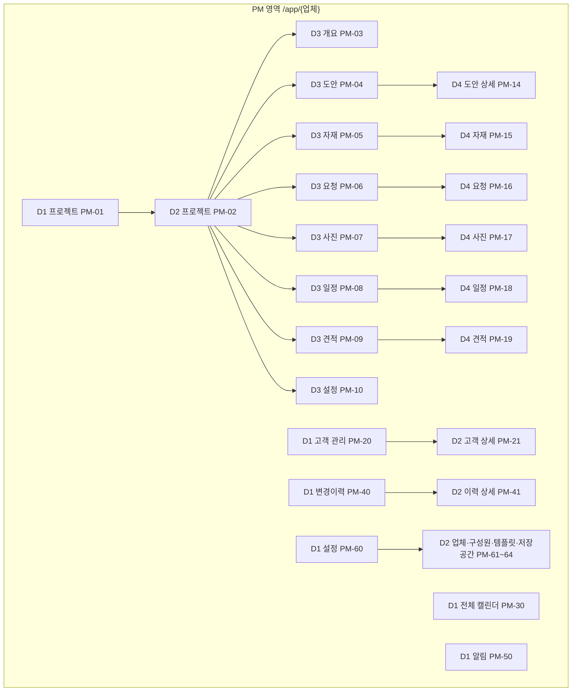
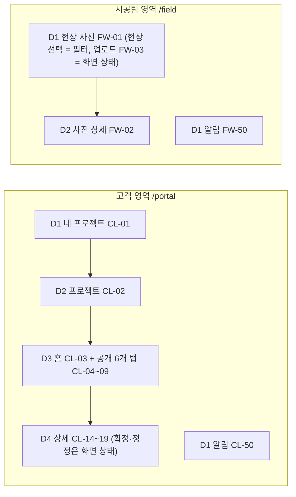

# 02 화면 구조 · 뎁스 · 디자인 시스템

> 상태: 확정 · 버전: 1.0 · 최종 수정: 2026-10-07 · 담당: A 박예원 (화면 소유는 표의 담당 열)
> 원본: `src/shared/contracts/screens.ts`(화면 ID·경로·뎁스·담당), `routes.ts`(URL 빌더), `src/app/globals.css`(디자인 토큰), `messages/{ko,en}/*.json`(문구). 이 문서는 그 의도와 규칙을 설명한다.

---

## 1. 뎁스 원칙

| 구분 | 뜻 | 예 |
|---|---|---|
| D0 영역 | 사용 환경. 뎁스 계산에서 제외 | PM `/app/{업체}` · 고객 `/portal` · 시공팀 `/field` · 인증·공개 |
| D1 | 그 영역에서 항상 찾을 수 있는 업무 메뉴 | 프로젝트, 고객 관리, 전체 캘린더, 변경이력, 알림, 설정 |
| D2 | 업무 대상 또는 설정 분류 | 특정 프로젝트, 특정 고객, 업체 정보 |
| D3 | 프로젝트 내부 기능 탭 | 개요, 도안, 자재, 요청, 사진, 일정, 견적, 설정 |
| D4 | 독립적으로 조회·공유하는 개별 항목 | 특정 자재 상세, 특정 요청 상세 |
| 화면 상태 | 그 화면에서 하는 일. **뎁스 아님(D5 없음)** | 등록·수정 폼, 필터, 확정, 업로드, A/B 비교, 미리보기 |

- 업체 전체 업무는 D1, 한 프로젝트의 업무는 D3, 항목 자체는 D4 에 둔다. **원본 기능의 위치는 하나** — 요약·알림·캘린더는 원본 D4 로 링크만 한다.
- 클릭 수·URL 슬래시 수로 뎁스를 세지 않는다. 직접 링크로 D4 에 들어와도 D4 다.
- 로그인·초대 수락은 공통 진입 절차이며 메뉴의 부모가 아니다.
- 모든 메뉴를 4단계로 늘리지 않는다 (고객 관리·사진 상세는 2단계로 끝남).

## 2. 정보 구조

### 2.1 전역 내비게이션

| 영역 | 데스크톱 상단바 | 모바일(<768px) |
|---|---|---|
| PM | 로고·업체명(업체 전환) · D1 메뉴 **프로젝트 / 고객 관리 / 전체 캘린더 / 변경이력** · 알림 버튼(안 읽은 수) · 설정 · 계정 메뉴(언어·비밀번호 변경·영역 전환·로그아웃) | 하단 탭 4개(프로젝트·캘린더·알림·더보기) — 더보기에 고객 관리·변경이력·설정·계정 |
| 고객 | 로고 · 내 프로젝트 · 알림 · 계정 메뉴 | 하단 탭 3개(내 프로젝트·알림·계정) |
| 시공팀 | 로고 · 현장 사진 · 알림 · 계정 메뉴 | 하단 탭 3개(현장 사진·알림·계정) |

프로젝트 안에서는 ProjectHeader(이름·현장·기간·상태·현재 공정·프로젝트 전환) 아래에 탭: PM `개요 | 도안 | 자재 | 요청 | 사진 | 일정 | 견적 | 설정`, 고객 `홈 | 도안 | 자재 | 요청 | 사진 | 일정 | 견적`. 모바일은 탭만 가로 스크롤. 브레드크럼: D1 › D2 › D3 › D4.

## 3. 화면 레지스트리 (요약 — 원본 `screens.ts`)

| 화면 ID | 이름 | 뎁스 | 경로 | 담당 | REQ |
|---|---|---|---|---|---|
| PUB-01 | 공개 랜딩 | D0 | `/` | A | REQ-009 |
| AUTH-01~05 | 로그인 · 업체 가입 · 초대 수락 · 비밀번호 재설정 · 영역 선택 | D0 | `/login` `/signup` `/invite/[token]` `/reset-password` `/select-area` | A | REQ-001~007 |
| PM-01 | 프로젝트 목록(+요약, 생성 Sheet) | D1 | `/app/[company]/projects` | A | REQ-010, REQ-011 |
| PM-02 / PM-03 | 프로젝트 컨테이너 / 개요(+고객 홈 편집·미리보기) | D2 / D3 | `…/projects/[project]` → `/overview` | A | REQ-012~014 |
| PM-04 / PM-14 | 도안 목록 / 도안 상세(버전·비교·확정 상태) | D3 / D4 | `…/designs` / `…/designs/[designId]` | B | REQ-100~106, REQ-121 |
| PM-05 / PM-15 | 자재 목록 / 자재 상세 | D3 / D4 | `…/materials` / `…/materials/[materialId]` | B | REQ-110~113, REQ-121 |
| PM-06 / PM-16 | 요청 목록 / 요청 상세(답변·상태) | D3 / D4 | `…/requests` / `…/requests/[requestId]` | C | REQ-200, REQ-202, REQ-204, REQ-205 |
| PM-07 / PM-17 | 사진 목록(+다중 업로드) / 사진 상세 | D3 / D4 | `…/photos` / `…/photos/[photoId]` | C | REQ-210~213 |
| PM-08 / PM-18 | 일정(월간·타임라인) / 일정 상세 | D3 / D4 | `…/schedule` / `…/schedule/[eventId]` | C | REQ-230~232 |
| PM-09 / PM-19 | 견적 목록 / 견적 상세(`?v=N`) | D3 / D4 | `…/estimates` / `…/estimates/[estimateId]` | B | REQ-130~133 |
| PM-10 | 프로젝트 설정(기본 정보·공개·참여자·보관) | D3 | `…/settings` | A | REQ-017~019, REQ-003 |
| PM-20 / PM-21 | 고객 관리 / 고객 상세 | D1 / D2 | `/app/[company]/clients[/[clientId]]` | A | REQ-020, REQ-021 |
| PM-30 | 전체 캘린더 | D1 | `/app/[company]/calendar` | C | REQ-233 |
| PM-40 / PM-41 | 변경이력 / 이력 상세 | D1 / D2 | `/app/[company]/history[/[eventId]]` | A | REQ-030 |
| PM-50 | 알림 | D1 | `/app/[company]/notifications` | A | REQ-040 |
| PM-60~64 | 설정 → 업체 정보 · 구성원 · 기본 템플릿 · 저장공간 | D1 / D2 | `/app/[company]/settings/{company,members,templates,storage}` | A | REQ-050~053, REQ-005 |
| CL-01 / CL-02 / CL-03 | 내 프로젝트 / 프로젝트 / 홈 | D1 / D2 / D3 | `/portal/projects` → `/[project]/home` | A | REQ-015, REQ-016 |
| CL-04·14, CL-05·15, CL-09·19 | 도안 · 자재 · 견적 (공개분, 확정은 화면 상태) | D3 / D4 | `/portal/projects/[project]/{designs,materials,estimates}[/[id]]` | B | REQ-100~132 |
| CL-06·16, CL-07·17, CL-08·18 | 요청(작성·정정) · 사진 · 일정 (공개분) | D3 / D4 | `/portal/projects/[project]/{requests,photos,schedule}[/[id]]` | C | REQ-200~232 |
| CL-50 / FW-50 | 알림 | D1 | `/portal/notifications`, `/field/notifications` | A | REQ-040 |
| FW-01 / FW-02 / FW-03 | 현장 사진 / 사진 상세 / 업로드(화면 상태 `?upload=1`) | D1 / D2 / 상태 | `/field/photos?project=` · `/field/photos/[photoId]?project=` | C | REQ-220~222 |
| SYS-403 / SYS-404 | 권한 없음 / 없음(존재 숨김) | D0 | — | A | REQ-012 |

규칙: 각 `page.tsx` 최상위 `<main data-screen-id="PM-05">`. 화면 ID 는 재번호·재사용 금지. 새 화면이 필요하면 만들지 말고 진행 기록(progress/<담당>.md)의 변경 요청(CR)으로 적는다(00 헌법 5.9). `screens.ts` 는 A 소유.

## 4. 화면 전환 규칙

| ID | 출발 | 행동 | 도착 | 규칙 |
|---|---|---|---|---|
| TR-01 | PM-01 | 프로젝트 선택 | PM-02 의 PM-03 | 중간 빈 화면 없음 (`routes.app.project(c,p)`) |
| TR-02 | PM-03 | 자재 탭 | PM-05 | D3 간 전환 |
| TR-03 | PM-05 | 자재 선택 | PM-15 | D3→D4 (`routes.app.material`) |
| TR-04 | PM-15 | 수정 후 저장 | PM-15 갱신, 목록에도 반영 | D4 유지, Sheet 닫힘, `revalidatePath` |
| TR-05 | PM-30 | 일정 선택 | 해당 프로젝트 PM-18 | 바로가기가 원본 계층을 바꾸지 않음 |
| TR-06 | PM-21 | 관련 프로젝트 선택 | PM-03 | 고객 아래 프로젝트 복제 없음 |
| TR-07 | CL-15 | 확정 | CL-15 갱신(확정 기록) | 코드 페이지 없음, 확인 대화상자 |
| TR-08 | FW-01 | 사진 업로드 성공 | 같은 현장 FW-01 목록 | 입력 상태 종료 |
| TR-09 | 알림 | 요청 알림 선택 | 역할별 PM-16 또는 CL-16 | 정규 상세로 |
| TR-10 | PM-14 | A/B 선택·핸들 이동 | 같은 화면 | D4 유지 |

- 로그인 후 목적지: `next`(같은 사이트 상대 경로만, `safeNext`) > 영역 1개면 그 영역 첫 화면 > 2개 이상이면 AUTH-05. PM 업체가 여럿이면 마지막 사용 업체(쿠키).
- 직접 URL·새로고침·뒤로가기에서 업체·프로젝트·선택 항목을 유지한다. 폼·필터 상태는 query(`?mode=new|edit`, `?status=`)로 표현 — 새 뎁스 아님.
- 없는 항목·권한 없음·비공개·만료 배정 → **상세를 먼저 그리지 않고** `notFound()`(존재 숨김). 다른 프로젝트로 묵시 이동 금지.
- 프로젝트를 전환하면 이전 프로젝트의 목록·필터·선택이 남지 않는다(레이아웃 key 에 projectId).

## 5. 화면 공통 규칙

| 항목 | 규칙 |
|---|---|
| 상태 6종 | 로딩(Skeleton) · 빈 상태(EmptyState + 다음 행동 버튼) · 오류(ErrorState + 재시도 + ref 코드) · 권한 없음/없음(SYS-404) · 필터 결과 없음(필터 초기화 버튼) · 충돌(`VERSION_CONFLICT`·`STALE_REVISION` → 새로고침 안내) — 모든 목록·상세 필수, 색만으로 구분하지 않음 |
| 폼 | 데스크톱 우측 Sheet, 모바일 전체 화면 Sheet. 위험 동작(보관·회수·재확인 요청)은 AlertDialog. 제출 중 버튼 비활성(중복 제출 방지). 실패 시 입력 보존 + 필드 오류 |
| 상세(D4) | 독립 경로. 헤더(제목·상태 배지·주요 동작) → 메타 → 본문 → 사이드(기록·파일) |
| 목록 | 필터바(검색·패싯) → 목록(30개 단위 '더 보기') → 빈/결과 없음 |
| 식별 속성 | `data-screen-id`(main), `data-ui-key="material-form-submit"`(kebab, 영역-요소-동작, 문구·언어·값 금지), 반복 항목 컨테이너 `data-key={레코드 id}` |
| 접근성 | 모든 기능 키보드 가능, 포커스 링 항상 표시, 아이콘 버튼 aria-label, 폼 오류 `aria-describedby`, 색만으로 의미 전달 금지 |
| 역할별 차이 | PM·고객 화면은 같은 컴포넌트 + `viewer.as` 로 동작 버튼만 다르게. 고객 화면에는 비공개 항목·편집 버튼·내부 행위자를 그리지 않음 |

## 6. 핵심 화면 세부

### 6.1 PM-14 / CL-14 A/B 비교 슬라이더 (B, REQ-105)
- A·B 각각 Select(이름·연결 버전·PDF 페이지 표시). 같은 이미지는 상대 쪽에서 선택 불가. 후보 = 같은 프로젝트·볼 수 있는 비교 이미지(고객은 공개 도안의 현재 버전분).
- 고정 비율 영역(16:10)에 B 를 깔고 A 를 `clip-path: inset(0 calc(100% - var(--pos)) 0 0)` 로 겹친다. 두 이미지 `object-fit: contain`(여백 허용). 핸들 위치만 바뀌고 이미지 크기는 불변.
- 핸들: `role="slider"` `aria-valuemin=0` `aria-valuemax=100` `aria-valuenow` `aria-valuetext="A 50% / B 50%"`. ←→ 1%, Shift+←→ 10%, Home 0%, End 100%. 포인터 드래그(터치 포함, `requestAnimationFrame` 로 갱신). 기본 50%. 0% = B 전체, 100% = A 전체. 창 크기 변경 시 비율 유지.
- 비활성 사유 4종: 이미지 2개 미만 / A·B 미선택 / 로딩·디코딩 실패 / 접근 불가(403·404). 비활성이어도 원본 다운로드는 가능.

### 6.2 PM-07 다중 업로드 큐 (C, REQ-211) · FW-03
- 최대 20장 선택 → 파일별 행(썸네일·이름·진행률·상태). 상태: 대기 → 업로드 중 → 확인 중(finalize) → 완료 / 실패(사유) → 재시도.
- 성공분은 즉시 목록에 반영·유지, 실패분만 재시도. 같은 파일 재시도 시 기존 files 행 재사용(중복 행 없음).
- 공통 입력(공정·촬영일·설명·공개)은 한 번에, 촬영일은 파일별 EXIF 로 제안. 시공팀은 공개 입력 없음.

### 6.3 FW-01 현장 선택 (C, REQ-220)
유효 배정 0개 → "배정된 현장이 없습니다" 안내, 업로드 버튼 없음 / 1개 → 자동 선택 / 여러 개 → 상단 현장 Select 필수, 선택 전 업로드 비활성. 업로드 폼 상단에 현장명 고정 표시, 제출 중 현장 변경 불가.

### 6.4 PM-08 일정 (C, REQ-230)
월간 그리드(일요일 시작, 오늘 강조, 날짜 칸에 일정 칩 — 시각순, 많으면 "+N") + 타임라인(프로젝트 기간 전체, 시작일순). 모바일은 월간 대신 주간 목록. 날짜·시각은 KST 달력 값 그대로 표시.

### 6.5 CL-15 / CL-14 확정 버튼 (B, REQ-120)
확정권 고객에게만 표시. `none` → [확정하기] / `confirmed` → "○○님이 2026-10-06 14:20 확정(리비전 2)" / `needs_reconfirm` → 경고 배지 + [변경됨 — 다시 확정]. 클릭 → AlertDialog(확정 대상 요약) → RPC. `STALE_REVISION` 이면 "내용이 바뀌었습니다. 새로고침 후 다시 확인하세요."

### 6.6 PM-03 고객 홈 편집 (A, REQ-014)
편집 모드(화면 상태): 안내문 Textarea(2,000자) + 4영역 리스트(위/아래 버튼, 표시 Switch). [고객 화면 미리보기]는 CL-03 과 같은 컴포넌트를 공개 필터로 렌더(읽기 전용, 편집 버튼 없음).

### 6.7 PM-10 참여자 구역 · PM-62 구성원 (A, REQ-003·005·018·051)
참여자 표(이름·역할·기간·확정권·상태) + [PM 배정] [고객 초대] [시공팀 초대]. 초대 Sheet 제출 → 링크를 **한 번만** 보여 주는 Dialog(복사 버튼, "닫으면 다시 볼 수 없습니다"). 대기 중 초대 목록(폐기). 재설정 링크도 같은 방식.

---

## 7. 디자인 시스템 — "차분한 스튜디오"

따뜻한 무채색 바탕 + 깊은 청록 강조, 얇은 선, 정보 밀도 높은 업무 화면. 기존 클론 디자인은 쓰지 않는다. 코드 원본: `src/app/globals.css`(Tailwind 4 `@theme` + shadcn 변수, 라이트/다크).

### 7.1 색 토큰 (hex 직접 사용·Tailwind 기본 팔레트 사용 금지, 토큰 클래스만)

| 토큰 | 라이트 | 다크 | 용도 |
|---|---|---|---|
| `--background` | #FAF9F7 | #161412 | 페이지 바탕 |
| `--foreground` | #1C1917 | #EDEAE6 | 본문 |
| `--card` | #FFFFFF | #1E1C19 | 카드·표·Sheet |
| `--muted` / `--muted-foreground` | #F1EFEC / #5E5852 | #292623 / #A9A29B | 보조 면 / 보조 글자 |
| `--border` / `--input` | #E3DFD9 / #8F877E | #37332F / #6E6760 | 구분선 / 입력 테두리(3:1) |
| `--primary` / `--primary-foreground` | #0F766E / #FFFFFF | #2DD4BF / #042F2E | 주요 버튼·링크·활성 탭 |
| `--ring` | #0F766E | #2DD4BF | 포커스 링 |
| `--secondary` | #EDEAE5 | #2A2724 | 보조 버튼 |
| `--accent` / `--accent-foreground` | #E3F1EE / #134E4A | #123430 / #99F6E4 | hover·선택 행 |
| `--destructive` | #B42318 | #F87171 | 위험·오류 |
| `--success` · `--warning` · `--info` | #15803D · #B45309 · #1D4ED8 | #4ADE80 · #FBBF24 · #60A5FA | 상태 아이콘 |

모든 텍스트 조합 WCAG AA(본문 4.5:1, UI 3:1) 계산 확인 완료. 다크 모드는 OS 설정을 따른다.

### 7.2 상태 배지 (톤 7개만, 라벨+아이콘이 의미 전달)

| 상태 | 톤 | 아이콘 | 상태 | 톤 | 아이콘 |
|---|---|---|---|---|---|
| 공개 | brand | Eye | 요청 접수 | info | CircleDot |
| 비공개 | neutral | EyeOff | 요청 처리 중 | caution | Clock |
| 확정 | positive | CircleCheck | 요청 완료 | positive | CircleCheck |
| 재확인 필요 | attention | TriangleAlert | 파일 확인 중 / 사용 가능 / 거절 | info / positive / critical | LoaderCircle / Check / CircleX |
| 미확정(PM만) | neutral | Circle | 프로젝트 예정·진행·보류·완료 | neutral·brand·caution·positive | CalendarClock·Hammer·Pause·Flag |

### 7.3 타이포·간격·형태

| 항목 | 값 |
|---|---|
| 글꼴 | Pretendard Variable(`next/font/local`, OFL) · 굵기 400/500/600/700 · 숫자 `tabular-nums` · `word-break: keep-all` |
| 크기 | 12(배지) · 13(메타) · **14(기본 본문·표·버튼)** · 16(읽기 본문·모바일 입력) · 18(카드·Sheet 제목) · 20(D4 제목) · 24(페이지 제목) · 30(인증 제목) · 36(랜딩 전용) |
| 간격 | 4px 단위 (4·8·12·16·24·32·48) |
| 반경 | sm 4 · md 8(기본) · lg 12 / 그림자 2단계(카드·떠 있는 요소) |
| 레이아웃 | 최대 폭 1280, 12열, 브레이크포인트 360 · 640 · 768 · 1024 · 1280 |
| 모션 | 150/200/300ms, `prefers-reduced-motion` 시 제거 |
| 아이콘 | lucide-react 16/20px |
| 터치 대상 | 최소 24×24px(권장 40px) |

### 7.4 컴포넌트 소유

| 구분 | 컴포넌트 | 소유·위치 |
|---|---|---|
| 기본(shadcn) | Button, Input, Textarea, Select, Combobox, Checkbox, Switch, Dialog, AlertDialog, Sheet, Tabs, Table, Card, Badge, DropdownMenu, Tooltip, Skeleton, Toast(sonner), Avatar, Breadcrumb, Calendar(DatePicker) | A · `src/shared/ui/` |
| 공통 도메인 | AppShell(상단바·하단 탭), ProjectHeader, ProjectTabs, StatusBadge, EmptyState, ErrorState, ForbiddenState, LoadMore, DateText(KST), ConfirmDialog | A · `src/shared/ui/` |
| 파일 공통 | FileDropzone, UploadQueue, FileDownloadLink | B · `src/features/files/components/` (D02) |
| B 도메인 | DesignVersionList, CompareSlider, PdfPreview, PdfPageExtractor, MaterialCard, MaterialFilters, ConfirmButton, ConfirmRecord, EstimateVersionPicker | B · `src/features/{designs,materials,estimates}/components/` |
| C 도메인 | RequestThread(원문·정정·답변), RequestStatusSelect, PhotoGrid, PhotoFilters, SiteSelector, CalendarMonth, Timeline, ScheduleForm | C · `src/features/{requests,photos,schedule}/components/` |

공통 컴포넌트가 부족하면 자기 feature 폴더 안에 만들고, 공통화는 병합 때 통합 책임자가 한다(00 헌법 13장).

## 8. 문구 규칙

| 항목 | 규칙 |
|---|---|
| 말투 | 존댓말 "~하세요 / ~했습니다". 버튼은 동사("저장", "공개하기"). 기술 용어 금지 |
| 오류 | 원인 + 해결 ("파일이 50MB를 넘습니다. 더 작은 파일을 올려 주세요.") + 서버 오류는 "문의 코드: {ref}" |
| 용어 | 01 문서 2장 용어 표시명만. "회사"·"삭제"(보관을 삭제라 부르지 않음) 금지 |
| 숫자·날짜 | ko `2026. 10. 7.(수) 14:20`, en `Oct 7, 2026, 2:20 PM` — 모두 KST. 금액 `45,000원` / `₩45,000` |
| i18n 키 | `messages/{ko,en}/{ns}.json`, 키는 `영역.요소.의미` 영문 camelCase. 화면 제목 = `screens.ts` 의 `titleKey`. 오류 = `errors.{ErrorCode}`, 필드 오류 = `errors.field.*`. 열거형 라벨 = `projects.status.*`, `materials.space.*`, `photos.phase.*`, `requests.status.*`, `designs.confirmState.*` |
| 네임스페이스 소유 | A: common·auth·errors·projects·clients·history·notifications·settings·files / B: designs·materials·estimates / C: requests·photos·schedule. **ko·en 키 집합은 항상 동일**(`npm run check:messages`) |
