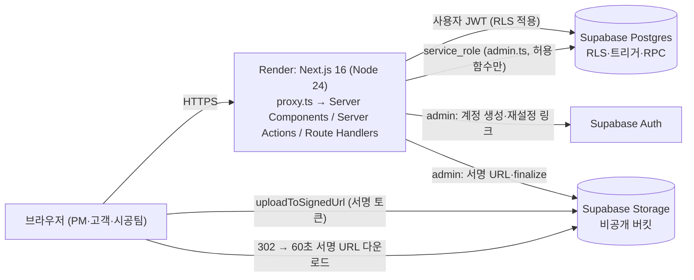
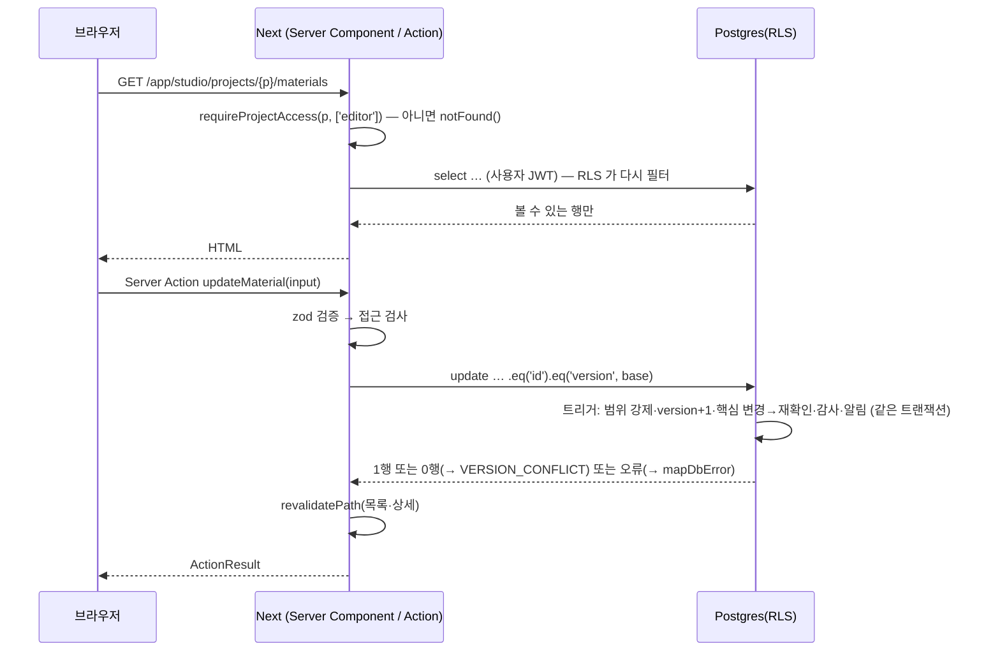

# 03 아키텍처 · 데이터 · 계약 · 보안 · 운영

> 상태: 확정 · 버전: 1.2 · 최종 수정: 2026-10-07 · 담당: A 박예원
> 원본(이 문서보다 우선): `supabase/migrations/*.sql`(스키마·RLS·트리거·RPC, pgTAP 110개 통과), `src/shared/contracts/*.ts`(계약), `src/shared/lib/supabase/*.ts`·`src/proxy.ts`(클라이언트·보안 헤더 기준 코드), `render.yaml`, `.env.example`

---

## 1. 기술 결정 (ADR 요약)

| ID | 결정 | 이유 | 기각한 대안 |
|---|---|---|---|
| ADR-001 | **Next.js 16 App Router 풀스택 단일 서비스** (ai-website-cloner-template 의 기술 뼈대는 스타터에 흡수 — 템플릿을 따로 받지 않음 + 스타터 `package.json` 버전 고정: Next 16.4, React 19.3, TS 5.9 strict, Tailwind 4.3, shadcn/base-ui, Node 24 — 상세 00 헌법 6장). 디자인은 02 문서로 새로 정의 | 한 레포·한 배포로 3인이 기능 폴더만 나눠 병렬 개발. 오늘 배포 가능 | 프론트+별도 API 서버(계약·CORS·배포 2배), SPA+Supabase 직결(파일 검증·이력 보장 약함) |
| ADR-002 | **Supabase(Postgres·Auth·Storage, Seoul) + RLS + 서버 이중 검증**. 데이터 접근은 서버에서만, 사용자 세션 클라이언트로 RLS 적용. service_role 은 `admin.ts` 한 곳·허용 함수만 | DB 가 마지막 방어선. 서버 버그가 곧 유출로 이어지지 않음 | service_role 만 쓰고 RLS 차단(서버 버그=유출), 자체 세션 |
| ADR-003 | **Render Web Service 무료**, Singapore, `*.onrender.com`, `render.yaml` Blueprint, health `/api/health`, 자동 배포 OFF | 사용자 결정. 비용 0 | 유료(잠들지 않음, 월 $7) — 파일럿 후 전환 |
| ADR-004 | **Supabase Auth 이메일+비밀번호, 공개 가입 OFF, 메일 없음.** 계정은 서버 `auth.admin.createUser({email_confirm:true})` 로만. 재설정 = `auth.admin.generateLink({type:'recovery'})` 의 `hashed_token` 으로 `/auth/confirm?token_hash=…&type=recovery&next=/reset-password` 링크를 관리자가 복사 전달 | 메일 미발송 결정 + 우회 가입 차단 | 매직링크·OAuth(메일·외부 계정 필요) |
| ADR-005 | **파일: 비공개 버킷 `project-files` + 서명 업로드 + 서버 finalize 검증 + 권한 재검사 다운로드(60초 서명 URL)**. 파이프라인은 **B 소유**(기준서 D02 — A 는 권한 판정, C 는 사진 업무 저장) | Render 메모리·본문 제한 회피, 위장 파일 차단, 공개 해제 즉시 차단 | 서버 경유 업로드(512MB 위험), 공개 버킷(유출) |
| ADR-006 | **next-intl 4**(라우팅 없이 쿠키 `NEXT_LOCALE` + `profiles.locale`), 네임스페이스별 파일 분리(소유 담당별) | URL 구조 유지, 병합 충돌 방지 | `/ko`·`/en` 경로(뎁스·URL 복잡) |
| ADR-007 | **업체 셀프 가입** — 원 설계안 9절 "운영 절차 개설" 대체(사용자 결정) | 파일럿 업체가 스스로 시작 | 운영자 수동 개설 |
| ADR-008 | **로컬 분리 개발·수동 병합 전략**: 같은 스타터 폴더(전체 DB·계약·버전·설정·문서·검사 스크립트) → 각자 로컬 폴더·각자 AI 로 개발(GitHub·원격 저장소 미사용) → 남의 기능은 계약 시그니처 STUB → `npm run submit` 제출본(내 소유 경로 파일만, STUB 자동 제외) → 통합 책임자가 새 스타터 위에 A→B→C 순서로 `npm run merge:submissions`. 소유권 판정은 Git 대신 `starter-manifest.json`(파일 해시) 비교 (00 헌법 3·12·13장) | 대안: 공유 Git 레포 — 사용자 결정으로 미사용 |

## 2. 구성



| ID | 구성 요소 | 책임 | 신뢰 경계 |
|---|---|---|---|
| COMP-web | Next.js 앱 (Render) | 화면 렌더, Server Action, 접근 검사, 입력 검증, 파일 finalize | 브라우저 입력은 신뢰하지 않음 |
| COMP-proxy | `src/proxy.ts` (Next 16 의 middleware 후속) | 세션 쿠키 갱신, CSP nonce, 보안 헤더. **권한 판단·리다이렉트 안 함** | — |
| COMP-db | Postgres + RLS | 행 단위 권한(최종 방어선), 범위 강제 복사, 감사·알림 생성, 상태 규칙 | 서버 코드도 신뢰하지 않음(RLS 우회 불가) |
| COMP-auth | Supabase Auth | 비밀번호 해시·세션·재설정 토큰 | 공개 가입 OFF |
| COMP-storage | Supabase Storage | 파일 바이트. 사용자 정책 없음 → 서버만 접근 | — |
| COMP-render | Render | 실행·로그·환경변수(비밀) | — |

### 2.1 폴더 구조와 소유 (원본: `ownership.json`)

```
src/
  proxy.ts · i18n/request.ts · app/{layout,globals.css,not-found,error}        A
  app/(public)/page.tsx · app/(auth)/{login,signup,invite/[token],reset-password,select-area}   A
  app/auth/confirm/route.ts · app/api/health/route.ts                            A
  app/api/files/[fileId]/route.ts                                                B
  app/app/[company]/layout.tsx (PM 셸) · projects/page.tsx · projects/[project]/{layout,page}.tsx   A
  app/app/[company]/projects/[project]/{overview,settings}/                      A
  app/app/[company]/projects/[project]/{designs,materials,estimates}/            B
  app/app/[company]/projects/[project]/{requests,photos,schedule}/               C
  app/app/[company]/{clients,history,notifications,settings}/                    A
  app/app/[company]/calendar/                                                    C
  app/portal/{layout, projects/page, projects/[project]/{layout,home}, notifications}   A
  app/portal/projects/[project]/{designs,materials,estimates}/                   B
  app/portal/projects/[project]/{requests,photos,schedule}/                      C
  app/field/{layout, notifications}  A  ·  app/field/photos/                       C
  features/core/                                                                 A
  features/files/  (공통 파일 어댑터, D02)                                        B
  features/{designs,materials,estimates}/                                        B
  features/{requests,photos,schedule}/                                           C
  shared/{ui, lib/supabase/{server,browser,admin}.ts, lib/{dates,logger,rate-limit,action}.ts, contracts/}   A (다른 담당은 읽기만)
messages/{ko,en}/{ns}.json (ns 소유 02 문서 8장) · supabase/{migrations,tests} (파일명 접두 a_/b_/c_) · tests/e2e/{a,b,c}/
```

- feature 내부: `components/` · `server/{queries,actions,summary,notification-target}.ts` · `schema.ts`(zod) · `types.ts` · `index.ts`(공개 API).
- 의존 방향: `app → features → shared`. 다른 feature 는 `index.ts` 만 import. B·C 는 `core`(접근 검사)·`files`(업로드)를 쓸 수 있고, **B↔C 직접 import 금지**(링크는 `routes.ts`).
- 페이지 파일(`page.tsx`)은 얇게: 접근 검사 → feature 쿼리 → feature 컴포넌트.

### 2.2 Supabase 클라이언트 3종 (기준 코드가 이미 스타터에 있음)

| 파일 | 키 | 쓰는 곳 | 금지 |
|---|---|---|---|
| `src/shared/lib/supabase/server.ts` `createServerSupabase()` | anon + 사용자 쿠키 세션 | Server Component, Server Action, Route Handler — **모든 데이터 조회·저장** | 클라이언트 컴포넌트 |
| `src/shared/lib/supabase/browser.ts` `createBrowserSupabase()` | anon | `storage.uploadToSignedUrl` **만** | 테이블 조회·RPC·auth 호출 |
| `src/shared/lib/supabase/admin.ts` `createAdminSupabase()` | service_role | 허용 목록: 가입·초대 수락·재설정 링크(`features/core/server/auth-actions.ts`), 업로드 의도·finalize·서명 다운로드(`features/files/server/*`, **B 소유**) | 그 밖의 모든 파일 (eslint 가 막음, TC-909) |

admin 을 쓰는 함수는 호출 전에 사용자 권한을 스스로 확인한다(`getAccessContext`, `can_issue_password_reset`, 사용자 권한으로 files 행 조회). 서버는 항상 `auth.getUser()` 로 사용자를 확인한다.

## 3. 핵심 흐름

### 3.1 화면 조회 · 저장



### 3.2 계정

| 흐름 | 단계 |
|---|---|
| 업체 가입 (REQ-001) | ① rate limit(IP 시간당 5) ② zod(slug 형식·예약어, 비밀번호 10~72) ③ `admin.auth.admin.createUser({email,password,email_confirm:true,user_metadata:{display_name,locale}})` → 프로필 트리거 생성 ④ `admin.rpc('create_company_with_owner', {p_user,p_company_name,p_slug,p_display_name})` — `slug_taken` 이면 ⑤ `admin.auth.admin.deleteUser`(보상) ⑥ 사용자 클라이언트 `signInWithPassword` → `/app/{slug}/projects` |
| 초대 생성 (REQ-003) | 토큰 32바이트(`crypto.randomBytes`, base64url) → SHA-256 hex 를 `invitations.token_hash` 로 **사용자 클라이언트** insert(RLS 가 권한 검사) → 화면에 `${APP_ORIGIN}/invite/{token}` 한 번 표시. 토큰 원문은 저장·로그 금지 |
| 초대 수락 (REQ-004) | `/invite/[token]` 서버에서 해시 → admin 으로 초대 조회(업체명·역할·이메일 표시) → 신규: `createUser` 후 `admin.rpc('accept_invitation',{p_user,p_token_hash})`, 실패 시 사용자 삭제 / 기존: 로그인 상태 확인 후 같은 RPC → 결과 `area` 로 이동 |
| 재설정 링크 (REQ-005) | `admin.rpc('can_issue_password_reset',{p_actor,p_company,p_target})` true 확인 → `admin.auth.admin.getUserById` → `generateLink({type:'recovery',email})` 의 `properties.hashed_token` 으로 `${APP_ORIGIN}/auth/confirm?token_hash=…&type=recovery&next=/reset-password` 생성 → 한 번 표시 |
| 재설정 사용 | `/auth/confirm` Route Handler: `supabase.auth.verifyOtp({type:'recovery', token_hash})` → `safeNext(next)` 로 302 → `/reset-password` 에서 `auth.updateUser({password})` → `auth.signOut({scope:'others'})` |

### 3.3 파일 (B 구현 — 공통 파일 어댑터, A·C 사용) — 계약: `integration.ts` 5장

| 단계 | 처리 |
|---|---|
| ① `createUploadIntent` (Server Action) | zod + `FILE_RULES`(확장자·크기 1차) → 접근 검사 → **사용자 클라이언트**로 `files` insert(status `pending`, RLS 가 종류별 권한 검사) → 경로 `company/{companyId}/project/{projectId 또는 _}/{kind}/{fileId}{ext}` → `admin.storage.createSignedUploadUrl(path)` → `{fileId, path, token}` |
| ② 브라우저 업로드 | `createBrowserSupabase().storage.from('project-files').uploadToSignedUrl(path, token, file)` (진행률은 UploadQueue) |
| ③ `finalizeUpload` (Server Action) | 사용자 권한으로 files 행 확인 → admin 으로 객체 다운로드 → 실제 크기·형식 헤더 검사(PDF `%PDF-`, DWG `AC10`, SKP SketchUp 헤더, PNG/JPEG/WebP 시그니처) → 이미지: `sharp(buf,{limitInputPixels:40e6}).rotate()` 재인코딩(EXIF 제거) 후 같은 경로 덮어쓰기, EXIF 촬영일 추출(`exifr`, 재인코딩 전), 사진은 썸네일 WebP 640px(`photo_thumb`, `derived_from`) → status `ready`(크기·폭·높이·sha256) 또는 `rejected`(사유) |
| ④ 업무 행 연결 | 업무 insert/RPC 에 `fileId` 전달 → DB `attach_file` 이 같은 프로젝트·ready·미연결·업로더 본인·허용 종류 검사 후 소유 연결 (위반 시 `file_*` 오류) |
| 다운로드 `GET /api/files/[fileId]` | 사용자 클라이언트로 files 행 select(RLS 의 `can_view_file` 이 소유 객체 열람 가능 여부 판정) → 없으면 404 → `admin.storage.createSignedUrl(path, 60, {download})` → 302, `Cache-Control: no-store` |

SKP 신버전 헤더는 실제 파일로 확인(B, TASK)하고 다르면 검사 함수를 고친다. 거절된 파일 행·객체는 남기되 연결 불가.

---

## 4. 데이터 (원본: 마이그레이션)

### 4.1 테이블

| ID | 테이블 | 소유 | 핵심 규칙 |
|---|---|---|---|
| ENT-profile | `profiles` | A | auth.users 생성 시 트리거로 생성. 표시명·언어 |
| ENT-company · ENT-company_setting | `companies` · `company_settings` | A | slug 불변. 내부 설정(기본 안내문)은 스태프 전용 테이블로 분리 |
| ENT-company_member | `company_members` | A | owner 1명·불변, 추가는 RPC 만, 역할 변경은 owner 만 |
| ENT-project | `projects` | A | 기본 비공개, `home_sections` 4키 순열 CHECK, 생성자 pm 자동 배정 |
| ENT-project_participant | `project_participants` | A | (project,user,role) 유일, 확정권은 customer 만, 기간·회수 |
| ENT-invitation | `invitations` | A | token_hash 만 저장, 72h, 재발급 시 이전 자동 폐기, 수락은 RPC 만 |
| ENT-client · ENT-client_project | `clients` · `client_projects` | A | 연락처 카드, 같은 업체 프로젝트만 연결 |
| ENT-file | `files` | A | pending→ready/rejected, 상태 변경은 서버만, `attach_file` 로 1회 연결 |
| ENT-audit_event | `audit_events` | A | 트리거만 기록, 사용자 쓰기 불가 |
| ENT-notification | `notifications` | A | 대상 참조만, `read_at` 외 불변 |
| ENT-design · ENT-design_version · ENT-design_preview | `designs` · `design_versions` · `design_previews` | B | 생성·새 버전은 RPC, `confirm_state`·`current_version` 시스템 전용 |
| ENT-material | `materials` | B | 핵심 필드 변경 → revision+1·재확인, 시스템 컬럼 보호 |
| ENT-estimate · ENT-estimate_version | `estimates` · `estimate_versions` | B | 번호 서버 부여(행 잠금), 파일 불변, 최초 공개 시각 |
| ENT-confirmation | `confirmations` | B | (대상,리비전) 유일, 무효화만 기록, RPC 만 |
| ENT-request · ENT-request_correction · ENT-request_reply | `requests` · `request_corrections` · `request_replies` | C | 제목·원문 불변, 정정·답변 추가 전용 |
| ENT-photo | `photos` | C | 시공팀 업로드 비공개 강제, 시공팀은 본인 사진 공정·촬영일·설명만 |
| ENT-schedule_event | `schedule_events` | C | 날짜·시각 CHECK(역전 거절), 관련 항목 링크 |

### 4.2 공통 규약 (모든 업무 테이블)

| 컬럼·장치 | 규칙 |
|---|---|
| `id uuid` | `gen_random_uuid()` |
| `company_id`, `project_id` | 트리거 `set_scope_from_project`/`_parent` 가 부모에서 **강제 복사** — 클라이언트 값 무시, 이후 불변 |
| `version` | `touch_row` 가 UPDATE 마다 +1. 클라이언트는 `.eq('version', base)` |
| `archived_at` | 보관. DELETE 권한·정책 없음 |
| `created_by`·`author_id`·`uploaded_by` | 트리거가 `auth.uid()` 로 강제 |
| 감사 | `audit_row` AFTER INSERT/UPDATE — 변경 키만 전후 값, 이벤트 created·updated·archived·restored·published·unpublished·revoked |
| 시스템 컬럼 | `guard_system_columns` — RPC 가 `app.system_write=on` 일 때만 변경 |

### 4.3 권한 헬퍼 (private 스키마, API 비노출, SECURITY DEFINER)

`is_company_staff` · `is_company_manager(_for)` · `is_company_owner` · `has_participation_for`(KST 기간) · `can_edit_project(_for)` · `can_view_as_customer` · `is_field_on` · `can_confirm_on` · `can_see_profile` · `can_see_company` · `row_visible_<table>`(파일 소유 테이블마다 정의, 파일 열람 판정에 재사용) · `attach_file` · `notify_participants` · `audit_row`.

### 4.4 RPC

| ID | 함수 | 호출자 | 용도·오류 |
|---|---|---|---|
| IF-rpc-create-company | `create_company_with_owner(p_user, p_company_name, p_slug, p_display_name)` | service_role | 업체+설정+owner. `slug_taken` |
| IF-rpc-accept-invitation | `accept_invitation(p_user, p_token_hash)` → `{company_id, project_id, area}` | service_role | `invite_not_found/expired/used/email_mismatch/revoked` |
| IF-rpc-password-reset-check | `can_issue_password_reset(p_actor, p_company, p_target)` | service_role | true/false |
| IF-rpc-storage-usage | `company_storage_usage(p_company)` | 사용자(manager) | 바이트 합계 |
| IF-rpc-create-design | `create_design(p_project, p_title, p_description, p_file, p_note, p_is_public)` | 사용자(편집자) | 도안+1번 버전. `forbidden`, `file_*` |
| IF-rpc-add-design-version | `add_design_version(p_design, p_file, p_note)` | 사용자(편집자) | 버전+1, 확정이면 재확인 |
| IF-rpc-confirm-target | `confirm_target(p_target_type 'designs'|'materials', p_target_id, p_revision)` | 사용자(확정권 고객) | `forbidden`, `stale_revision`, `already_confirmed` |
| IF-rpc-request-reconfirm | `request_reconfirm(p_target_type, p_target_id, p_reason)` | 사용자(편집자) | `reason_required`, `not_confirmed` |

C 영역은 RPC 없이 RLS + 트리거로 처리한다.

### 4.5 마이그레이션 운영 (상세 규칙 00 헌법 8장)

- 베이스라인 4개(`20261006000100_a_foundation`, `…200_b_…`, `…300_c_…`, `…900_a_grants_hardening`) **동결**. 고칠 일이 있으면 새 파일.
- 새 파일명 `YYYYMMDDHHMMSS_<a|b|c>_<설명>.sql`, **자기 테이블만** 변경. 새 테이블 체크리스트: RLS 활성 · select/insert/update 정책 · `row_visible_<table>`(파일 소유 시) · 범위·touch·immutable·audit 트리거 · GRANT 블록(900 파일과 같은 형식) · pgTAP 테스트.
- 생성 타입 `src/shared/contracts/database.types.ts` 는 `npm run db:types` 로만, 병합 후 통합 책임자가 재생성.
- prod 적용은 통합 책임자만(병합 후).

---

## 5. 계약 (원본 `src/shared/contracts/`)

| ID | 위치 | 내용 |
|---|---|---|
| IF-action-result | `errors.ts` | 모든 Server Action 반환 `ActionResult<T> = {ok:true,data} | {ok:false,error:{code,fieldErrors?,ref?}}`, `ERROR_CODES` 18종, `mapDbError()`(P0001 메시지·SQLSTATE → 코드) |
| IF-access-context | `integration.ts` 1장 | `getAccessContext()`, `requireProjectAccess(projectId, ['editor'|'customer'|'field'])`, `requireCompanyStaff(slug)` — 실패 시 redirect/notFound. A 구현 |
| IF-project-shell | `integration.ts` 2장 | 프로젝트 layout(헤더·탭)은 A. B·C 는 탭 `page.tsx` 만 |
| IF-summary-item | `integration.ts` 3장 | `SummaryItem`, `SummaryProvider.recent`, `NextScheduleProvider.next`(C), `DocumentsProvider.documents`(B) — 호출자 RLS 그대로 |
| IF-notification-target | `integration.ts` 4장 | object_type 별 해석기 `(objectId, projectId, area, slug) → {title, href, screenId} | null`. 소유: designs·materials·estimate_versions=B, requests·photos·schedule_events=C, project_participants=A |
| IF-upload-intent · IF-upload-finalize · IF-file-download | `integration.ts` 5장 | 3.3 절 — **B 제공**(D02) |
| IF-routes | `routes.ts` | URL 생성의 유일한 곳, `safeNext` |
| IF-health | `/api/health` | `{ok:true}` 200, DB 조회 없음 |

### 5.1 Server Action 표준 형태 (모든 담당 동일)

```ts
// src/features/materials/server/actions.ts (B) — 표준 예시
'use server';
import { revalidatePath } from 'next/cache';
import { createServerSupabase } from '@/shared/lib/supabase/server';
import { requireProjectAccess } from '@/features/core';
import { ok, fail, mapDbError, type ActionResult } from '@/shared/contracts/errors';
import { routes } from '@/shared/contracts/routes';
import { logger, newRef } from '@/shared/lib/logger';
import { materialUpdateSchema } from '../schema';

export async function updateMaterial(raw: unknown): Promise<ActionResult<{ version: number }>> {
  const parsed = materialUpdateSchema.safeParse(raw);
  if (!parsed.success) return fail('VALIDATION_FAILED', { fieldErrors: parsed.error.flatten().fieldErrors });
  const { projectId, id, baseVersion, ...fields } = parsed.data;
  const access = await requireProjectAccess(projectId, ['editor']);          // 1차: 앱 검사
  const supabase = await createServerSupabase();
  const { data, error } = await supabase                                      // 2차: RLS
    .from('materials')
    .update(toDbColumns(fields))           // camelCase → snake_case, 시스템 컬럼 제외
    .eq('id', id).eq('project_id', projectId).eq('version', baseVersion)
    .select('version').maybeSingle();
  if (error) {
    const ref = newRef();
    logger.warn('material.update.failed', { ref, dbCode: error.code, projectId, objectId: id });
    return fail(mapDbError(error), { ref });
  }
  if (!data) return fail('VERSION_CONFLICT');                                // 0행 = 다른 사람이 먼저 수정
  revalidatePath(routes.app.material(access.companySlug, projectId, id));
  revalidatePath(routes.app.project(access.companySlug, projectId, 'materials'));
  return ok({ version: data.version });
}
```

목록 규약: 페이지 30개, 정렬 `created_at desc, id desc`, 커서 = 마지막 행의 `(created_at, id)`. 날짜는 ISO 문자열, `date` 는 `YYYY-MM-DD`, 표시는 `dates.ts`(KST).

---

## 6. 상태 · 알림 규칙

### 6.1 상태 전이

| ID | 대상 | 전이 |
|---|---|---|
| ST-001 | 프로젝트 `status` | planned ⇄ active ⇄ on_hold, active → completed (편집자 자유 변경, 자동 전이 없음) |
| ST-002 | 참여 유효성 | 대기(시작일 전) → 유효 → 만료(종료일 후) / 어느 때나 회수(`revoked_at`) — 판정은 매 요청 |
| ST-003 | 초대 | 대기 → 수락 / 만료(72h) / 폐기(수동·재발급) |
| ST-004 | 파일 | pending → ready(검사 통과) / rejected — 되돌림 없음, ready 만 연결 가능 |
| ST-100 | 확정 | none → confirmed(고객 RPC) → needs_reconfirm(핵심 변경·새 버전·PM 재확인 요청) → confirmed(새 리비전) |
| ST-101 | 견적 버전 공개 | 비공개 ⇄ 공개, 최초 공개 시각 고정 |
| ST-200 | 요청 | open → in_progress/resolved · in_progress → resolved/open · resolved → in_progress |
| ST-201 | 사진 공개 | 비공개(시공팀 업로드 강제) → 공개(편집자) ⇄ 비공개 |

### 6.2 알림 발생 (DB 트리거가 원본, 행위자 본인 제외, 고객 대상은 프로젝트 공개 시에만)

| 이벤트 | 조건 | 수신자 | type | 링크 |
|---|---|---|---|---|
| 배정 변경 | 참여자 추가·기간·회수·확정권 변경 | 해당 사용자 | `assignment_changed` | 역할 영역 첫 화면 |
| 공개 | 도안·자재·견적 버전 공개 전환/공개 생성 | 고객 | `item_published` | CL-14 / CL-15 / CL-19 |
| 확정 | 확정 생성 | 프로젝트 PM | `item_confirmed` | PM-14 / PM-15 |
| 재확인 필요 | confirm_state → needs_reconfirm | 확정권 고객 | `reconfirm_requested` | CL-14 / CL-15 |
| 요청 작성 · 정정 | 요청 insert · 정정 insert | 프로젝트 PM | `request_created` · `request_corrected` | PM-16 |
| 답변 · 상태 변경 | 답변 insert · status 변경 | **요청 작성자**(고객) | `request_replied` · `request_status_changed` | CL-16 |
| 시공팀 업로드 | 사진 insert(field) | 프로젝트 PM | `photo_uploaded` | PM-17 |
| 사진 공개 | 공개 전환 | 고객 | `photo_published` | CL-17 |
| 일정 변경 | 공개 일정 생성·공개 전환·일시 변경 | 고객 | `schedule_changed` | CL-18 |

---

## 7. 보안 (ASVS 5.0 L2: 권한·인증·파일 / L1: 기타)

| ID | 위협 | 등급 | 통제 (SEC) | 검증 |
|---|---|---|---|---|
| THR-001 | 업체 간 데이터 노출 | 높음 | SEC-001 RLS 전 테이블 + 범위 강제 복사 + 존재 숨김 | TC-901, TC-905 |
| THR-002 | 고객이 비공개 항목·과거 버전 열람 | 높음 | SEC-002 `row_visible_*` 공개·현재 버전 판정, 알림 제목 재조회 | TC-016, TC-103, TC-132, TC-212 |
| THR-003 | 시공팀 권한 확대 | 높음 | SEC-003 사진 전용 RLS, 공개·보관 변경 트리거 차단, 기간 판정 | TC-902, TC-221 |
| THR-004 | 초대 링크 탈취·이메일 미확인 가입 | 중간(수용) | SEC-004 72h·1회용·해시 저장·재발급 폐기·이메일 일치. **메일 확인 없음은 사용자 결정으로 수용** | TC-004 |
| THR-005 | 재설정 링크 남용 | 중간 | SEC-005 owner/manager 만·소유자 제외·자기 업체 대상만·1시간·다른 세션 종료·이력 | TC-005 |
| THR-006 | 확장자 위장·악성 파일 | 높음 | SEC-006 서버 형식 헤더·디코딩·재인코딩, rejected 연결 불가 | TC-060 |
| THR-007 | 이미지 폭탄·대용량 | 중간 | SEC-007 크기 한도·4,000만 픽셀·버킷 50MB | TC-060 |
| THR-008 | 남의 파일·다른 프로젝트 파일 재사용 | 높음 | SEC-008 `attach_file`(업로더 본인·같은 프로젝트·미연결·종류) — **테스트로 시스템 문맥 우회 버그를 찾아 수정함** | TC-101 |
| THR-009 | 다운로드 링크 유출·회수 후 접근 | 중간 | SEC-009 매번 RLS 재검사 + 60초 서명 URL + no-store | TC-903 |
| THR-010 | service_role 키 노출 | 높음 | SEC-010 서버 환경변수만, `server-only`, admin.ts 허용 목록, 번들 검사(병합 후 `.next` 문자열 검색) | TC-909, TC-912 |
| THR-011 | 새 테이블 RLS 누락 | 높음 | SEC-011 기본 권한 회수 + RLS 전수 테스트 + 체크리스트 | TC-905, TC-906 |
| THR-012 | SECURITY DEFINER 우회 | 높음 | SEC-012 `search_path=''`, 함수 안 명시 권한 검사, 실행 권한 최소화 | TC-001, TC-004, TC-101 |
| THR-013 | 동시 수정 덮어쓰기 | 중간 | SEC-013 version 낙관적 잠금 | TC-111 |
| THR-014 | CSRF | 중간 | SEC-014 Server Actions Origin 검사, SameSite 쿠키, Route Handler 는 GET 만(confirm 은 1회용 토큰) | TC-910 |
| THR-015 | XSS | 높음 | SEC-015 React 이스케이프, `dangerouslySetInnerHTML` 금지, CSP nonce + `strict-dynamic` | TC-910 |
| THR-016 | 오픈 리다이렉트 | 중간 | SEC-016 `safeNext` | TC-904 |
| THR-017 | 무차별 로그인·가입 남용 | 중간 | SEC-017 IP·이메일 rate limit + Supabase Auth 자체 제한 | TC-911 |
| THR-018 | 변경이력 위조·삭제 | 중간 | SEC-018 쓰기 권한 회수, 트리거만 기록 | TC-031 |
| THR-019 | 로그에 개인정보·토큰 | 중간 | SEC-019 `logger` 허용 필드만, 토큰·서명 URL 금지 | 리뷰 |
| THR-020 | 의존성 취약점 | 중간 | SEC-020 `npm audit --omit=dev` high 0 | 통합 책임자(병합 후) |

보안 헤더(`src/proxy.ts`): CSP(nonce, `frame-ancestors 'none'`, Supabase 도메인만 img/connect 허용) · HSTS · `X-Content-Type-Options: nosniff` · `Referrer-Policy: strict-origin-when-cross-origin` · `Permissions-Policy` · `COOP`.

---

## 8. 배포 · 운영

### 8.1 환경

| 환경 | Supabase | Render | 누가 |
|---|---|---|---|
| prod | `interior-prod` (통합 책임자 계정, Seoul) | `interior-supporter` (통합 책임자 계정, render.yaml, 배포 전용 비공개 저장소 연결) | 통합 책임자만 마이그레이션·배포 |
| dev-A / dev-B / dev-C | 각자 계정 무료 프로젝트 | 사용 안 함(로컬 `npm run dev`) | 각자 |

환경변수(`.env.example`): `NEXT_PUBLIC_SUPABASE_URL`, `NEXT_PUBLIC_SUPABASE_ANON_KEY`(publishable 키 가능), `SUPABASE_SERVICE_ROLE_KEY`(secret, 서버만), `APP_ORIGIN`, `NEXT_PUBLIC_APP_NAME`, `NODE_VERSION=24`, `LOG_LEVEL`, `SUPABASE_PROJECT_REF`.

### 8.2 Supabase 설정 체크리스트 (prod·dev 동일)

Region Seoul · Auth → Email provider ON, **"Allow new users to sign up" OFF**, 최소 비밀번호 10 · Site URL = `APP_ORIGIN`, Redirect URLs 에 `${APP_ORIGIN}/auth/confirm` · `npx supabase link --project-ref …` → `npx supabase db push` → `npm run db:test` → `npm run db:types` · Storage 버킷은 마이그레이션이 생성(비공개 확인).

### 8.3 배포 순서 · 롤백

배포: ① prod `db push`(마이그레이션 먼저, 하위 호환으로 작성) ② Render Manual Deploy ③ `/api/health` ④ 스모크(가입→프로젝트→업로드→고객 진입). 롤백: Render 이전 배포 재실행, DB 는 전진 수정 마이그레이션. 릴리스 태그 `REL-1.0.0`.

### 8.4 운영

| 항목 | 방법 |
|---|---|
| 백업 (주 1회) | `npx supabase db dump --linked -f backup/db-YYYYMMDD.sql` + Storage 객체 내려받기 스크립트, 복구 리허설 1회 |
| 모니터링 | Render 로그(JSON), Supabase 사용량(DB·Storage 80% 경고), 주간 점검 |
| 무료 플랜 | Render 잠들기(첫 접속 지연 안내), Supabase 7일 미사용 일시정지 → 주 1회 접속 |
| 소유자 비밀번호 분실 | 운영자가 Supabase 대시보드에서 본인 확인 후 재설정 링크 생성·전달, 기록 |
| 탈퇴 (POL-035) | `profiles.display_name='탈퇴한 사용자'`, Auth 사용자 ban, 처리 기록 |
| 알림 정리 | 월 1회 `delete from notifications where created_at < now() - interval '90 days'` (운영자, SQL 편집기) |

---

## 9. 팀 기준서 대응표 (데이터아키텍처 통합기준서 v1.1 · 통합 작업평가서 v1.0 → 실제 구현)

기준서는 기술을 정하지 않은 **논리 모델**이다. 아래는 그 논리 이름이 이 문서 세트·스타터에서 무엇으로 구현됐는지의 대응표다. 기준서대로 이미 만든 코드가 있으면 **이 표의 오른쪽 이름으로 바꿔서** 제출한다(병합 시 왼쪽 이름은 남기지 않는다).

### 9.1 논리 테이블 → 실제 테이블

| 기준서 논리 테이블 | 실제 구현 (`supabase/migrations`) | 차이·이유 |
|---|---|---|
| users | `auth.users`(Supabase Auth) + `profiles` | 인증 주체는 Supabase, 표시명·언어는 profiles |
| companies | `companies` (+ 내부 설정 `company_settings`) | 고객에게 보이는 이름과 내부 설정 분리 |
| company_members (active) | `company_members` (`removed_at`, `role` owner/manager/pm) | active=false ↔ `removed_at` 있음 |
| company_capabilities (D06) | `company_members.role = 'manager'` | 권한 1종(업체 설정)뿐이라 별도 테이블 대신 역할값 |
| customers | `clients` (고객 카드) | 이름만 다름 |
| customer_accounts | `clients.user_id`(선택 연결) + `project_participants`(role=customer) | 프로젝트 접근은 참여자 행으로만 판정 |
| projects.customer_id (D03) | `client_projects` + `unique(project_id)` | 프로젝트 1 : 고객 카드 1 을 DB 가 강제 |
| project_participants (role pm/client/field) | `project_participants` (role pm/**customer**/field) | client=customer. 기간은 날짜(양 끝 포함, POL-006) |
| project_home_configs | `projects.home_message` + `projects.home_sections`(CHECK 로 4키 검증) | 블록이 고정 4개라 별도 테이블 불필요 |
| decision_grants (scope design/material) | `project_participants.can_confirm` | 확정 대상 범위는 도안·자재 둘 다로 고정(POL-011) |
| content_items (공통 상위 테이블) | **채택 안 함** — 업무별 테이블에 공통 컬럼(`id, company_id, project_id, is_public, archived_at, version, created_by/at, updated_at`) | Supabase RLS·타입 생성이 단순, 110개 권한 테스트 완료. content_id = 각 행 `id`, kind = 테이블 이름 |
| client_visibility hidden/published/request_parties | `is_public` false/true · 요청은 작성자 본인 열람(POL-018) | |
| file_assets (pending/ready/failed/quarantined) | `files` (pending/ready/**rejected**) | failed=rejected, quarantined 미사용 |
| designs.original_file_id (+D07 보류) | `designs` + `design_versions`(버전마다 파일) | D07 확정: 전 버전 보존 |
| design_previews (source_file_id, pdf_page) | `design_previews` (`design_version_id`, `pdf_page`) | 출처 = 연결 버전 |
| materials (+ currency) | `materials` (KRW 고정, `unit_price numeric(14,0)`, `quantity numeric(12,2)`) | 통화 1종 |
| material_images (1:N) | `materials.image_file_id` (1장) | v1 은 대표 이미지 1장 |
| estimates · estimate_versions | `estimates` · `estimate_versions` | 동일 |
| confirmations (grant_id, snapshot_hash/ref) | `confirmations` (`snapshot` jsonb, `target_revision`, `invalidated_*`) | 확정 당시 값 자체를 저장 |
| customer_requests (original_body) | `requests` (`title`, `body` 불변) | |
| request_entries (correction/reply) | `request_corrections` + `request_replies` | 작성 권한이 달라 테이블 분리 |
| photos (captured_on, uploader_id) | `photos` (`captured_on`, `uploaded_by`, `uploader_role`) | |
| schedule_events (is_all_day, starts_at/ends_at, end_date_exclusive) | `schedule_events` (`start_date`, `start_time?`, `end_date?`, `end_time?`) | 시각 없음 = 종일, **종료일 포함**. 화면도 포함 기준으로 표시 |
| schedule_links | `schedule_events.related_type` + `related_id` (1개) | v1 은 관련 항목 1개 |
| audit_events (correlation_id) | `audit_events` (DB 트리거 기록) | 같은 트랜잭션 보장 |
| outbox_events | **채택 안 함** — 알림은 DB 트리거가 같은 트랜잭션에서 `notifications` 에 직접 기록 | 외부 발송이 없어 비동기 큐 불필요. 업무 실패 시 알림·이력도 함께 롤백 |
| notifications (source_event_id, screen_id) | `notifications` (`type`, `object_type`, `object_id`) | 화면은 열 때 해석기가 결정(제목 미저장) |
| idempotency_records | **채택 안 함** — 클라이언트 생성 `id` + PK 유일 + `version` 잠금(POL-038) | 테이블 없이 같은 효과 |
| 복합 외래키 UNIQUE(company_id,project_id,id) | 범위 강제 트리거(`set_scope_from_project/parent`) + 불변 트리거 + `attach_file` 검사 | 클라이언트가 보낸 범위 키를 무시하고 부모에서 복사 → 바꿔치기 불가 |

### 9.2 계약 CT → IF

| 기준서 계약 | 이 구현 | 소유 |
|---|---|---|
| CT01 ProjectContext / AccessContext | IF-access-context (`getAccessContext`, `requireProjectAccess`, `requireCompanyStaff`) | A |
| CT02 Content DTO v1 | 각 feature `types.ts`(camelCase) + `server/queries.ts` 변환. 고객 응답은 RLS 가 비공개 행을 제거 | 각 담당 |
| CT03 FileAsset / attach / download | IF-upload-intent · IF-upload-finalize · IF-file-download + DB `attach_file` | **B** |
| CT04 AuditEvent / OutboxEvent | DB 트리거 `audit_row` · 알림 트리거 (03 6.2) | A |
| CT05 SummaryItem v1 | IF-summary-item (`SummaryProvider`, `NextScheduleProvider`, `DocumentsProvider`) | B·C 생산 / A 표시 |
| CT06 DecisionAuthority / confirm | `can_confirm_on`(DB) + RPC `confirm_target`·`request_reconfirm` | A 정책 / B 실행 |
| CT07 Schedule read / calendar | C 의 `server/queries.ts` (PM-08·PM-30·홈 공통) + `NextScheduleProvider` | C |
| CT08 ScreenRegistry / UI tokens | `src/shared/contracts/screens.ts`, `src/app/globals.css` | A |

### 9.3 API·오류 형태

| 기준서 제안 | 이 구현 |
|---|---|
| `GET /api/v1/projects/{id}/materials` | Server Component 에서 `listMaterials(projectId)` (사용자 세션 + RLS) |
| `PATCH …/materials/{id}` body `{expected_revision}` | Server Action `updateMaterial({ id, projectId, baseVersion, … })` |
| `POST …/confirmations` + Idempotency-Key | `supabase.rpc('confirm_target', { p_target_type, p_target_id, p_revision })` — (대상, 리비전) 유일 |
| `GET /api/v1/content/{content_id}/files/{file_id}` | `GET /api/files/{fileId}` — 서버가 files 행의 소유 연결(owner_type/owner_id)로 권한 판정 |
| 성공 `{data, meta}` / 오류 `{error:{code,message,details}, meta}` | `ActionResult` = `{ok:true, data}` / `{ok:false, error:{code, fieldErrors?, ref?}}` (ref = request_id) |

| HTTP (기준서) | ErrorCode (`errors.ts`) |
|---|---|
| 401 | `UNAUTHENTICATED` |
| 403 | `FORBIDDEN` (존재를 숨겨야 하면 `NOT_FOUND`) |
| 404 | `NOT_FOUND` |
| 409 | `VERSION_CONFLICT` · `STALE_REVISION` · `ALREADY_CONFIRMED` · `CONFLICT` · `INVITE_USED` |
| 413 | `FILE_TOO_LARGE` |
| 422 | `VALIDATION_FAILED` · `FILE_TYPE_REJECTED` · `FILE_CORRUPT` |
| 429 | `RATE_LIMITED` |
| 500 | `INTERNAL` (상세는 서버 로그, 사용자에게는 ref 만) |

Route Handler(`/api/files`, `/api/health`, `/auth/confirm`)는 위 HTTP 상태를 그대로 쓴다.

### 9.4 사건 이름

기준서의 사건 이름은 감사 기록의 `object_type` + `event_type` 으로 표현된다: `material.updated` = (`materials`, `updated`), `design.published` = (`designs`, `published`), `request.created` = (`requests`, `created`), `request.entry_added` = (`request_corrections`|`request_replies`, `created`), `photo.uploaded` = (`photos`, `created`), `schedule.updated` = (`schedule_events`, `updated`), `estimate_version.published` = (`estimate_versions`, `published`). 알림 종류는 6.2 표.

### 9.5 모든 요청의 검사 순서 (기준서 9장 ↔ 구현)

| 기준서 순서 | 구현 위치 |
|---|---|
| 인증 계정 확인 | `getAccessContext()` → `supabase.auth.getUser()` |
| 업체/프로젝트 허용 확인 | `requireProjectAccess()` + RLS `can_edit_project / can_view_as_customer / is_field_on` |
| 역할·배정 기간·회수 확인 | `has_participation_for`(KST 날짜·`revoked_at`) |
| 항목의 실제 소속 확인 | 범위 강제 트리거 + `.eq('project_id', projectId)` + RLS |
| 행동 권한 확인 | RLS insert/update 정책, RPC 내부 검사, 시스템·불변 컬럼 트리거 |
| 고객 공개·요청 당사자·필드 범위 확인 | `row_visible_<table>` (공개·현재 버전·작성자) |
| 결과 반환 (존재 은폐) | 0행 → `notFound()` / `NOT_FOUND` |
